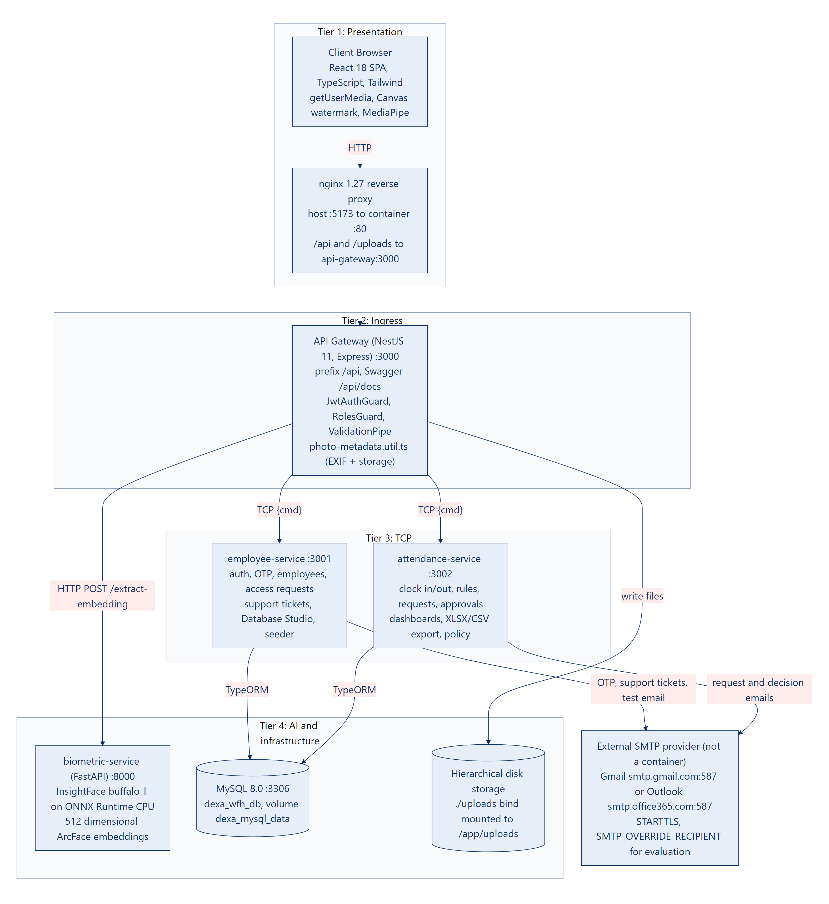

# WFH Attendance & Employee Monitoring System

**Dexa Group Fullstack Developer Skill Test** by **Abdurrahman Khairi**

A Work From Home (WFH) attendance and employee monitoring system built as a **NestJS 11 microservices monorepo**, a **React 18 + Vite + TypeScript + Tailwind CSS** web app, a **Python FastAPI biometric service** running InsightFace, and **MySQL 8.0** through TypeORM. The interface uses Corporate Blue (`#1E40AF`, `#2563EB`) and Dexa Group Red (`#D32F2F`) in both light and dark mode.

## Project Overview

Employees clock in and out from home with a live webcam photo that has to match the face they enrolled. The server, not the browser, records the official time. HR monitors attendance in real time, reviews requests and exports payroll ready reports. Department managers review their team's WFH notices, leave, overtime and corrections from a one click email link, and the System Admin manages the data through a built in database studio.

* **Face recognition:** InsightFace ArcFace (`buffalo_l`, ResNet 50 on ONNX Runtime) turns each face into a 512 dimensional vector. A clock in photo must reach a cosine similarity of at least 0.45 against the enrolled face, and enrollment refuses a face that already belongs to another account.
* **Photo proof:** an HTML5 Canvas watermark (WIB time, NIP, full name) is burned into every photo, perceptual hashes reject reused photos, and capture times are checked against the server clock.
* **Server authoritative time:** clock in and clock out times come from `new Date()` on the server. Status, work duration and overtime pay follow from them automatically.
* **Home location:** each clock in and clock out is tagged inside or outside a 100 meter radius around the employee's registered home, and HR sees it on a map.
* **Real email:** Gmail or Outlook SMTP delivers 6 digit OTP codes, WFH and request notices with a review link, approval decisions and developer support tickets.
* **Reporting:** Excel (`.xlsx`), CSV and printable PDF exports, plus a bottom right toast and a headbar notification center that state `where`, `what` and `why` for every action.

## Engineering Methodology & AI Collaboration

**Abdurrahman Khairi** acted as Lead Architect and Systems Engineer on this project. I designed the distributed topology (an HTTP API Gateway fronting two internal TCP microservices and a Python biometric sidecar), defined the business rules and acceptance criteria, tested edge cases by hand, and decided what shipped.

To build at high velocity without sacrificing depth, I worked in close partnership with two AI engineering agents (**Antigravity** and **Claude Code**). The agents served as fast technical collaborators for drafting code against my specifications, reviewing diffs, chasing down bugs, and cross checking documentation against the actual source files. They did not replace engineering judgment. Every architectural trade off, including keeping the authoritative clock strictly on the server, enforcing biometric similarity thresholds, and escalating a manager's own WFH notices upward to HR, was decided by me after evaluating the options.

## Grounded Domain Research (Quora, Reddit & HR Practitioners)

Before writing code, I studied real world remote work discussions on **Quora** and **Reddit** to see how WFH attendance systems fail in practice, and validated those findings with **two professional corporate staff relations practitioners** regarding daily HR operations and Indonesian labor rules:

* **Buddy Punching & Photo Reuse:** Solved by combining live webcam capture with 512 dimensional InsightFace ArcFace matching (a cosine similarity of at least 0.45 against the enrolled face), a duplicate face check at enrollment, HTML5 Canvas burned watermarks, perceptual hashes that reject a photo reused from an earlier session, and a same day capture time check on uploaded photos.
* **Client Clock Manipulation:** Solved by ignoring the browser clock and recording all official timestamps strictly on the server (`new Date()`).
* **Manager Approval Fatigue:** Solved by one click email links (`/manager/approvals?requestId=...`) that open the review window for that exact request after sign in, with automatic `attendances` table synchronization when an attendance correction is approved.
* **Managers Approving Themselves & Overtime Disputes:** Handled by sending every request a Department Manager submits to HR Admin (`admin.hrd@dexagroup.com`) instead of to the manager, and by automating the Indonesian Depnaker `1/173` overtime formula: overtime starts after a 9 hour span from clock in (8 working hours plus a 60 minute break, so 17:30 WIB for an 08:30 start), the first hour pays 1.5x and each later hour 2.0x.

## 1. Fulfillment of Technical Assessment Objectives

| Assessment Requirement | Implementation in This Repository |
| :--- | :--- |
| **1.a Backend (TS + NestJS + MySQL)** | `backend/`: NestJS 11 TypeScript monorepo with TypeORM and MySQL 8.0 across 9 tables (`users`, `employees`, `departments`, `attendances`, `attendance_requests`, `access_requests`, `support_tickets`, `otp_codes`, `system_settings`). |
| **1.b Frontend (React.js)** | `frontend/`: React 18, Vite, TypeScript and Tailwind CSS, with a collapsible navy sidebar, a top headbar with the notification center, a dark and light mode toggle, and the official Dexa Group red and white logos. |
| **2.a.i Proper Database Structure** | 9 relational tables with foreign keys, unique keys on `employee_code` and on `(employee_id, attendance_date)`, and soft delete columns (`is_active`, `deleted_at`). |
| **2.a.ii Connect to Any Database** | `DatabaseModule` (`backend/libs/common/src/database/database.module.ts`) reads `DB_TYPE` from `.env`: `mysql` (default), `mariadb` or `postgres`. |
| **2.a.iii API with Microservices Concept** | The HTTP `api-gateway` (`:3000`) calls `employee-service` (`:3001`) and `attendance-service` (`:3002`) over the NestJS TCP transport, and the Python `biometric-service` (`:8000`) over HTTP. |
| **2.a.iv Manipulate Data (CRUD) with API** | Full CRUD with soft delete (`DELETE /api/employees/:id`) and restore (`PATCH /api/employees/:id/restore`), clock in and clock out, and request approval. The NIP is mandatory. |
| **2.b.i Create Pages / Screens** | 14 screens: 4 public auth pages, face enrollment, 4 employee pages, manager approvals, 3 HR pages and the System Admin database studio. |
| **2.b.ii Call API from/to Backend** | One Axios client (`frontend/src/api/client.ts`) with Bearer JWT injection, a silent token refresh on 401, and the toast and notification center. |
| **2.b.iii Create Custom Components** | 14 components in `frontend/src/components/custom/`: `CameraPhotoUpload`, `LiveServerClock`, `OtpInputGroup`, `InteractiveDataTable`, `PhotoLightboxModal`, `AttendanceLocationMapModal`, `LeaveAndCorrectionModal`, `CompanyPolicyModal`, `ContactDeveloperModal`, `ToastContainerBottomRight`, `NotificationCenterDropdown`, `ThemeToggle`, `DexaBrandLogo`, `CopyrightFooterWatermark`. |
| **3.1 Use Case 1: WFH Employee Attendance** | Sign in → enroll a face once → live webcam photo or upload with a burned in watermark → clock in with `daily_plan` → clock out with `daily_accomplishment` → follow the results on `/employee/dashboard`. |
| **3.2 Use Case 2: HRD Employee Monitoring** | Master employee CRUD (mandatory NIP, edit, soft delete, restore, resend OTP), the real time monitoring dashboard, lightbox photo inspection, location map, request review, and Excel or CSV export. |

## 2. Architecture & Port Mapping



Docker Compose runs six containers. Email leaves through an external SMTP provider, which is not a container. Mailpit (`:1025`, `:8025`) is no longer part of the stack.

| # | Service | Container | Port (host → container) | Protocol | Responsibility |
| :--- | :--- | :--- | :--- | :--- | :--- |
| 1 | `frontend` | `dexa-wfh-frontend` | `5173 → 80` | HTTP | nginx serves the React build and forwards `/api` and `/uploads` to the gateway. |
| 2 | `api-gateway` | `dexa-wfh-api-gateway` | `3000 → 3000` | HTTP | The only public API: JWT auth, role guards, photo uploads and EXIF parsing, static `/uploads`, Swagger at `/api/docs`. |
| 3 | `employee-service` | `dexa-wfh-employee-service` | `3001 → 3001` | TCP | Auth, OTP, users and employees, face enrollment with the duplicate face check, access requests, support tickets, seeding. |
| 4 | `attendance-service` | `dexa-wfh-attendance-service` | `3002 → 3002` | TCP | Clock in and clock out, status and overtime rules, location tags, requests and approvals, dashboards, exports. |
| 5 | `biometric-service` | `dexa-wfh-biometric-service` | `8000 → 8000` | HTTP | FastAPI with InsightFace `buffalo_l` on ONNX Runtime (CPU): `GET /health`, `POST /extract-embedding`, `POST /verify-face`. |
| 6 | `mysql` | `dexa-wfh-mysql` | `3306 → 3306` | MySQL | MySQL 8.0 with the `dexa_wfh_db` schema on a named volume. |
| External | SMTP provider | none | `587` (STARTTLS) | SMTP | Gmail (`smtp.gmail.com`) or Outlook (`smtp.office365.com`). |

**Stack:** NestJS 11, TypeORM 0.3, Nodemailer 6 · React 18.3, Vite 5.4, TypeScript 5.6, Tailwind CSS 3.4, React Router 6, Leaflet 1.9, MediaPipe Tasks Vision · Python 3.10, FastAPI, InsightFace 0.7, ONNX Runtime, OpenCV · MySQL 8.0 · nginx 1.27 · Node.js 22.

## 3. Roles & Access

| Role | What it can do |
| :--- | :--- |
| **`EMPLOYEE`** | Clock in and out, personal dashboard and history, WFH notices and leave, sick, overtime and correction requests, profile with the home location, developer support. |
| **`MANAGER`** | Everything an employee can do, plus review of the requests from their own department at `/manager/approvals`. Requests a manager submits are emailed to HR Admin. |
| **`HR_ADMIN`** | HR dashboard, attendance monitoring and export, master employee CRUD, request review across all departments, sibling exemptions for the duplicate face check, and the company WFH policy. |
| **`SYSTEM_ADMIN`** | Database studio at `/system/database`, the HR pages, support tickets and the SMTP test. For separation of duties, the System Admin skips face enrollment and is kept out of the employee attendance pages. |

## 4. 9+1 Core System Modules

1. **RBAC & JWT Auth with a Targeted 6 Digit Email OTP**
   * Four roles: `EMPLOYEE`, `MANAGER`, `HR_ADMIN` and `SYSTEM_ADMIN` (section 3).
   * Daily sign in uses email and password and returns a JWT access token and a refresh token.
   * A 6 digit OTP, valid for 15 minutes and locked after 5 wrong tries, is used only for **new account verification** (`/verify-account`) and **forgot password** (`/forgot-password`). Visitors can ask for an account at `/request-access`.
2. **Live Camera Capture, Face Biometrics & Photo Proof**
   * Face enrollment at `/auth/enroll-face` runs browser liveness prompts (MediaPipe Face Landmarker) and stores a 512 dimensional ArcFace vector.
   * The duplicate face check at enrollment has three tiers: below 0.50 similarity the face is unique; from 0.50 to below 0.90 it is blocked unless HR Admin grants a sibling exemption (`PATCH /api/employees/:id/sibling-exemption`); at 0.90 or more it is always blocked.
   * Every clock in and clock out photo must match the enrolled face with a cosine similarity of at least 0.45.
   * HTML5 `<canvas>` burns a watermark bar (WIB timestamp, NIP, full name, capture source) onto each photo.
   * Perceptual hashes reject a photo that repeats one from the employee's last 10 sessions.
   * The gateway reads EXIF `DateTimeOriginal` with `exif-parser` when the original file reaches the API. A live capture must be within 5 minutes of the server clock; an upload must come from the same WIB day and be no older than 12 hours (`is_timestamp_verified`).
3. **Server Authoritative Timestamp**
   * `clock_in_time` and `clock_out_time` are generated on the server with `new Date()`. The browser clock is never used for official times.
4. **Master Employee Management (CRUD & Soft Delete)**
   * HR Admin and System Admin create, edit, deactivate and restore employees. Deactivation sets `is_active = false`, `status = 'INACTIVE'` and `deleted_at`, so attendance foreign keys stay intact.
   * The NIP (`employeeCode`) is mandatory and unique: the backend returns 400 when it is empty and the form marks it `required`. The form starts the phone number at `+62`, leaves department and position empty, and uses `Abdurrahman Khairi` as the placeholder.
   * HR can resend the verification OTP (`POST /api/employees/:id/resend-otp`).
5. **Dual Dashboard Architecture**
   * **HR real time monitoring:** SQL aggregations (`COUNT`, `GROUP BY`, `JOIN`), filters for date range, department, status and search, and `<PhotoLightboxModal />` for photo and timestamp inspection.
   * **Individual dashboard** (`/employee/dashboard`, backed by `GET /api/attendances/my-dashboard`): a 14 day SVG work duration chart with an 8.0 hour target line, a punctuality breakdown, overtime pay, the weekly WFH quota and recent sessions.
6. **Daily Work Log / Task Summary**
   * `daily_plan` (`work_notes`) at clock in and a mandatory `daily_accomplishment` (`clock_out_notes`, at least 10 characters) at clock out.
7. **Automated Working Hours & Status Calculation**
   * `ON_TIME` up to 08:45 WIB (08:30 start plus 15 minutes of grace), `LATE` after that, `HALF_DAY` under 240 minutes of work, `COMPLETED` otherwise, and `MISSING_CLOCK_OUT` for a past day that was never closed. `work_duration_minutes` and overtime are computed at clock out (section 6).
8. **Leave, Sick, Overtime, WFH & Correction Requests**
   * Request types `WFH_APPROVAL`, `OVERTIME`, `LEAVE`, `SICK` and `CORRECTION`, with an optional attachment.
   * Status moves from `PENDING` to `APPROVED` or `REJECTED`; an approval writes the result into `attendances` automatically.
   * Each department allows 1 WFH day per week, and the company policy switches between `STRICT_APPROVAL` and `NOTICE_ONLY`.
9. **Data Export & Payroll Ready Reporting**
   * Filtered attendance exports to **Excel (`.xlsx`)**, **CSV (`.csv`)** and a **printable PDF view**, including base salary, work duration, overtime minutes, multiplier hours and overtime pay in IDR.
10. **Targeted SMTP Support Ticket Routing**
    * **To:** every active `SYSTEM_ADMIN` account (`sysadmin@dexagroup.com`).
    * **Cc:** every active `HR_ADMIN` account (`admin.hrd@dexagroup.com`) and the sender.
    * `Reply-To` and `Sender` carry the user's own address, so a reply reaches them directly. The `From` header is the `SMTP_FROM` mailbox, because Gmail and Outlook only send as the signed in account.

## 5. Email Flows

| Email | When it is sent | Recipients |
| :--- | :--- | :--- |
| Verification or reset code | A new account is verified, or a password is reset | The account owner |
| WFH notice or request | An employee submits a request | To the department manager; Cc HR Admin and the employee |
| A manager's own request | A `MANAGER` or `SYSTEM_ADMIN` submits a request | To HR Admin; Cc the System Admin, HR Admin and the sender |
| Decision | A request is approved or rejected | To the employee; Cc the department manager and HR Admin |
| Support ticket | Contact Developer | To every active System Admin; Cc every active HR Admin and the sender |
| SMTP test | `POST /api/support/test-email` (HR Admin or System Admin) | The address given in the request, or the caller's own address |

Request emails carry a **Review & Approve in System Portal** button that links to `http://localhost:5173/manager/approvals?requestId=<id>`. After sign in, the page opens the review window for that request. The link is not signed; the route's role guard protects it.

With `SMTP_OVERRIDE_RECIPIENT` set, every message goes to that one inbox, with a yellow banner that names the intended recipients. Request and decision emails drop their Cc list under the override. Support tickets keep theirs, so the provider may report the `@dexagroup.com` copies as undeliverable.

## 6. Business Rules & Governance

* **Work schedule:** 08:30 WIB start, 15 minutes of grace, and a 240 minute half day threshold (`WORK_START_TIME`, `HALF_DAY_THRESHOLD_MINUTES`).
* **Overtime (Depnaker, now Kemnaker, PP 35/2021):** overtime counts the minutes beyond a 540 minute span from clock in (8 working hours plus the 60 minute break, which is 17:30 WIB for an 08:30 start), once the extra time reaches 30 minutes. The hourly rate is the monthly base salary divided by 173; the first hour pays 1.5x and each later hour 2.0x. HR Admin or System Admin can switch overtime pay off in the company policy.
* **Home location:** an employee saves a home point from GPS on the profile page (`PATCH /api/employees/me/profile`). The Haversine distance tags each session `IN_HOME_RADIUS` (within 100 meters), `OUT_OF_HOME_RADIUS` or `LOCATION_UNAVAILABLE`. The tag never blocks a clock in. HR opens each session on a Leaflet and OpenStreetMap map.
* **Hierarchical storage:** photos and attachments are saved under `uploads/<year>/<department>/<employee|manager>/<person>/<MM-month>/` with readable file names (`<name>_YYYY-MM-DD_HH-mm-ss`).
* **Database studio:** the System Admin browses, creates, edits and deletes rows table by table at `/system/database` (`/api/system/database/...`).

## 7. Preseeded Demo Accounts

| Role | Email | Password | NIP | Department | Ready to test |
| :--- | :--- | :--- | :--- | :--- | :--- |
| **`SYSTEM_ADMIN`** | `sysadmin@dexagroup.com` | `AdminDexa2026!` | `DEXA-SYS-001` | IT & Digital Innovation | Database studio, HR pages, support tickets, SMTP test |
| **`HR_ADMIN`** | `admin.hrd@dexagroup.com` | `AdminDexa2026!` | `DEXA-2026-001` | HRD & People Operations | HR dashboard, monitoring and export, employee CRUD, all requests |
| **`MANAGER`** | `manager.it@dexagroup.com` | `ManagerDexa2026!` | `DEXA-MGR-001` | IT & Digital Innovation | Reviews IT requests; its own requests go to HR |
| **`MANAGER`** | `manager.finance@dexagroup.com` | `ManagerDexa2026!` | `DEXA-MGR-002` | Finance & Accounting | Reviews Employee Two's pending WFH notice |
| **`EMPLOYEE`** | `employee.one@dexagroup.com` | `EmployeeDexa2026!` | `DEXA-2026-002` | IT & Digital Innovation | Has an approved WFH notice and an approved 90 minute overtime request |
| **`EMPLOYEE`** | `employee.two@dexagroup.com` | `EmployeeDexa2026!` | `DEXA-2026-003` | Finance & Accounting | Has a WFH notice for the seeding day, waiting for Manager Two |
| **`EMPLOYEE`** | `employee.three@dexagroup.com` | `EmployeeDexa2026!` | `DEXA-2026-004` | Quality Assurance & R&D | A first clock in |
| **`EMPLOYEE`** (unverified) | `employee.four@dexagroup.com` | Set on `/verify-account` | `DEXA-2026-005` | IT & Digital Innovation | New account verification with OTP **`123456`** |

* The first start of an empty database creates six of these accounts. The two manager accounts are added on the next start of `employee-service`, so run `docker compose restart employee-service` once after the very first boot.
* Everyone except the System Admin enrolls a face at the first sign in. A fresh database has no attendance sessions yet.

## 8. Quick Start

### Prerequisites

* Docker Desktop (or Docker Engine with Compose v2), at least 8 GB of RAM (16 GB recommended) and about 6 GB of free disk.
* A Gmail account with 2 Step Verification and a 16 character App Password, or an Outlook account.
* **The InsightFace `buffalo_l` model on the host, one time (about 288 MB).** The biometric container mounts `~/.insightface` (on Windows `%USERPROFILE%\.insightface`) read only and does not download the model itself. Without it, the container still reports healthy, but every face enrollment and clock in fails.

```powershell
# Windows PowerShell
New-Item -ItemType Directory -Force "$env:USERPROFILE\.insightface\models\buffalo_l" | Out-Null
Invoke-WebRequest -Uri "https://github.com/deepinsight/insightface/releases/download/v0.7/buffalo_l.zip" `
  -OutFile "$env:USERPROFILE\.insightface\models\buffalo_l.zip"
Expand-Archive "$env:USERPROFILE\.insightface\models\buffalo_l.zip" `
  -DestinationPath "$env:USERPROFILE\.insightface\models\buffalo_l" -Force
```

```bash
# macOS / Linux
mkdir -p ~/.insightface/models/buffalo_l
curl -L -o ~/.insightface/models/buffalo_l.zip \
  https://github.com/deepinsight/insightface/releases/download/v0.7/buffalo_l.zip
unzip ~/.insightface/models/buffalo_l.zip -d ~/.insightface/models/buffalo_l
```

The five `.onnx` files must sit directly in `models/buffalo_l/`. If unzipping creates a nested `buffalo_l/buffalo_l/` folder, move them up one level.

### Step 1: Create `.env` in the repository root

`.gitignore` excludes every `.env*` file, so the repository has no root template. Create `.env` by hand with these values:

```dotenv
# Database: Docker Compose creates MySQL with these values, and a manual run connects with them
DB_TYPE=mysql
DB_HOST=localhost
DB_PORT=3306
DB_USERNAME=dexa_user
DB_PASSWORD=dexa_password_2026
DB_DATABASE=dexa_wfh_db

# Work schedule in WIB
WORK_START_TIME=08:30
HALF_DAY_THRESHOLD_MINUTES=240

# Email through Gmail (Outlook: SMTP_HOST=smtp.office365.com with the same port)
SMTP_HOST=smtp.gmail.com
SMTP_PORT=587
SMTP_SECURE=false
SMTP_USER=your_email@gmail.com
SMTP_PASS=your_16_character_app_password
SMTP_FROM='"Dexa Group WFH Monitoring" <your_email@gmail.com>'
SMTP_OVERRIDE_RECIPIENT=your_email@gmail.com
```

* Keep `SMTP_FROM` in single quotes, or Docker Compose cannot parse the inner double quotes.
* `SMTP_OVERRIDE_RECIPIENT` sends every email to your own inbox, because the seeded `@dexagroup.com` addresses are not real mailboxes.
* Do not put `BIOMETRIC_SERVICE_URL` in this file: Docker Compose would pass it into the containers and replace their internal `http://biometric-service:8000` address.

### Option A: Docker Compose (Recommended)

```bash
docker compose up --build -d
docker compose ps                          # six containers, all healthy
docker compose restart employee-service    # first boot only: adds the two manager accounts
```

Once running, open:

* **Web app:** [http://localhost:5173](http://localhost:5173)
* **API Gateway Swagger:** [http://localhost:3000/api/docs](http://localhost:3000/api/docs). Sign in as HR Admin or System Admin and call `POST /api/support/test-email` to check the SMTP settings.
* **Biometric service Swagger:** [http://localhost:8000/docs](http://localhost:8000/docs)
* **Emails:** OTP codes, request notices, decisions and support tickets arrive in the inbox set in `SMTP_OVERRIDE_RECIPIENT`.

### Option B: Run the Services Locally

Needs Node.js 22, Python 3.10 and the C++ build tools that `pip install insightface` compiles with (on Windows, the "Desktop development with C++" workload).

1. **MySQL 8.0** (in Docker, or a local server with the same credentials):
   ```bash
   docker compose up -d mysql
   ```
2. **Biometric service** (`biometric-service/`):
   ```bash
   cd biometric-service
   python -m venv .venv
   # Windows PowerShell: .\.venv\Scripts\Activate.ps1    macOS/Linux: source .venv/bin/activate
   pip install -r requirements.txt
   uvicorn main:app --host 0.0.0.0 --port 8000
   ```
3. **The three NestJS services** (`backend/`). They read `backend/.env` first and then the root `.env`, so the file from step 1 is enough:
   ```bash
   cd backend
   npm install
   npm run build
   npm run start:all    # or: npm run start:dev for watch mode
   ```
4. **React frontend** (`frontend/`). Its template is tracked and sets `VITE_API_BASE_URL=/api`; the Vite dev server forwards `/api` and `/uploads` to `:3000`:
   ```bash
   cd frontend
   cp .env.example .env
   npm install
   npm run dev
   ```

## 9. Known Limitations

These are open at the time of writing. The full defect register is in the PRD, Chapter IX, "Known defects found during this review" (D1 to D17).

* Approving or rejecting a `/request-access` submission returns 404, because the UI calls `PATCH /access-requests/:id/review`, which does not exist (D2).
* A manager's own requests are emailed to HR, but they still appear in the manager's department queue, and the review endpoint does not stop a manager from approving their own request.
* The portal redraws every photo on the canvas, which removes EXIF data, so uploaded photos are verified against the capture time the browser sends (D4).
* Before 07:00 WIB the request form fills in the previous day's date, because it uses the UTC date (D13).
* Docker Compose passes `JWT_ACCESS_SECRET` and `LATE_GRACE_MINUTES`, but the code reads `JWT_SECRET` and `WORK_GRACE_MINUTES`, so the built in defaults apply (D7).

## 10. Documentation

| Document | PDF | Word |
| :--- | :--- | :--- |
| Product Requirements Document (PRD) | [PDF](PRD%20WFH%20System%20Dexa%20Group_Abdurrahman%20Khairi.pdf) | [DOCX](PRD%20WFH%20System%20Dexa%20Group_Abdurrahman%20Khairi.docx) |
| Installation Guide | [PDF](Installation%20Guide%20WFH%20System%20Dexa%20Group_Abdurrahman%20Khairi.pdf) | [DOCX](Installation%20Guide%20WFH%20System%20Dexa%20Group_Abdurrahman%20Khairi.docx) |
| User Manual | [PDF](User%20Manual%20WFH%20System%20Dexa%20Group_Abdurrahman%20Khairi.pdf) | [DOCX](User%20Manual%20WFH%20System%20Dexa%20Group_Abdurrahman%20Khairi.docx) |

* **Diagrams:** [`docs/prd_diagrams/`](docs/prd_diagrams/) holds the architecture, the 12 end to end flows and the database ERD as PNG files.
* **Screenshots:** [`docs/install_screenshots/`](docs/install_screenshots/) and [`docs/manual_screenshots/`](docs/manual_screenshots/).
* **API reference:** Swagger at `http://localhost:3000/api/docs` while the stack runs.
* **Earlier Markdown drafts:** [`documentation/final/`](documentation/final/) was written before the move from Mailpit to real SMTP. Where it differs, the Word and PDF files above are current.

## 11. License & Copyright Notice (All Rights Reserved)

This repository and all associated source code, UI components, microservices architecture and documentation are proprietary and protected under **All Rights Reserved** ([LICENSE](./LICENSE)). It is **NOT** licensed under MIT or any open source license.

> **© 2026 Abdurrahman Khairi - Created strictly for Technical Assessment evaluation. Unauthorized commercial use is prohibited**
