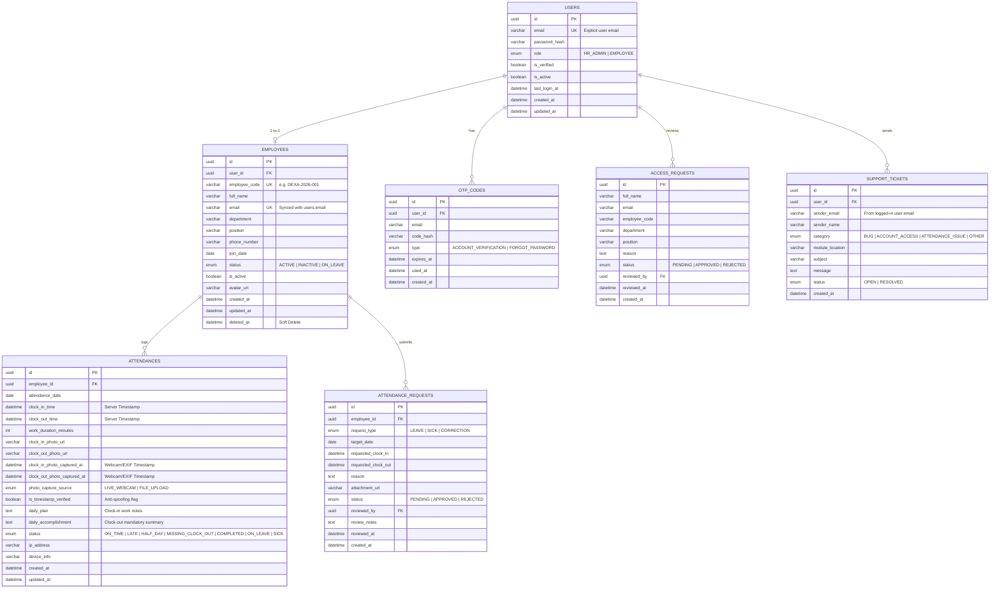

# Product Requirements Document (PRD) & Technical Implementation Plan
## WFH Attendance & Employee Monitoring System — Dexa Group Fullstack Skill Test
**Author:** Abdurrahman Khairi | **License:** Proprietary — All Rights Reserved ([LICENSE](../LICENSE))

---

## 1. Executive Summary & Mandatory Objectives

The **WFH Attendance & Employee Monitoring System** is an enterprise-grade, full-stack web application built with **NestJS (Microservices Architecture)**, **React.js (TypeScript + Tailwind CSS)**, and **MySQL 8.0**.

### Fulfillment of Skill Test Requirements
1. **Backend (`backend/`):**
   - **Language & Framework:** TypeScript + NestJS.
   - **Database:** **MySQL 8.0** (primary, matching `prefer Oracle, MySQL`) via **TypeORM** with environment-driven adapter support (`mysql` / `postgres`) to satisfy *Objective 2.a.ii: Able to connect to any database*.
   - **Microservices Concept (*Objective 2.a.iii*):** Monorepo architecture splitting HTTP ingress (`api-gateway` on `:3000`) from internal TCP microservices (`employee-service` on `:3001` and `attendance-service` on `:3002`).
   - **Data Manipulation (*Objective 2.a.iv*):** Full RESTful CRUD with Soft Delete, relational integrity, aggregations, and file streaming.
2. **Frontend (`frontend/`):**
   - **Framework (*Objective 2.b.i*):** React.js 18 + Vite + TypeScript + Tailwind CSS.
   - **API Integration (*Objective 2.b.ii*):** Axios with JWT Bearer & Refresh interceptors + automated bottom-right Toast notification triggers.
   - **Custom Components (*Objective 2.b.iii*):** Purpose-built reusable components (`CameraPhotoUpload` with Canvas timestamp watermark & EXIF parser, `ToastContainerBottomRight`, `LiveServerClock`, `OtpInputGroup`, `InteractiveDataTable`, `PhotoLightboxModal`, `LeaveAndCorrectionModal`, `ContactDeveloperModal`, `DexaBrandLogo`, `CopyrightFooterWatermark`).

---

## 2. Intellectual Property, Clean Code & Mandatory Function Comment Standard

### 2.1. "All Rights Reserved" License & Author Watermark Protection
To protect the author's intellectual property during technical assessment evaluation:
1. **No Open-Source/MIT License:** Repository root includes a strict **All Rights Reserved** [LICENSE](../LICENSE) and `"license": "UNLICENSED"` in every `package.json`.
2. **Source File Header Watermark:** Every `.ts`, `.tsx`, and `.css` file across `backend/` and `frontend/` begins with:
   ```typescript
   // ============================================================================
   // Copyright (c) 2026 Abdurrahman Khairi. All Rights Reserved.
   // Created strictly for Technical Assessment evaluation.
   // Unauthorized commercial use, modification, or distribution is prohibited.
   // ============================================================================
   ```
3. **UI Footer & README Watermark:** Every screen/page in the React application and the bottom of `README.md` visibly displays:
   > **© 2026 Abdurrahman Khairi - Created strictly for Technical Assessment evaluation. Unauthorized commercial use is prohibited**

### 2.2. Clean Code, Maximum Optimization & Structured `//` Function Comments
1. **Clean, Optimal Code:** SOLID & DRY design, strict TypeScript types (zero `any`), indexed SQL queries, and clean browser resource disposal (stopping webcam `MediaStream` tracks and revoking object URLs on unmount).
2. **Mandatory Structured `//` Comment on Every Function & Component:**
   Every function, method, endpoint, custom hook, and UI component **MUST** include a 3-part `//` comment header:
   ```typescript
   // [Purpose]: Brief description of what this function/component does and why.
   // [Connected To]: Exact file paths, API endpoints, TCP message patterns, or DB entities it connects to.
   // [Feature]: Which core feature (#1 - #10) this code implements.
   ```

---

## 3. Complete Feature Specifications (9 Core Features + Security & Support Extensions)

### Feature 1: Role-Based Access Control (RBAC) & JWT/SSO Authentication
- **Purpose:** Strictly segregates page and API access between **Employees (`EMPLOYEE`)** and **HRD Administrators (`HR_ADMIN`)**, where Admin has full control over the entire platform.
- **Technical Mechanism:**
  - Credentials verified via `bcrypt` against the `users` table (which explicitly stores `email`, `password_hash`, and `role`).
  - Issues signed **JWT (`accessToken` & `refreshToken`)** containing `{ userId, email, employeeId, role }`.
  - Backend enforces access via `JwtAuthGuard` and `RolesGuard` (`@Roles(UserRole.HR_ADMIN)`), while React enforces route protection via `<ProtectedRoute allowedRoles={[...]} />`.
  - **OTP Policy:** Daily login uses direct Email + Password -> JWT for seamless UX. **6-Digit Email OTP** is enforced strictly for **New Account Verification** and **Forgot Password**.

### Feature 2: Live Camera Capture, Photo Proof Verification & Timestamp Anti-Spoofing
- **Purpose:** Ensures employees are genuinely working from home at the time of Clock-In and Clock-Out and detects/prevents spoofing with old gallery photos.
- **How Photo Timestamps Work (Dual-Layer Verification for Both Webcam & Uploaded Files):**
  1. **Live Webcam Capture (`navigator.mediaDevices.getUserMedia` + HTML5 Canvas Watermark):**
     - When the employee clicks **Capture Photo**, an HTML5 `<canvas>` captures the live video frame and **burns a permanent visual watermark bar** at the bottom of the image displaying:
       - **Server-Synced Date & Time:** e.g., `2026-11-05 08:19:42 WIB (Server Synced)`
       - **Employee Identity:** e.g., `DEXA-2026-001 | Budi Santoso (IT Dept)`
       - **Capture Badge:** `[VERIFIED LIVE WEBCAM - CLOCK IN | © 2026 Abdurrahman Khairi]`
     - The canvas exports a compressed JPEG `Blob`/`File` uploaded via `multipart/form-data`.
     - Backend stores `photo_capture_source = 'LIVE_WEBCAM'`, `clock_in_photo_captured_at`, and marks `is_timestamp_verified = true`.
  2. **Uploaded Photo File (EXIF & Metadata Timestamp Inspection):**
     - If an employee uploads an image file from their device (fallback mode), the Frontend and Backend (`exif-parser`) inspect the file's **EXIF `DateTimeOriginal` / `CreateDate`** and `File.lastModified` metadata.
     - HTML5 Canvas burns a watermark bar stating `[FILE UPLOAD | Original Photo Time: YYYY-MM-DD HH:mm:ss | Uploaded: HH:mm:ss]`.
     - Backend saves the extracted `clock_in_photo_captured_at` to MySQL and compares it against the current server date:
       - If the photo's EXIF/capture timestamp is from today within the valid window -> `is_timestamp_verified = true`.
       - If the uploaded photo was taken on an earlier date or lacks valid metadata -> `is_timestamp_verified = false` (flagged with an **Unverified / Old File Timestamp Warning Badge** in the HRD Monitoring Dashboard & Lightbox Modal).

### Feature 3: Server-Side Real-Time Timestamp & Timezone Synchronization
- **Purpose:** Prevents employees from manipulating their device/OS clock to fake on-time attendance.
- **Technical Mechanism:**
  - Frontend `<LiveServerClock />` fetches the server's current ISO-8601 timestamp on load and calculates the exact client-server clock offset.
  - On `POST /api/attendances/clock-in` and `POST /api/attendances/clock-out`, the backend **never trusts client time payloads** for attendance timestamps; `attendance-service` strictly assigns `new Date()` on the server (normalized to `Asia/Jakarta` WIB / UTC).

### Feature 4: Master Employee Management (CRUD & Soft Delete)
- **Purpose:** Allows HRD Admin to create new employees, update roles/departments/positions, manage active status, and deactivate resigned employees without breaking historical attendance foreign keys.
- **Technical Mechanism:**
  - Full REST endpoints (`GET`, `POST`, `PATCH`, `DELETE /api/employees`) routed to `employee-service`.
  - Uses **Soft Delete** (`is_active = false`, `status = 'INACTIVE'`, and TypeORM `@DeleteDateColumn() deleted_at`) instead of hard SQL `DELETE`, preserving 100% of past `attendances` and `attendance_requests` records.

### Feature 5: HRD Real-Time Monitoring Dashboard & Audit Log
- **Purpose:** Gives HRD instant visibility into daily attendance metrics (Total Active Employees, Present On-Time, Late, Completed Clock-Out, On Leave/Sick, Absent) and a searchable audit log with photo proof verification.
- **Technical Mechanism:**
  - Backend executes SQL aggregations (`COUNT`, `GROUP BY`, `LEFT JOIN` between `employees` and `attendances`).
  - Dynamic filtering by date range (`startDate` to `endDate`), `department`, `status`, `capture_source`, and employee name/NIP keyword search.
  - Clicking any photo thumbnail opens `<PhotoLightboxModal />` showing full-resolution Clock-In & Clock-Out photos, burned-in watermarks, EXIF/Webcam verification status, IP/device metadata, and daily work logs.

### Feature 6: Daily Work Log / Task Summary Submission
- **Purpose:** Correlates WFH attendance hours with concrete daily deliverables.
- **Technical Mechanism:**
  - During **Clock-In**, employees fill in `daily_plan` (`work_notes` — planned tasks for the day).
  - During **Clock-Out**, the form requires `daily_accomplishment` (`clock_out_notes` — completed tasks/output) before closing the session. Both fields are stored in `attendances` and visible to HRD.

### Feature 7: Automated Working Hours & Status Calculation
- **Purpose:** Automatically classifies attendance status and calculates net working duration without manual HRD calculation.
- **Technical Mechanism:**
  - Compares server `clock_in_time` against configurable shift start time (default `08:30 WIB`, grace period `15 mins` -> `08:45 WIB`): tags `ON_TIME` or `LATE`.
  - On Clock-Out, computes `work_duration_minutes = Math.floor((clockOutTime - clockInTime) / 60000)`.
  - Automatically updates status to `HALF_DAY` (if `< 240 mins`) or `COMPLETED` (and flags unclosed past-day records as `MISSING_CLOCK_OUT`).

### Feature 8: Leave, Sick & Attendance Correction Request (Self-Service)
- **Purpose:** Handles real-world WFH edge cases (power/internet outage during clock-in window, medical leave, or annual leave).
- **Technical Mechanism:**
  - Employees submit a request (`LEAVE`, `SICK`, or `CORRECTION`) with target date, proposed times, reason, and supporting attachment (e.g., medical certificate) stored in `attendance_requests` (`status = 'PENDING'`).
  - HRD Admin reviews requests in the dashboard and clicks **Approve** or **Reject**.
  - When **Approved**, `attendance-service` automatically creates or updates the corresponding row in `attendances` (`status = 'ON_LEAVE' | 'SICK' | 'COMPLETED'`) with an audit note.

### Feature 9: Data Export & Payroll-Ready Reporting (CSV / Excel / PDF)
- **Purpose:** Enables HRD to download monthly/filtered attendance recaps for payroll processing and management reporting.
- **Technical Mechanism:**
  - HRD filters by date range/month and department, then clicks **Export Excel (`.xlsx`)**, **Export CSV (`.csv`)**, or **Print / PDF Report**.
  - Backend uses `exceljs` to generate formatted spreadsheets containing NIP, Name, Department, Date, Clock-In, Clock-Out, Duration (Hours/Mins), Status, Photo Verification Status, Daily Plan, and Accomplishment, streaming the buffer directly to the browser.

### Feature 10: Contact Developer / Support Ticket via Dynamic User SMTP Sender
- **Purpose:** Built-in helpdesk channel for any user experiencing issues.
- **Technical Mechanism:**
  - Logged-in user submits category, module location, subject, and message.
  - Saved in `support_tickets` and emailed via `Nodemailer` where **`from: '"${user.fullName} (WFH System)" <${user.email}>'` and `replyTo: user.email`** are dynamically populated from the authenticated user's `users.email` record.

---

## 4. UI/UX Theme & Mandatory Bottom-Right Toast Rules

1. **Theme:** **Corporate Blue (`#1E40AF` / `#2563EB` / `#0F172A`)** paired with **Dexa Group Red (`#D32F2F` / `#E11D48`)** on the logo and key brand accents, rendered on eye-friendly soft slate/white surfaces (`#F8FAFC` / `#FFFFFF`).
2. **Bottom-Right Toast Notification (`bottom-right`):**
   - Triggered on **every** action (CRUD, Auth, OTP, Clock-In/Out, Photo Capture, Leave Request, Export, Filter, Support Ticket, Validation/Server Error).
   - **Colors:** **Green (`success`)**, **Red (`error`)**, **Blue (`info`)**.
   - **Mandatory Content:** Every toast displays **`[WHERE]`** (module/feature), **`WHAT`** (action summary), and **`WHY`** (detailed reason/result).

---

## 5. Database Schema (ERD)



---

## 6. Implementation Roadmap

- **Phase 1 (Completed):** `.gitignore`, `LICENSE` (All Rights Reserved), `README.md`, `AGENTS.md`, `.agents/skills.json`, 4 English `skill/` modules, English `documentation/PRD.md`, and 3 Mermaid diagrams in `documentation/`.
- **Phase 2:** Initialize `backend/` NestJS Monorepo (`api-gateway`, `employee-service`, `attendance-service`, `libs/common`), TypeORM MySQL 8.0 configuration, 7 Entities, Standardized Response/Exception Interceptor, and Database Seeder.
- **Phase 3:** Build `employee-service` (JWT Auth, RBAC Guards, 6-Digit OTP for Account Verification & Forgot Password, Master Employee CRUD with Soft Delete, Access Requests, and Contact Developer SMTP with `from: user.email`).
- **Phase 4:** Build `attendance-service` (Clock-In/Out with Server Timestamp, Photo Upload + EXIF/Capture Timestamp Verification, Daily Plan & Accomplishment, Automated Status/Duration Calculation, Leave/Sick/Correction Workflow, HRD Dashboard Aggregations, and Excel/CSV Export).
- **Phase 5:** Build `frontend/` React.js application (Corporate Blue + Dexa Group Red theme, Bottom-Right Detailed Toast system, Copyright Footer Watermark, Live Webcam Canvas Timestamp Watermarker, OTP Input, DataTable, Lightbox Modal, Leave/Correction Modal, Contact Developer Modal, Employee & HRD Admin Portals).
- **Phase 6:** Create `Dockerfile`s, `docker-compose.yml` (MySQL 8.0 + Mailpit + Backend + Frontend), run end-to-end verification, and finalize `README.md`.

---

> **© 2026 Abdurrahman Khairi - Created strictly for Technical Assessment evaluation. Unauthorized commercial use is prohibited.**
