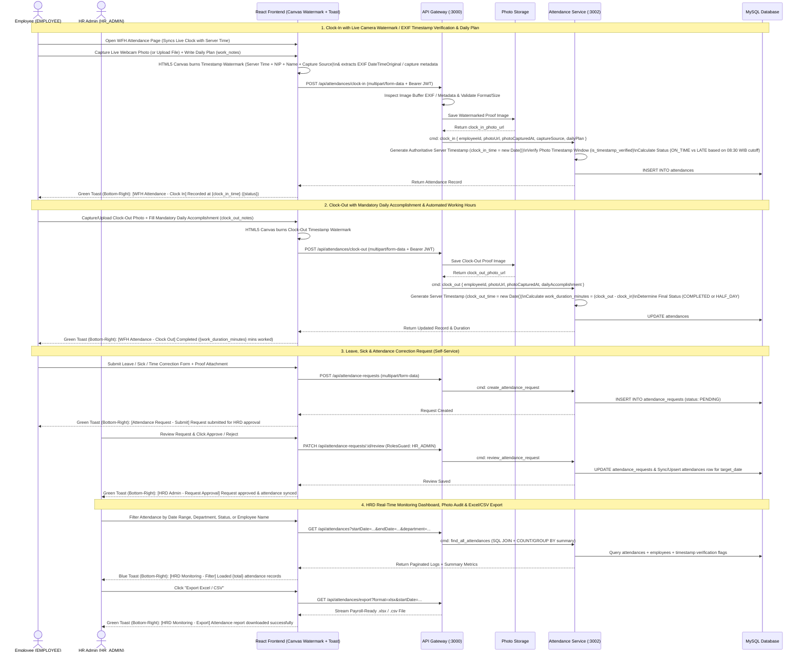

# WFH Attendance (Photo Timestamp Verification), Leave Request & Export Flow

Sequence diagram covering **Live Camera / File Upload Timestamp Verification**, **Server-Side Clock-In & Clock-Out with Daily Work Logs**, **Leave/Sick/Attendance Correction Self-Service**, and **HRD Monitoring & Payroll Export (Excel/CSV/PDF)**.

