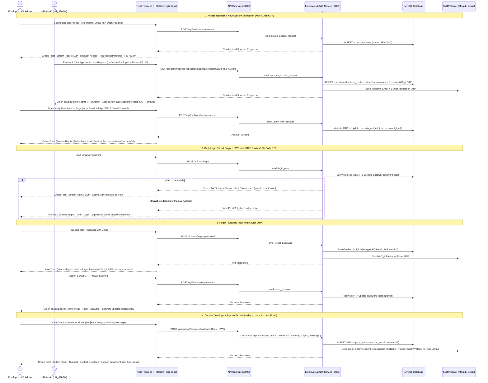

# Authentication, RBAC, OTP Verification & Contact Developer Flow

Sequence diagram covering **JWT/SSO Login with RBAC**, **New Account OTP Verification**, **Forgot Password OTP**, **Access Request**, and **Contact Developer via SMTP** (where `from`/`sender` uses the logged-in user's account email).

