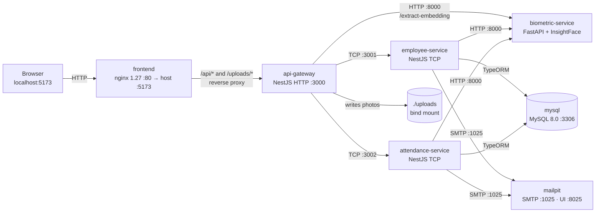
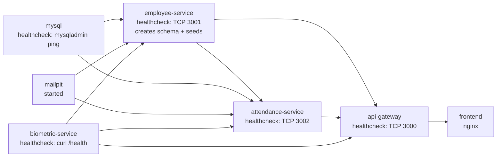
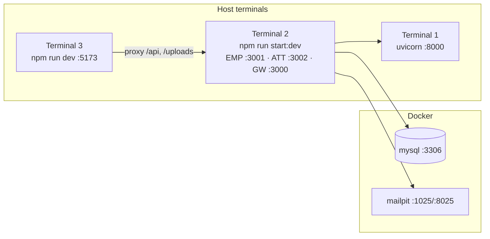
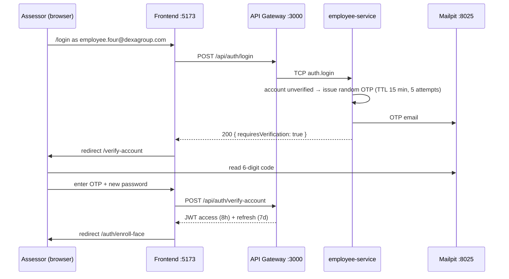

# Installation, Configuration & Local Execution Guide

## WFH Attendance & Employee Monitoring System — Dexa Group Fullstack Technical Assessment

| Item | Value |
|---|---|
| **Author** | Abdurrahman Khairi |
| **Copyright** | © 2026 Abdurrahman Khairi. All Rights Reserved. Created strictly for Technical Assessment evaluation. |
| **License** | All Rights Reserved (`LICENSE`); `package.json` files declare `"license": "UNLICENSED"` |
| **Document type** | Installation, configuration and local execution guide for assessors and developers |
| **Companion document** | [`PRD.md`](./PRD.md) — product requirements and technical specification |
| **Verified against** | The repository working tree and a running Docker Compose stack on 2026-11-09 |

> [!IMPORTANT]
> **Local assessment scope.** This system is designed and configured **only for local evaluation** of a technical assessment. It runs entirely on your own machine through Docker Compose, or as natively started services. Nothing is deployed to a cloud provider, and no paid external service (AWS, GCP, SendGrid, S3, etc.) is required:
> - **Real SMTP Auto-Emailing Engine:** Automated live email delivery via **Google Gmail SMTP** (`smtp.gmail.com:587`, STARTTLS with Google App Password) or **Microsoft Outlook / Office 365** (`smtp.office365.com:587`). Includes **Smart Evaluation Forwarding** (`SMTP_OVERRIDE_RECIPIENT`), which automatically delivers all system notifications (OTPs, WFH requests, approval decisions, and support tickets) directly to your real inbox in real-time with an evaluation alert banner.
- **Diagnostic Endpoint:** `POST /api/support/test-email` allows administrators to verify live SMTP handshakes and delivery instantly.
> - **Photos and attachments** are written to the **local disk** in a year/department/role/person/month folder tree under `uploads/`.
> - **Face recognition** runs locally on the CPU through InsightFace and ONNX Runtime. Only the one-time model download needs internet access.

> [!NOTE]
> **How to read this guide.** Every command, port, environment variable, file path and account below was checked against the source code. Where the original brief for this guide described behaviour that differs from what the code does, this guide follows the code and says so in a **"Code reality"** callout. Section 9.0 lists all of those differences in one place.

---

## Table of Contents

1. [Document Header, Copyright & Local Evaluation Scope Notice](#installation-configuration--local-execution-guide)
2. [System Architecture & Port Mapping Overview](#2-system-architecture--port-mapping-overview)
3. [Prerequisites, Hardware & Software Requirements](#3-prerequisites-hardware--software-requirements)
4. [Repository Structure & Directory Breakdown](#4-repository-structure--directory-breakdown)
5. [Environment Variables Configuration Reference](#5-environment-variables-env-configuration-reference)
6. [Method A: Automated Docker Compose Setup (Recommended)](#6-installation--execution-method-a-automated-docker-compose-setup-recommended-for-assessors)
7. [Method B: Manual / Hybrid Local Development Setup](#7-installation--execution-method-b-manual--hybrid-local-development-setup)
8. [Database Initialization & Pre-Seeded Test Accounts](#8-database-initialization--pre-seeded-test-accounts-reference)
9. [End-to-End Feature Verification & Assessor Walkthrough](#9-end-to-end-feature-verification--assessor-testing-walkthrough)
10. [Troubleshooting & FAQ](#10-comprehensive-troubleshooting--faq-guide)

---

## 2. System Architecture & Port Mapping Overview

### 2.1 ASCII topology

```text
                         ┌──────────────────────────────────────────────┐
  Browser (assessor)     │  http://localhost:5173                       │
  webcam + MediaPipe ───▶│  frontend  (React 18 + Vite build, nginx)    │
                         │   /api/*     ─┐   /uploads/* ─┐             │
                         └───────────────┼───────────────┼─────────────┘
                                         ▼               ▼
                         ┌──────────────────────────────────────────────┐
                         │  api-gateway  :3000  (NestJS HTTP, /api)     │
                         │  JWT + RBAC guards · Multer uploads ·        │
                         │  exif-parser · Swagger /api/docs · /uploads  │
                         └───────┬──────────────┬───────────────┬───────┘
                       TCP :3001 │     TCP :3002│        HTTP :8000│
                                 ▼              ▼                 ▼
               ┌──────────────────────┐ ┌──────────────────────┐ ┌────────────────────────┐
               │ employee-service     │ │ attendance-service   │ │ biometric-service      │
               │ auth · OTP · CRUD ·  │ │ clock-in/out · rules │ │ FastAPI + InsightFace  │
               │ access requests ·    │ │ requests · approvals │ │ buffalo_l (ONNX, CPU)  │
               │ support · DB studio ·│ │ dashboards · export  │ │ 512-D embeddings       │
               │ schema sync + seeder │ │ WFH policy           │ └────────────────────────┘
               └──────┬──────────┬────┘ └──────┬──────────┬────┘
                      │ SQL      │ SMTP        │ SQL      │ SMTP
                      ▼          ▼             ▼          ▼
               ┌──────────────────────┐  ┌─────────────────────────────┐
               │ mysql  :3306         │  │ mailpit  SMTP :1025         │
               │ MySQL 8.0            │  │          Web UI :8025       │
               │ volume dexa_mysql_data│ │ (catches every email)       │
               └──────────────────────┘  └─────────────────────────────┘
```

### 2.2 Mermaid architecture diagram



### 2.3 Service & port mapping reference

| # | Tier | Compose service | Container name | Technology (verified) | Host port → container port | Protocol | Purpose |
|---|---|---|---|---|---|---|---|
| 1 | Frontend client | `frontend` | `dexa-wfh-frontend` | React 18.3, TypeScript 5.6, Vite 5.4, Tailwind 3.4, built and served by `nginx:1.27-alpine` | `5173 → 80` | HTTP | Single-page app. nginx proxies `/api/` and `/uploads/` to `api-gateway:3000` and falls back to `index.html` for client-side routes. |
| 2 | API gateway / ingress | `api-gateway` | `dexa-wfh-api-gateway` | NestJS 11 on Express, Node 22 | `3000 → 3000` | HTTP | REST API under prefix `/api`; Swagger at `/api/docs`; JWT and role guards; Multer uploads; `exif-parser`; serves `/uploads/*` as static files. |
| 3 | Employee microservice | `employee-service` | `dexa-wfh-employee-service` | NestJS 11 microservice, TypeORM 0.3 | `3001 → 3001` | TCP (Nest transport, **not HTTP**) | Login, JWT issuing, 6-digit OTP, employee CRUD and soft delete, onboarding access requests, Contact Developer tickets, System Admin Database Studio. **Owns schema synchronisation and runs the seeder.** |
| 4 | Attendance microservice | `attendance-service` | `dexa-wfh-attendance-service` | NestJS 11 microservice, TypeORM 0.3, ExcelJS | `3002 → 3002` | TCP (Nest transport, **not HTTP**) | Clock-in/out, face-match scoring, status and duration rules, overtime pay, leave/sick/correction/WFH/overtime requests and approvals, dashboards, XLSX/CSV export, company WFH policy. |
| 5 | AI biometric engine | `biometric-service` | `dexa-wfh-biometric-service` | Python 3.10, FastAPI, Uvicorn, InsightFace `buffalo_l` on ONNX Runtime (CPU) | `8000 → 8000` | HTTP | `GET /health`, `POST /extract-embedding` (512-D L2-normalised vector plus image hashes), `POST /verify-face` (present but not called by the backend). Swagger at `/docs`. |
| 6 | Relational database | `mysql` | `dexa-wfh-mysql` | `mysql:8.0`, `TZ=Asia/Jakarta` | `${DB_PORT:-3306} → 3306` | MySQL | Nine tables, persisted in the named volume `dexa_mysql_data`. |
| 7 | Email simulation | `mailpit` | `dexa-wfh-mailpit` | `axllent/mailpit:latest` | `1025 → 1025`, `8025 → 8025` | SMTP / HTTP | Catches every email the system sends. Read them at `http://localhost:8025`. |

> [!NOTE]
> **Code reality — face-match threshold.** The brief described cosine similarity checked at **≥ 0.55** inside the Python service. In the code, the Python service only **extracts** embeddings. The attendance service computes the similarity (a dot product of two L2-normalised vectors, which equals cosine similarity) and accepts a match at **≥ 0.45** (`backend/apps/attendance-service/src/attendance/attendance.service.ts`). The Python `/verify-face` endpoint also defaults to 0.45, but the backend does not call it.

### 2.4 Startup order enforced by Docker Compose



`employee-service` waits until MySQL is healthy and is the **only** service allowed to synchronise the schema (`DB_SYNCHRONIZE: "true"`; `attendance-service` has `"false"`). `attendance-service` waits for `employee-service` to be healthy, so the tables already exist when it starts.

---

## 3. Prerequisites, Hardware & Software Requirements

### 3.1 Hardware & operating system

| Resource | Minimum | Recommended | Why |
|---|---|---|---|
| RAM | 8 GB | 16 GB | Seven containers run at once. InsightFace loads five ONNX models into memory the first time a face is processed. |
| CPU | 4 cores (x86-64) | 6+ cores | ONNX Runtime runs on the CPU. The first `docker compose build` also compiles InsightFace's native extension. |
| Free disk | ~6 GB | 10 GB+ | Docker images (Node 22 builds ×2, Python 3.10 with OpenCV and ONNX Runtime, MySQL 8.0, nginx, Mailpit), the MySQL volume, the `buffalo_l` model (~288 MB zip, ~330 MB unpacked) and uploaded photos. |
| Camera | Built-in or USB webcam | 720p webcam, good front lighting | Live capture uses `navigator.mediaDevices.getUserMedia`. Without a camera, use the photo-upload fallback (Section 9.4.3). |
| OS | Windows 10/11 with WSL 2, macOS 12+, or a modern Linux distribution | — | Docker Desktop on Windows requires WSL 2. |
| Browser | Recent Chrome, Edge or Firefox | Chrome / Edge | `http://localhost` counts as a secure context, so the camera works without HTTPS. |

### 3.2 Software for Method A (Docker, recommended)

| Software | Version | Check with |
|---|---|---|
| Docker Desktop or Docker Engine | 24.x or newer (verified on Engine 29.1.3) | `docker version` |
| Docker Compose v2 plugin (`docker compose`, not `docker-compose`) | v2.x or newer (verified on v5.0.1) | `docker compose version` |
| Git | any recent | `git --version` |
| Python 3.10 **or** a way to download one zip file | — | Only needed to fetch the InsightFace model once (Section 6.2) |

### 3.3 Software for Method B (manual / hybrid)

| Software | Version | Notes |
|---|---|---|
| Node.js | **22.x LTS** (the Dockerfiles use `node:22-alpine`); 20.x LTS also meets NestJS 11 and Vite 5 requirements | `node -v` |
| npm | Ships with Node | The repo uses **npm** (`package-lock.json` in `backend/` and `frontend/`). There is no root `package.json` and no pnpm/yarn lockfile. |
| Python | **3.10.x** (the biometric Dockerfile uses `python:3.10-slim`) | Standard `venv` or Conda both work. |
| C/C++ build tools | Required by `pip install insightface` | InsightFace is installed from source and compiles a small Cython extension. **Windows:** install *Microsoft C++ Build Tools* with the "Desktop development with C++" workload. **Linux:** `build-essential` and Python headers. **macOS:** `xcode-select --install`. |
| MySQL Server | 8.0 | Or run just the `mysql` container from Compose (recommended). |
| Mailpit | latest | Or run just the `mailpit` container from Compose (recommended). |

---

## 4. Repository Structure & Directory Breakdown

```text
WFH-Monitoring-System/
├── docker-compose.yml            # Orchestrates all 7 services, health checks and start order
├── .env.example                  # Root env template (Compose interpolation + local dev)
├── LICENSE                       # All Rights Reserved — Abdurrahman Khairi
├── README.md
├── uploads/                      # Bind-mounted into api-gateway at /app/uploads (Docker mode)
│   └── 2026/<dept-slug>/<manager|employee>/<person-slug>/<MM-month>/*.jpg
├── database/
│   ├── schema.sql                # Optional manual DDL for the 9 tables (MySQL 8.0)
│   └── demo-data.sql             # Optional demo data dump (see the warning in Section 8.4)
├── backend/                      # NestJS 11 monorepo (one Dockerfile builds all three apps)
│   ├── Dockerfile                # node:22-alpine, multi-stage, `npm run build`
│   ├── .env.example
│   ├── nest-cli.json             # Monorepo projects: api-gateway, employee-service, attendance-service, common
│   ├── package.json              # Scripts: build, start:dev, start:employee, start:attendance, start:gateway, start:all …
│   ├── apps/
│   │   ├── api-gateway/          # HTTP :3000 — controllers, JWT/roles guards, uploads, EXIF, biometric client, Swagger
│   │   ├── employee-service/     # TCP :3001 — auth, OTP, employees, access requests, support, mail, DB studio, seed
│   │   └── attendance-service/   # TCP :3002 — attendance, requests, export, policy
│   └── libs/common/              # Shared entities, DTOs, enums, message patterns, rules, DB module, env loader
├── biometric-service/            # Python 3.10 FastAPI sidecar :8000
│   ├── Dockerfile                # python:3.10-slim + build-essential + libgl1 + curl
│   ├── requirements.txt          # fastapi, uvicorn, insightface, onnxruntime, opencv-python-headless, numpy …
│   ├── main.py                   # Routes: /health, /extract-embedding, /verify-face
│   ├── service.py                # FaceBiometricService singleton — loads buffalo_l lazily
│   └── schemas.py
├── frontend/                     # React 18 + Vite 5 + TypeScript + Tailwind
│   ├── Dockerfile                # node:22-alpine build → nginx:1.27-alpine
│   ├── nginx.conf                # Proxies /api/ and /uploads/ to api-gateway:3000, SPA fallback
│   ├── vite.config.ts            # Dev server :5173, proxies /api and /uploads to localhost:3000
│   ├── .env.example              # VITE_API_BASE_URL, VITE_BACKEND_ORIGIN
│   ├── public/                   # logo-dexa-red.png, logo-dexa-white.png
│   └── src/                      # pages/, components/, api/client.ts, contexts/, hooks/
└── documentation/final/          # PRD.md, this guide, architecture/ERD/flow documents
```

| Path | Role |
|---|---|
| `backend/apps/api-gateway` | The only HTTP entry point to the backend. Validates JWTs, enforces roles, accepts multipart photo uploads, reads EXIF timestamps, calls the biometric service for embeddings and image hashes, stores files, and forwards everything else to the two microservices over TCP. |
| `backend/apps/employee-service` | Identity and people data. On start-up it synchronises the database schema (TypeORM `synchronize`) and runs `SeedService.onApplicationBootstrap()`. |
| `backend/apps/attendance-service` | Attendance domain: clock-in/out rules, requests and approvals, dashboards, exports, WFH policy and manager emails. |
| `backend/libs/common` | Shared TypeORM entities (9 tables), DTOs, enums, TCP message patterns, attendance-rule maths, and `config/load-env.ts`, which loads `.env` from the current working directory and then from its parent. |
| `biometric-service` | Stateless face-embedding engine. It stores nothing; embeddings are saved by the backend in `employees.face_embedding`. |
| `uploads/` | Root-level folder used in Docker mode. In Method B the gateway writes to `backend/uploads/` instead (Section 5.5). |

---

## 5. Environment Variables (`.env`) Configuration Reference

### 5.1 How configuration is actually loaded

| Context | Where values come from |
|---|---|
| **Docker Compose** | Compose reads the **root `.env`** (if present) only to fill `${VAR:-default}` placeholders in `docker-compose.yml`. Each container then gets the `environment:` block written in the compose file. **Every placeholder has a default, so the stack also starts with no `.env` at all.** Hosts are fixed to the service names (`DB_HOST: mysql`, `EMPLOYEE_SERVICE_HOST: employee-service`, …) regardless of `.env`. |
| **Local NestJS (Method B)** | Each app first imports `libs/common/src/config/load-env.ts`, which loads `<cwd>/.env` and then `<cwd>/../.env` without overriding values already set. Running `npm run …` from `backend/` therefore reads `backend/.env` first and then the **root `.env`**. `ConfigModule.forRoot({ isGlobal: true })` exposes the same values. |
| **Frontend (Vite)** | `VITE_*` values are baked in at build time. Both have safe defaults, so no frontend `.env` is needed. |
| **Biometric service** | No `.env` file. It reads only `INSIGHTFACE_HOME` (model folder) and `FORCE_GPU` (set to `1` to try the CUDA provider). |

### 5.2 Root `.env` (Docker Compose + local development)

Create it from the tracked template:

```bash
# macOS / Linux / Git Bash
cp .env.example .env
```

```powershell
# Windows PowerShell
Copy-Item .env.example .env
```

Contents of `.env.example` (verbatim values):

```dotenv
# 1. Database Configuration
DB_TYPE=mysql
DB_HOST=127.0.0.1
DB_PORT=3306
DB_USERNAME=dexa_user
DB_PASSWORD=dexa_password_2026
DB_DATABASE=dexa_wfh_db
DB_SYNCHRONIZE=true
DB_LOGGING=false

# 2. NestJS Microservices Ports & Hosts
API_GATEWAY_PORT=3000
EMPLOYEE_SERVICE_HOST=127.0.0.1
EMPLOYEE_SERVICE_PORT=3001
ATTENDANCE_SERVICE_HOST=127.0.0.1
ATTENDANCE_SERVICE_PORT=3002

# 3. JWT & OTP Security Configuration
JWT_ACCESS_SECRET=dexa-wfh-jwt-access-secret-2026-abdurrahman-khairi
JWT_REFRESH_SECRET=dexa-wfh-jwt-refresh-secret-2026-abdurrahman-khairi
JWT_ACCESS_EXPIRES_IN=8h
JWT_REFRESH_EXPIRES_IN=7d
OTP_EXPIRES_MINUTES=10

# 4. WFH Shift Schedule & Attendance Thresholds (Asia/Jakarta WIB)
WORK_START_TIME=08:30
LATE_GRACE_MINUTES=15
HALF_DAY_THRESHOLD_MINUTES=240

# 5. Real SMTP Email Configuration (Google Gmail & Microsoft Outlook)
# ----------------------------------------------------------------------------
# Option A (Recommended): Real Google Gmail SMTP (Direct Real-World Inbox Delivery):
SMTP_HOST=smtp.gmail.com
SMTP_PORT=587
SMTP_SECURE=false
SMTP_USER=your_email@gmail.com
SMTP_PASS=your_16_digit_app_password
SMTP_FROM="Dexa Group WFH Monitoring" <your_email@gmail.com>

# Option B: Real Microsoft Outlook / Office 365 SMTP:
# SMTP_HOST=smtp.office365.com
# SMTP_PORT=587
# SMTP_SECURE=false
# SMTP_USER=your_email@outlook.com
# SMTP_PASS=your_outlook_password
# SMTP_FROM="Dexa Group WFH Monitoring" <your_email@outlook.com>

# Smart Evaluation Forwarding (Directs all demo @dexagroup.com notifications to your real inbox):
SMTP_OVERRIDE_RECIPIENT=your_email@gmail.com

SYSTEM_NOREPLY_EMAIL=noreply-wfh@dexagroup.com
DEVELOPER_SUPPORT_EMAIL=abdurrahman.khairi@dexagroup.com

# 6. Local Upload Directory for Watermarked WFH Photo Proofs
UPLOAD_DIR=./uploads
```

> [!WARNING]
> **Some variables in the templates are not read by the code.** They are harmless only because the code's built-in defaults happen to match:
> | Template variable | What the code actually reads | Effective value |
> |---|---|---|
> | `JWT_ACCESS_SECRET` | `JWT_SECRET` (gateway guard and employee-service) | Built-in default `dexa-wfh-secret-2026` on both sides, so tokens verify correctly |
> | `LATE_GRACE_MINUTES` | `WORK_GRACE_MINUTES` | Built-in default `15` |
> | `OTP_EXPIRES_MINUTES` | Nothing; the TTL is the constant `OTP_TTL_MINUTES = 15` in `otp.service.ts` | 15 minutes |
> | `UPLOAD_DIR` | Nothing; uploads go to `<process cwd>/uploads` | `/app/uploads` in Docker, `backend/uploads` in Method B |
>
> To change the access-token secret, set **`JWT_SECRET`** for **both** `api-gateway` and `employee-service`. To change the grace period, set **`WORK_GRACE_MINUTES`** for `attendance-service`.

### 5.3 Backend `.env` (optional, Method B)

`backend/.env.example` holds the same keys and values as the root template. Because `load-env.ts` also reads the parent folder's `.env`, **a root `.env` is enough**. Create `backend/.env` only if you want backend-specific overrides:

```bash
cp backend/.env.example backend/.env      # optional
```

### 5.4 Frontend `.env` (optional)

```dotenv
# frontend/.env.example
VITE_API_BASE_URL=/api
VITE_BACKEND_ORIGIN=
```

The Axios client (`frontend/src/api/client.ts`) uses `VITE_API_BASE_URL` (default `/api`) as its `baseURL`, so every request is relative to the page's origin:
- In Docker, nginx forwards `/api` and `/uploads` to `api-gateway:3000`.
- With `npm run dev`, the Vite dev server forwards the same paths to `http://localhost:3000`, or to `VITE_API_PROXY_TARGET` if you set that variable in the shell before starting Vite.

**No frontend `.env` is required in either mode.**

### 5.5 Environment variable dictionary

| Variable | Read by | Default in code | Docker value | Method B value | Controls |
|---|---|---|---|---|---|
| `DB_TYPE` | employee, attendance | `mysql` | `${DB_TYPE:-mysql}` | `mysql` | TypeORM driver: `mysql`, `mariadb` or `postgres` (drivers `mysql2` and `pg` are installed). |
| `DB_HOST` | employee, attendance | `localhost` | **`mysql`** (fixed) | `127.0.0.1` | Database host. |
| `DB_PORT` | employee, attendance | `3306` | `3306` inside the network; host port `${DB_PORT:-3306}` | `3306` | Database port. |
| `DB_USERNAME` / `DB_PASSWORD` / `DB_DATABASE` | employee, attendance, mysql | `wfh_user` / `wfh_password` / `wfh_monitoring` | `dexa_user` / `dexa_password_2026` / `dexa_wfh_db` | same as Docker | Credentials. The MySQL container creates this user and database on first boot. |
| `DB_SYNCHRONIZE` | employee only | `true` | employee `"true"`, attendance `"false"` | `true` | Lets TypeORM create and alter tables. Only employee-service is allowed to (`allowSchemaSync`). |
| `DB_LOGGING` | employee, attendance | `false` | not set | `false` | SQL query logging. |
| `API_GATEWAY_PORT` (or `PORT`) | api-gateway | `3000` | `3000` | `3000` | HTTP listen port. |
| `EMPLOYEE_SERVICE_HOST` / `_PORT` | gateway (client), employee (listener) | `0.0.0.0` / `3001` | gateway: `employee-service`; employee: `0.0.0.0`; port `3001` | `127.0.0.1` / `3001` | TCP transport for employee-service. |
| `ATTENDANCE_SERVICE_HOST` / `_PORT` | gateway (client), attendance (listener) | `0.0.0.0` / `3002` | gateway: `attendance-service`; attendance: `0.0.0.0`; port `3002` | `127.0.0.1` / `3002` | TCP transport for attendance-service. |
| `BIOMETRIC_SERVICE_URL` | gateway, employee, attendance | `http://127.0.0.1:8000` | `http://biometric-service:8000` | not set → `http://127.0.0.1:8000` | Base URL of the FastAPI engine. |
| `JWT_SECRET` | gateway, employee | `dexa-wfh-secret-2026` | not set → default | not set → default | Access-token HMAC secret. |
| `JWT_REFRESH_SECRET` | employee | `dexa-wfh-refresh-secret-2026` | template value | template value | Refresh-token secret. |
| `JWT_ACCESS_EXPIRES_IN` / `JWT_REFRESH_EXPIRES_IN` | employee | `8h` / `7d` | not set → default | `8h` / `7d` | Token lifetimes. |
| `WORK_START_TIME` | attendance | `08:30` | `08:30` | `08:30` | Shift start in WIB. |
| `WORK_GRACE_MINUTES` | attendance | `15` | not set → default | not set → default | Minutes after the start time before a clock-in counts as `LATE`. |
| `HALF_DAY_THRESHOLD_MINUTES` | attendance | `240` | `240` | `240` | Sessions shorter than this become `HALF_DAY`. |
| `SMTP_HOST` / `SMTP_PORT` | employee, attendance | `localhost` / `1025` | `mailpit` / `1025` | `127.0.0.1` / `1025` | Mail server. |
| `SMTP_SECURE`, `SMTP_USER`, `SMTP_PASS`, `SMTP_FROM` | employee, attendance | `false`, empty, empty, empty | empty | empty | TLS and authentication; leave empty for Mailpit. |
| `SYSTEM_NOREPLY_EMAIL` | employee, attendance | — | `noreply-wfh@dexagroup.com` | same | Sender for system emails (OTP, approvals). |
| `DEVELOPER_SUPPORT_EMAIL` | employee | `abdurrahman.khairi.dev@dexagroup.com` | `abdurrahman.khairi@dexagroup.com` | same | Developer address for support tickets. |
| `NODE_ENV` | employee | — | `production` (set in `backend/Dockerfile`) | unset | When **not** `production`, the API includes the OTP in the response (`demoOtpHint` / `verificationOtpPreview`) for local convenience. |
| `INSIGHTFACE_HOME` | biometric | `~/.insightface` | `/root/.insightface` (bind-mounted read-only) | unset → `~/.insightface` | Folder that holds `models/buffalo_l`. |
| `FORCE_GPU` | biometric | unset | unset | unset | `1` tries the CUDA execution provider; otherwise CPU only. |
| `VITE_API_BASE_URL` / `VITE_BACKEND_ORIGIN` | frontend build | `/api` / empty | defaults | defaults | Axios base URL and optional absolute origin for assets. |
| `VITE_API_PROXY_TARGET` | Vite dev server | `http://localhost:3000` | n/a | optional | Where `npm run dev` proxies `/api` and `/uploads`. |

---

## 6. Installation & Execution Method A: Automated Docker Compose Setup (Recommended for Assessors)

### 6.1 Clone & navigate

```bash
git clone <repository-url> WFH-Monitoring-System
cd WFH-Monitoring-System
```

### 6.2 Prepare the InsightFace model on the host (required, one time)

> [!CAUTION]
> **The biometric container does not download its model.** `docker-compose.yml` mounts the host folder `${USERPROFILE:-~}/.insightface` **read-only** at `/root/.insightface`. If `models/buffalo_l` is missing on the host, the container still reports `HEALTHY` (the model loads lazily on the first request), but every face enrollment and clock-in then fails to extract an embedding. **Complete this step before the first `docker compose up`.**

The host folder resolves to:
- **Windows:** `%USERPROFILE%\.insightface` (for example `C:\Users\<you>\.insightface`)
- **macOS / Linux:** `~/.insightface` (`USERPROFILE` is normally unset there)

When you are done, this folder layout must exist:

```text
<home>/.insightface/models/buffalo_l/
├── 1k3d68.onnx
├── 2d106det.onnx
├── det_10g.onnx
├── genderage.onnx
└── w600k_r50.onnx        # ArcFace ResNet-50 recognition model (512-D)
```

**Option 1 — let InsightFace download it** (needs Python 3.10 and the C++ build tools from Section 3.3):

```bash
cd biometric-service
python -m venv .venv
# Windows PowerShell: .\.venv\Scripts\Activate.ps1      macOS/Linux: source .venv/bin/activate
pip install -r requirements.txt
python -c "from insightface.app import FaceAnalysis; FaceAnalysis(name='buffalo_l').prepare(ctx_id=0)"
cd ..
```

**Option 2 — download the zip manually** (no Python needed). This is the same release asset InsightFace fetches automatically, about 288 MB:

```bash
mkdir -p ~/.insightface/models/buffalo_l
curl -L -o ~/.insightface/models/buffalo_l.zip \
  https://github.com/deepinsight/insightface/releases/download/v0.7/buffalo_l.zip
unzip ~/.insightface/models/buffalo_l.zip -d ~/.insightface/models/buffalo_l
```

```powershell
# Windows PowerShell
New-Item -ItemType Directory -Force "$env:USERPROFILE\.insightface\models\buffalo_l" | Out-Null
Invoke-WebRequest -Uri "https://github.com/deepinsight/insightface/releases/download/v0.7/buffalo_l.zip" `
  -OutFile "$env:USERPROFILE\.insightface\models\buffalo_l.zip"
Expand-Archive "$env:USERPROFILE\.insightface\models\buffalo_l.zip" `
  -DestinationPath "$env:USERPROFILE\.insightface\models\buffalo_l" -Force
```

> [!TIP]
> If unzipping produces a nested `buffalo_l/buffalo_l/` folder, move the five `.onnx` files up one level so they sit directly in `models/buffalo_l/`.

### 6.3 Environment preparation

```bash
cp .env.example .env                  # PowerShell: Copy-Item .env.example .env
```

This step is optional. Every value in `docker-compose.yml` has a default, and container hosts are fixed to the Compose service names.

### 6.4 Build & launch all containers

```bash
docker compose up --build -d
```

The first build takes several minutes:
- two `npm install` + build stages (backend and frontend);
- `pip install` of OpenCV, ONNX Runtime and InsightFace, which compiles a native extension.

Later starts reuse the cached images:

```bash
docker compose up -d
```

Follow overall progress:

```bash
docker compose ps
docker compose logs -f
```

### 6.5 First-boot biometric model notice

On start-up the biometric service only creates the FastAPI app. The `buffalo_l` `FaceAnalysis` model is created the **first time** `/extract-embedding` is called, through the singleton `FaceBiometricService.get_instance()`. That first enrollment or clock-in takes a few extra seconds while five ONNX models load into memory; later calls are fast.

> [!NOTE]
> The gateway gives the biometric service **10 seconds** to answer. On a cold start the model load can take longer, so the very first face registration may fail with a timeout. The model keeps loading in the background; wait about 10 seconds and submit again. Verified on 2026-11-09: the first attempt timed out and the retry succeeded.

```bash
docker compose logs -f biometric-service
```

Expected log lines on that first request:

```text
[BIOMETRIC] Active ONNX Execution Providers: ['CPUExecutionProvider']
[BIOMETRIC] Loading InsightFace Buffalo_L from root: /root/.insightface
[BIOMETRIC] Buffalo_L FaceAnalysis model prepared successfully.
```

If you instead see an error about writing to a read-only file system or a missing `buffalo_l` folder, go back to Section 6.2.

### 6.6 Database schema & seeding in Docker (automatic)

There are **no migration or seed commands to run**:
1. MySQL creates the database `dexa_wfh_db` and user `dexa_user` from the container environment on first boot.
2. `employee-service` connects (TypeORM retries 15 times, 3 seconds apart) and, because `DB_SYNCHRONIZE=true`, creates all 9 tables from the entities.
3. `SeedService.onApplicationBootstrap()` runs:
   - **Empty `users` table:** it seeds 5 departments, 6 accounts with employee records (System Admin, HR Admin, Employees One to Four), and one OTP for the unverified account. It then runs the department/payroll backfill. **The two manager accounts are not created on this first boot.**
   - **Existing data:** it only ensures departments, payroll backfill, the 2 manager accounts and a System Admin exist. **It never overwrites existing users or passwords.**

> [!WARNING]
> **Restart `employee-service` once after the very first boot**, so the seeder's "existing data" path provisions `manager.it@dexagroup.com` and `manager.finance@dexagroup.com`:
> ```bash
> docker compose restart employee-service
> docker compose logs employee-service | grep -i "Provisioned Manager"
> ```
> This was verified on a fresh volume on 2026-11-09: the first boot created 6 users, and the restart added the two managers.

Confirm that seeding ran:

```bash
docker compose logs employee-service | grep -iE "seed|provision|already contains"
```

### 6.7 Health check verification

| Port | Service | How to check | Expected |
|---|---|---|---|
| 5173 | frontend | Open `http://localhost:5173` | Login page |
| 3000 | api-gateway | `curl http://localhost:3000/api/system/health` | `{"success":true,…,"data":{"status":"OK",…}}` |
| 3000 | API docs | Open `http://localhost:3000/api/docs` | Swagger UI |
| 3000 | server clock | `curl http://localhost:3000/api/system/time` | `formattedWib`, `serverEpochMs`, `schedule` |
| 3001 | employee-service (TCP) | `docker compose ps` shows `healthy`; or `Test-NetConnection localhost -Port 3001` / `nc -zv localhost 3001` | Port open (it is not HTTP — a browser shows nothing) |
| 3002 | attendance-service (TCP) | same as above with port `3002` | Port open |
| 8000 | biometric-service | `curl http://localhost:8000/health`; Swagger at `http://localhost:8000/docs` | `{"status":"HEALTHY","model":"insightface_buffalo_l","embedding_dimensions":512,…}` |
| 3306 | mysql | `docker compose exec mysql mysql -udexa_user -pdexa_password_2026 dexa_wfh_db -e "SHOW TABLES;"` | 9 tables |
| 8025 | mailpit | Open `http://localhost:8025` | Mailpit inbox |

One-shot check from Git Bash, macOS or Linux:

```bash
for u in http://localhost:5173 http://localhost:3000/api/docs http://localhost:3000/api/system/health \
         http://localhost:8000/health http://localhost:8000/docs http://localhost:8025; do
  printf "%-45s " "$u"; curl -s -o /dev/null -w "%{http_code}\n" "$u"
done
```

Every line should print `200`.

---

## 7. Installation & Execution Method B: Manual / Hybrid Local Development Setup

This method runs MySQL and Mailpit in Docker, and the biometric engine, the three NestJS apps and the Vite dev server natively, each in its own terminal.



### Step 1 — Start infrastructure (MySQL 8.0 Only)

```bash
cp .env.example .env            # root .env: DB_HOST=127.0.0.1, SMTP_HOST=127.0.0.1
docker compose up -d mysql
docker compose ps               # wait until mysql shows "healthy"
```

The container creates `dexa_wfh_db` and `dexa_user` for you.

**Native MySQL instead:** create the same database and user yourself.

```sql
CREATE DATABASE dexa_wfh_db CHARACTER SET utf8mb4 COLLATE utf8mb4_0900_ai_ci;
CREATE USER 'dexa_user'@'%' IDENTIFIED BY 'dexa_password_2026';
GRANT ALL PRIVILEGES ON dexa_wfh_db.* TO 'dexa_user'@'%';
FLUSH PRIVILEGES;
```

> [!NOTE]
> Do not run `docker compose up -d` without service names in this mode. It would also start the containerised gateway and microservices on ports 3000–3002 and conflict with the native ones.

### Step 2 — Biometric engine (`biometric-service`, port 8000)

```bash
cd biometric-service
python -m venv .venv
```

```powershell
# Windows PowerShell
.\.venv\Scripts\Activate.ps1
```

```bash
# macOS / Linux / Git Bash
source .venv/bin/activate          # Git Bash on Windows: source .venv/Scripts/activate
```

Conda alternative:

```bash
conda create -n dexa-biometric python=3.10 -y && conda activate dexa-biometric
```

Install and run:

```bash
pip install -r requirements.txt
uvicorn main:app --host 0.0.0.0 --port 8000 --reload
```

Alternatively run `python main.py`, which starts Uvicorn on `0.0.0.0:8000` without reload.

Verify the service:
- `http://localhost:8000/health` returns `"status":"HEALTHY"`.
- `http://localhost:8000/docs` shows the FastAPI Swagger UI.

In this mode the model folder is your own `~/.insightface`, which is writable. If `models/buffalo_l` is missing, InsightFace downloads it automatically on the first `/extract-embedding` call. To avoid that delay during testing, pre-download it with the one-liner from Section 6.2, Option 1.

### Step 3 — NestJS backend (`api-gateway` :3000, `employee-service` :3001, `attendance-service` :3002)

```bash
cd backend
npm install
```

**There are no migration or seed scripts in `package.json`.** The schema is created by TypeORM synchronisation in `employee-service`, and the seeder runs automatically when that service starts (Section 6.6).

Available scripts (from `backend/package.json`):

| Script | Command it runs | Use |
|---|---|---|
| `npm run start:dev` | `concurrently` of `start:employee`, `start:attendance`, `start:gateway` | **All three apps in watch mode, one terminal** (log prefixes `EMP`, `ATT`, `GW`) |
| `npm run start:employee` | `nest start employee-service --watch` | Employee service only |
| `npm run start:attendance` | `nest start attendance-service --watch` | Attendance service only |
| `npm run start:gateway` | `nest start api-gateway --watch` | API gateway only |
| `npm run build` | `nest build` for all three apps | Production build to `dist/` |
| `npm run start:all` | `concurrently` of the three `start:prod:*` scripts | Run the built `dist/` output |
| `npm run typecheck` | `tsc --noEmit -p tsconfig.json` | Type check |

Recommended start:

```bash
npm run start:dev
```

> [!TIP]
> **Fresh empty database:** start `employee-service` first so it creates the tables and seed data, then start the other two:
> ```bash
> npm run start:employee      # terminal A — wait for "listening via TCP on 127.0.0.1:3001"
> npm run start:attendance    # terminal B
> npm run start:gateway       # terminal C
> ```
> `attendance-service` never creates tables itself.

Expected log lines:

```text
Employee & Auth Microservice is listening via TCP on 127.0.0.1:3001
Attendance Microservice is listening via TCP on 127.0.0.1:3002
API Gateway running on http://localhost:3000/api (Swagger Docs: http://localhost:3000/api/docs)
```

In this mode, uploaded photos are written to **`backend/uploads/`**, because the gateway uses `<cwd>/uploads` and the cwd is `backend/`.

### Step 4 — React frontend (`frontend`, port 5173)

```bash
cd frontend
npm install
npm run dev        # = vite --port 5173 --host
```

Open `http://localhost:5173`. Vite proxies `/api` and `/uploads` to `http://localhost:3000`. No `.env` is needed.

Other frontend scripts:
- `npm run build`: `tsc -b && vite build`
- `npm run preview`: serves the build on port 5173
- `npm run typecheck`

---

## 8. Database Initialization & Pre-Seeded Test Accounts Reference

### 8.1 What the seeder creates on an empty database

Source: `backend/apps/employee-service/src/seed/seed.service.ts`.

**Departments** (each with `maxWfhDaysPerWeek = 1`):

| Code | Name | Department manager email |
|---|---|---|
| `DEPT-IT` | IT & Digital Innovation | `manager.it@dexagroup.com` |
| `DEPT-HRD` | HRD & People Operations | `admin.hrd@dexagroup.com` |
| `DEPT-FIN` | Finance & Accounting | `manager.finance@dexagroup.com` |
| `DEPT-QA` | Quality Assurance & R&D | `manager.qa@dexagroup.com` (no login account is seeded) |
| `DEPT-SCM` | Supply Chain & Logistics | `manager.scm@dexagroup.com` (no login account is seeded) |

### 8.2 Pre-seeded accounts credential table

| Role | Full name | NIP (employee code) | Department | Email | Password | Verification / biometric status | Key capabilities to test |
|---|---|---|---|---|---|---|---|
| `SYSTEM_ADMIN` | Abdurrahman Khairi (Lead System Administrator) | `DEXA-SYS-001` | IT & Digital Innovation | `sysadmin@dexagroup.com` | `AdminDexa2026!` | Verified. **Never asked to enroll a face** and **cannot clock in or out** (separation of duties). | Everything HR Admin can do, plus Database Studio (`/system/database`), company WFH policy, and receiving support tickets as `To` |
| `HR_ADMIN` | HR Admin One (Head of People & Culture) | `DEXA-2026-001` | HRD & People Operations | `admin.hrd@dexagroup.com` | `AdminDexa2026!` | Verified. No face enrolled (redirected to `/auth/enroll-face` on first login). | HRD dashboard, monitoring and lightbox, employee CRUD and soft delete, approvals for all departments, XLSX/CSV/print export, CC on support tickets |
| `MANAGER` | Manager One (IT & Digital Innovation Manager) | `DEXA-MGR-001` | IT & Digital Innovation | `manager.it@dexagroup.com` | `ManagerDexa2026!` | Verified. No face enrolled. | Approve IT department requests at `/manager/approvals`; own WFH requests escalate to HR |
| `MANAGER` | Manager Two (Finance & Accounting Manager) | `DEXA-MGR-002` | Finance & Accounting | `manager.finance@dexagroup.com` | `ManagerDexa2026!` | Verified. No face enrolled. | Approve Finance department requests |
| `EMPLOYEE` | Employee One (Senior Fullstack Engineer) | `DEXA-2026-002` | IT & Digital Innovation | `employee.one@dexagroup.com` | `EmployeeDexa2026!` | Verified. No face enrolled. Has seeded demo requests (approved WFH and overtime). | Clock-in/out, personal dashboard, history, leave/sick/correction/WFH/overtime requests, Contact Developer |
| `EMPLOYEE` | Employee Two (Corporate Financial Analyst) | `DEXA-2026-003` | Finance & Accounting | `employee.two@dexagroup.com` | `EmployeeDexa2026!` | Verified. No face enrolled. Has a seeded **pending** WFH request for today. | Same as above; Finance requests route to Manager Two |
| `EMPLOYEE` | Employee Three (Pharmaceutical QA Specialist) | `DEXA-2026-004` | Quality Assurance & R&D | `employee.three@dexagroup.com` | `EmployeeDexa2026!` | Verified. No face enrolled. | Requests routed to `manager.qa@dexagroup.com` (visible in Mailpit only) |
| `EMPLOYEE` (unverified) | Employee Four (UI/UX Product Designer) | `DEXA-2026-005` | IT & Digital Innovation | `employee.four@dexagroup.com` | `EmployeeDexa2026!` (the seeded password; it is not checked until the account is verified) | **Unverified.** Demonstrates first-login OTP verification. | Login → OTP email in Mailpit → `/verify-account` → set password → face enrollment |

> [!IMPORTANT]
> **The OTP for Employee Four is not a fixed `123456`.** The seeder issues a `123456` OTP once, when the database is first seeded, and like every OTP it expires after **15 minutes**. Each later login of an unverified account issues a **new random 6-digit OTP** and emails it. Read it in Mailpit at `http://localhost:8025`. (The login code only hard-codes `123456` for a former demo address, `nadia.putri@dexagroup.com`, which no longer exists in the seeder.)

> [!NOTE]
> **Face enrollment status after a fresh seed.** No seeded account has a face enrolled. Every role except `SYSTEM_ADMIN` is sent to `/auth/enroll-face` on first login and must enroll before using the portal. If you restore a database snapshot instead (Section 8.4), some accounts may already be enrolled.

### 8.3 Inspect the seeded data directly

```bash
docker compose exec mysql mysql -udexa_user -pdexa_password_2026 dexa_wfh_db -e \
"SELECT u.email, u.role, u.is_verified, e.employee_code, e.department,
        (e.face_embedding IS NOT NULL) AS face_enrolled
   FROM users u LEFT JOIN employees e ON e.user_id = u.id ORDER BY u.role;"
```

### 8.4 Optional SQL files in `database/`

| File | What it is | Need to run it? |
|---|---|---|
| `database/schema.sql` | Hand-written MySQL 8.0 DDL for the 9 tables. It **drops and recreates** each table. | **No.** TypeORM synchronisation creates the same schema automatically. Use it only to inspect or recreate the schema without the app. |
| `database/demo-data.sql` | A `mysqldump` of a demo database with anonymised names. It includes one extra account, **Employee Five** (`employee.five@dexagroup.com`, `DEXA-2026-625`), that the seeder does **not** create. | **No.** |

> [!WARNING]
> **`demo-data.sql` cannot be imported as-is.** The file starts with a UTF-8 header, but the dump body is **UTF-16LE**. This is what happens when `mysqldump` output is redirected with PowerShell `>`. The `mysql` client will reject it. If you need it, regenerate the dump with `docker compose exec mysql mysqldump … --result-file=…` or convert the body to UTF-8 first. Its password hashes are whatever was stored when the dump was taken, so the default passwords above are not guaranteed for accounts that only exist in the dump.

---

## 9. End-to-End Feature Verification & Assessor Testing Walkthrough

### 9.0 Differences between the original brief and the code

| Brief said | The code actually does |
|---|---|
| Cosine similarity ≥ **0.55** in Python | Dot product of L2-normalised vectors in `attendance-service`, threshold **≥ 0.45** |
| Enrollment at `/enroll-face` | Route is **`/auth/enroll-face`**; the API is `POST /api/employees/me/enroll-face` |
| `-60 m` lunch deduction | **No break deduction.** Duration = clock-out − clock-in. |
| Overtime after **17:30 WIB** | Overtime = duration − **540 min**, counted only if **≥ 30 min** |
| Approval deep link `/requests/review?token=…` | Plain link **`http://localhost:5173/manager/approvals?requestId=<uuid>`**, which needs a normal manager or HR login (no signed token) |
| Dedicated "WFH notice" endpoint | A WFH request is an attendance request of type **`WFH_APPROVAL`** |
| Database Studio runs SQL queries | **Row-level view/create/update/delete on 9 whitelisted tables, plus row counts.** There is no free-form SQL. |
| Lightbox shows the ArcFace similarity score | The lightbox shows the photo, timestamps and capture metadata; **the similarity score is not displayed there** |
| PDF export | **Browser print dialog** (`window.print()`) from the monitoring page; save as PDF from there |
| EXIF `DateTimeOriginal` must be same-day | Upload must be the **same WIB day and ≤ 12 h old**. A browser-supplied capture time is also accepted (see PRD defect D4). |

### 9.1 Real Email Inbox Verification (Gmail / Outlook)

All system emails arrive directly in your real inbox configured in `SMTP_OVERRIDE_RECIPIENT` (Gmail or Outlook):

| Trigger | Typical recipients |
|---|---|
| First-login OTP for an unverified account / OTP for a new employee | The account's email |
| Forgot-password OTP | The account's email |
| WFH, leave, sick, correction or overtime request from an `EMPLOYEE` | **To:** department manager email; **CC:** department HR PIC (`admin.hrd@dexagroup.com`) + sender |
| Request from a `MANAGER` | **To:** HR PIC (`admin.hrd@dexagroup.com`); **CC:** `sysadmin@dexagroup.com`, HR PIC and sender (upward escalation) |
| Contact Developer ticket | **To:** active `SYSTEM_ADMIN` accounts; **CC:** active `HR_ADMIN` accounts + sender; **Reply-To / From:** sender |

### 9.2 Flow 1 — Login, 6-digit email OTP & public onboarding



1. Open `http://localhost:5173/login` and sign in as `employee.four@dexagroup.com` with any password. The password is not checked before verification.
2. The response is **HTTP 200** with `requiresVerification: true` (not a 403). The app moves you to `/verify-account`.
3. In your real email inbox, open the newest **account verification** email and copy the 6-digit code.
4. Enter the code and a new password. The form pre-fills `EmployeeDexa2026!`, and the password must meet the strong-password rule. The OTP is valid for **15 minutes** and allows **5 attempts**.
5. You are signed in and sent to face enrollment.

Also try:
- **Forgot password:** `/forgot-password`, then use the OTP delivered to your real email inbox.
- **Public onboarding:** `/request-access` creates an **access request**. HR Admin or System Admin reviews it on `/hrd/employees`.

> [!WARNING]
> **Known defect D2 (PRD §9):** the employees page calls `PATCH /api/access-requests/:id/review`, which does not exist (the API has `/approve` and `/reject`). Approving or rejecting an access request from the UI therefore returns **404**. Use Swagger (`/api/docs`) to call `/approve` or `/reject` directly if you need to finish that flow.

### 9.3 Flow 2 — Biometric face enrollment, Duplicate Face Prevention & Sibling Exemption

1. **Initial Face Enrollment:**
   - Sign in as any non-System-Admin account without a face (for example `employee.one@dexagroup.com` / `EmployeeDexa2026!`). You are redirected to `/auth/enroll-face`.
   - Allow camera access for `http://localhost:5173` when the browser asks.
   - Centre your face in the oval guide, with good front lighting and no other faces in view, then capture.
   - The gateway sends the photo to `POST http://biometric-service:8000/extract-embedding`. Exactly **one** face must be found (`NO_FACE` and `MULTIPLE_FACES` are rejected).
   - The 512-D vector is checked for duplicates against all existing employees in the database before saving.

2. **1:N Duplicate Face Prevention (3-Tier Engine):**
   - **Tier 1 (Unique Face, Similarity < 50% / 0.50):** The embedding is unique and successfully stored in `employees.face_embedding`.
   - **Tier 2 (Sibling / High Resemblance, 50% ≤ Similarity < 90%):**
     - If `is_sibling_exempt = false`: The system immediately blocks registration with **HTTP 409 Conflict**:
       `"Wajah sudah terdaftar! Wajah ini memiliki kemiripan biometrik X% dengan profil karyawan '<Name>' (<NIP>). Jika Anda memiliki saudara kandung atau kembar di Dexa Group, hubungi HR Admin untuk mengaktifkan Sibling Biometric Exemption."`
     - If `is_sibling_exempt = true`: Registration succeeds under logged HR administrative override.
   - **Tier 3 (Identical Photo / Hard Duplicate, Similarity ≥ 90% / 0.90):**
     - Strictly blocked with **HTTP 409 Conflict**:
       `"Wajah terdeteksi identik (X%) dengan karyawan '<Name>' (<NIP>). Sistem menolak pendaftaran foto yang sama untuk akun berbeda demi keamanan biometrik."` (Bypass prohibited).

3. **Assessor Walkthrough: Testing Duplicate Face Detection & Sibling Exemption:**
   - Sign in as `employee.one@dexagroup.com` and enroll your face.
   - Log out, then sign in as an un-enrolled account (e.g. `employee.four@dexagroup.com`).
   - Try to enroll the **same face**: observe the **HTTP 409 Conflict** error dialog identifying the conflict with Employee One.
   - Now log in as `admin.hrd@dexagroup.com` (`AdminDexa2026!`), open **Employee Management** (`/hrd/employees`), locate Employee Four, and toggle **Sibling Biometric Exemption** to `ON` (`PATCH /api/employees/:id/sibling-exemption`).
   - Log back in as `employee.four@dexagroup.com` and capture your face again: enrollment now succeeds with the sibling exemption applied!

4. Check in MySQL:
   ```bash
   docker compose exec mysql mysql -udexa_user -pdexa_password_2026 dexa_wfh_db -e \
   "SELECT employee_code, full_name, is_sibling_exempt, face_embedding IS NOT NULL AS enrolled FROM employees WHERE email IN ('employee.one@dexagroup.com', 'employee.four@dexagroup.com');"
   ```

### 9.4 Flows 3 & 4 — WFH request, upward escalation & biometric clock-in

#### 9.4.1 WFH request as `EMPLOYEE` vs `MANAGER`

1. As **`employee.one@dexagroup.com`**, open `/employee/attendance` and submit a **WFH** request (type `WFH_APPROVAL`) for today.
2. In your real email inbox, the email arrives **to `manager.it@dexagroup.com`** with **CC `admin.hrd@dexagroup.com` + `employee.one@dexagroup.com`**. Its button links to `http://localhost:5173/manager/approvals?requestId=<uuid>`.
3. Sign in as **`manager.it@dexagroup.com`** / `ManagerDexa2026!` (enroll a face first if prompted). Submit a WFH request from the same page. In your real email inbox, the email now arrives **to `admin.hrd@dexagroup.com`** with **CC `sysadmin@dexagroup.com`**, HR and the manager. This is the upward escalation.
4. The WFH policy mode (`STRICT_APPROVAL` or `NOTICE_ONLY`) and the **1 day/week** quota come from the company policy (`/api/system/policy`), falling back to the department settings. In `NOTICE_ONLY` mode, requests are approved automatically.

#### 9.4.2 Live webcam clock-in

1. As an enrolled employee, open `/employee/attendance`, fill in today's **work plan** (`work_notes`), and capture a live photo.
2. Pass the **MediaPipe liveness challenge** shown on screen.
3. The browser burns a watermark onto the photo before upload:
   - date and time in WIB;
   - NIP and full name;
   - a Dexa badge.

   > [!NOTE]
   > Known defect D6: the header clock and this watermark use the device clock, because the page reads `serverTimestampMs` but the API returns `serverEpochMs`.
4. On the server:
   - The **official `clock_in_time` is always set by the backend clock**, never the browser.
   - The gateway checks the photo timestamp is within **±5 minutes** of server time for live captures.
   - It rejects duplicates (same SHA-256, or an 8×8 average-hash Hamming distance ≤ 5 against your last 10 photos).
   - The attendance service compares the new embedding with your enrolled one and accepts a match at **≥ 0.45**.
5. Status rules:
   - Clock-in **after 08:45 WIB** (08:30 + 15 min grace) is `LATE`, and late minutes are counted from 08:30.
   - Otherwise it is `ON_TIME`.
   - Distance from the registered home location (100 m radius) is **recorded but never blocks** a clock-in.

#### 9.4.3 Photo upload fallback (no webcam)

Choose **upload** instead of capture and pick a photo **taken today (WIB)** and **no more than 12 hours ago**:
- The gateway reads the EXIF `DateTimeOriginal` with `exif-parser`.
- It records `capture_source`, `photo_captured_at` and `is_timestamp_verified`.
- The face must still match your enrolled face.

### 9.5 Flow 5 — Clock-out, duration & overtime (1/173)

1. Later the same day, write your **daily accomplishment** (`clock_out_notes`, required), capture a photo and clock out.
2. Rules applied by `libs/common/src/utils/attendance-rules.ts`:

| Rule | Formula in code |
|---|---|
| Work duration | `clock_out − clock_in` in minutes, **with no lunch deduction** |
| Final status | Duration **< 240 min** → `HALF_DAY`; otherwise → `COMPLETED` |
| Overtime minutes | `duration − 540`, counted only if **≥ 30** |
| Hourly rate | `round(base_salary / 173)` |
| Multiplier hours | `1.5 × min(1, h) + 2.0 × max(0, h − 1)`, where `h` = overtime hours |
| Overtime pay | `hourly_rate × multiplier_hours` |
| No clock-out | Shown as `MISSING_CLOCK_OUT` (applied when records are read) |

**Worked example** for base salary IDR 12,000,000, 08:30 → 20:00:

| Quantity | Value |
|---|---|
| Duration | 690 min |
| Overtime | 150 min (2.5 h) |
| Multiplier hours | 1.5 + 3.0 = 4.5 |
| Hourly rate | 69,364 |
| Overtime pay | **IDR 312,138** |

You will not usually work 9+ hours during an evaluation. To see overtime figures, look at Employee One's seeded data, or submit an `OVERTIME` request.

### 9.6 Flow 6 — Leave, sick & attendance correction via the email link

1. As `employee.two@dexagroup.com`, open the **Leave & Correction** modal and submit a **CORRECTION** request with a requested clock-in and/or clock-out time, a reason and an optional proof attachment. Leave and sick requests work the same way.
2. In your real email inbox, the email arrives to `manager.finance@dexagroup.com`. Click its **review** button. It opens `http://localhost:5173/manager/approvals?requestId=<uuid>`; sign in as `manager.finance@dexagroup.com` / `ManagerDexa2026!` if asked.
3. **Approve** the request. The status changes `PENDING → APPROVED`, and the attendance service creates or updates the matching row in `attendances` for that date.
4. Check the result:
   ```bash
   docker compose exec mysql mysql -udexa_user -pdexa_password_2026 dexa_wfh_db -e \
   "SELECT request_type, status, target_date FROM attendance_requests ORDER BY created_at DESC LIMIT 5;"
   ```

### 9.7 Flows 7, 8 & 9 — HRD monitoring, photo lightbox & exports

1. Sign in as `admin.hrd@dexagroup.com` / `AdminDexa2026!`.
2. Open `/hrd/dashboard` for headcount, status distribution and department summaries. These are aggregated in memory in the attendance service.
3. Open `/hrd/monitoring`. Filter by date range, department, status and search text, then click a photo thumbnail. The **lightbox** shows:
   - the watermarked photo;
   - the server clock-in/out times;
   - the photo capture time, capture source and timestamp-verified badge.
4. Exports, using the active filters:
   - **Excel (`.xlsx`)** and **CSV (`.csv`)** are built by ExcelJS in the attendance service, capped at **5,000 rows**, and sent back through the gateway as a file download.
   - **Printable PDF**: use the print action, which opens the browser's print dialog (`window.print()`), then choose *Save as PDF*.

### 9.8 Flow 10 — Hierarchical disk storage

| Mode | Root folder |
|---|---|
| Docker | `./uploads/` at the repository root (bind-mounted into `api-gateway` at `/app/uploads`) |
| Method B | `backend/uploads/` |

Folder layout, built by `buildOrganizedDirectory()` and `buildOrganizedFilename()` in `api-gateway/src/storage/photo-metadata.util.ts`:

```text
uploads/<YYYY>/<department-slug>/<manager|employee>/<person-slug>/<MM-monthname>/<prefix>_<person-slug>_<YYYY-MM-DD>_<HH-mm-ss>.jpg
```

- `prefix` is `clock-in`, `clock-out`, `request` (attachments) or `avatar`.
- The role folder is `manager` for `MANAGER`, `HR_ADMIN` and `SYSTEM_ADMIN`, and `employee` for everyone else.

Example:

```text
uploads/2026/it-digital-innovation/employee/employee-one/11-november/clock-in_employee-one_2026-11-09_08-41-07.jpg
```

> [!NOTE]
> Folder and file names use the **container's local time**. The Node container runs in UTC, so a photo taken just after midnight WIB may land under the previous day's date (PRD defect D11). The database timestamps are unaffected.

```bash
find uploads -type f | head          # PowerShell: Get-ChildItem uploads -Recurse -File | Select-Object -First 10
```

### 9.9 Flows 11 & 12 — System Admin Database Studio & developer support routing

**Database Studio**

1. Sign in as `sysadmin@dexagroup.com` / `AdminDexa2026!` and open `/system/database`.
2. You see **row counts** for the 9 whitelisted tables: `users`, `departments`, `employees`, `attendances`, `attendance_requests`, `access_requests`, `otp_codes`, `support_tickets`, `system_settings`.
3. You can page through, create, edit and delete rows. **There is no SQL console.**
4. `HR_ADMIN` can currently open this page as well (PRD defect D1).

**Contact Developer**

1. From the header bar, open the **Support** modal. Choose a category, write a subject and message, and send.
2. In Mailpit, check the message routing:

| Field | Value |
|---|---|
| **To** | Every active `SYSTEM_ADMIN` (`sysadmin@dexagroup.com`) |
| **CC** | Every active `HR_ADMIN` (`admin.hrd@dexagroup.com`) + the sender |
| **From / Sender / Reply-To** | `"<Full Name>" <sender email>` |

3. The ticket is also stored in `support_tickets`.

### 9.10 Assessor checklist

- [ ] All six microservice containers are `healthy` or running (`docker compose ps`)
- [ ] `/api/system/health` returns OK; Swagger loads at `:3000/api/docs` and `:8000/docs`
- [ ] Unverified login → OTP in Mailpit → `/verify-account` succeeds
- [ ] Face enrollment stores a 512-D embedding
- [ ] Clock-in sets a server-side time and the correct `ON_TIME` / `LATE` status
- [ ] Upload fallback accepts a same-day photo and rejects an old one
- [ ] Clock-out requires accomplishment notes and sets `COMPLETED` or `HALF_DAY`
- [ ] An employee WFH request emails the department manager; a manager's request escalates to HR
- [ ] A correction request approved through the email link updates `attendances`
- [ ] HRD monitoring filters, lightbox, XLSX/CSV download and print view all work
- [ ] Photos appear under the department/role/person/month folder tree
- [ ] Database Studio shows row counts and supports row edits for System Admin
- [ ] The support ticket arrives with the correct To / CC / Reply-To

---

## 10. Comprehensive Troubleshooting & FAQ Guide

### 10.1 Webcam access blocked or unavailable

- **Check the address.** Use `http://localhost:5173`. A LAN IP such as `http://192.168.x.x:5173` is *not* a secure context, so browsers block the camera there.
- **Chrome / Edge:** click the padlock or site-settings icon, then *Camera → Allow*, and reload. Alternatively open `chrome://settings/content/camera`.
- **Firefox:** use the camera icon in the address bar, or *Settings → Privacy & Security → Permissions → Camera*.
- **Windows:** *Settings → Privacy & security → Camera*. Turn on access for the browser.
- **Camera already in use:** close Teams, Zoom or OBS.
- **No camera at all:** use the upload fallback (Section 9.4.3). The photo must be from the **same WIB day** and **≤ 12 hours** old, and the face must still match.

### 10.2 Face match fails (similarity below 0.45)

- Use even, frontal light. Avoid a bright window behind you, a strong side angle, sunglasses or a mask.
- Keep exactly one face in the frame at a similar distance to your enrollment photo.
- **Re-enroll:** clear the stored embedding, then sign in again to be sent back to `/auth/enroll-face`.
  - Option 1: use Database Studio as System Admin and set `employees.face_embedding` to `NULL` for that employee.
  - Option 2: run this SQL:
    ```bash
    docker compose exec mysql mysql -udexa_user -pdexa_password_2026 dexa_wfh_db -e \
    "UPDATE employees SET face_embedding = NULL WHERE email = 'employee.one@dexagroup.com';"
    ```

### 10.3 InsightFace / ONNX Runtime model download issues

| Symptom | Fix |
|---|---|
| Docker logs show `Read-only file system` or a missing `buffalo_l` folder | The model is missing on the host. Follow Section 6.2, then run `docker compose restart biometric-service`. |
| The download stalls behind a corporate proxy or firewall | Download `buffalo_l.zip` on another network from `https://github.com/deepinsight/insightface/releases/download/v0.7/buffalo_l.zip` and unzip it into `~/.insightface/models/buffalo_l/` (Windows: `%USERPROFILE%\.insightface\models\buffalo_l\`) so the five `.onnx` files sit directly inside. |
| `pip install insightface` fails on Windows with `Microsoft Visual C++ 14.0 or greater is required` | Install *Microsoft C++ Build Tools* with the "Desktop development with C++" workload, open a new terminal and retry. |
| macOS on Linux/arm64, or a slow first request | The first `/extract-embedding` call loads five ONNX models. Allow up to ~20 s on slower CPUs; later calls are fast. |

### 10.4 Port conflicts (3000, 3001, 3002, 3306, 5173, 8000)

```powershell
# Windows: find the process using a port, then stop it
netstat -ano | findstr :3306
taskkill /PID <pid> /F
```

```bash
# macOS / Linux
lsof -i :3306
kill -9 <pid>
```

Typical conflicts:
- A local MySQL, XAMPP or Laragon instance on **3306**. Stop it, or set `DB_PORT=3307` in the root `.env`; Compose then publishes `3307:3306`, while containers still talk to `mysql:3306`.
- Another Vite app on **5173**.

All other host ports are fixed in `docker-compose.yml`. Change the left-hand side of a `ports:` entry if you need a different host port.

### 10.5 Container start-up race conditions

The compose file already guards against these:
- **Health-gated `depends_on`.** `employee-service` waits for a healthy MySQL and biometric service. `attendance-service` waits for `employee-service`. `api-gateway` waits for both microservices. `frontend` waits for `api-gateway`.
- **TypeORM retries.** It retries the database connection 15 times, 3 s apart.
- **Automatic restarts.** Every service has `restart: unless-stopped`.

If a service still fails on the very first boot (for example, MySQL initialising slowly on a cold disk):

```bash
docker compose ps
docker compose logs --tail=100 employee-service
docker compose restart employee-service attendance-service api-gateway
```

In Method B, start `employee-service` first on an empty database (Section 7, Step 3 tip).

### 10.6 OTP email never arrives

- Check that your SMTP credentials in `.env` are valid:
  - Google Gmail: Ensure you are using a 16-character Google App Password (not your normal password) with `SMTP_HOST=smtp.gmail.com` and `SMTP_PORT=587`.
  - Ensure `SMTP_OVERRIDE_RECIPIENT` is set to your active email inbox.
  - Test the connection using `POST /api/support/test-email`.
- If SMTP delivery fails, the login response message itself contains the OTP (*"Enter 6-digit OTP … (local SMTP preview)"*).
- In Method B (`NODE_ENV` unset), the response also includes `demoOtpHint`.

### 10.7 Useful maintenance commands

| Goal | Command |
|---|---|
| Stop all containers (keep data) | `docker compose stop` |
| Stop and remove containers (keep the DB volume) | `docker compose down` |
| **Full reset**: remove containers **and** the MySQL volume | `docker compose down -v` |
| Re-seed from scratch | `docker compose down -v` then `docker compose up -d` (the seeder runs on an empty `users` table) |
| Rebuild after code changes | `docker compose up --build -d` |
| Rebuild one service | `docker compose up --build -d api-gateway` |
| Follow a service's logs | `docker compose logs -f attendance-service` |
| Open a MySQL shell | `docker compose exec mysql mysql -udexa_user -pdexa_password_2026 dexa_wfh_db` |
| Remove uploaded photos | Delete everything under `uploads/` except `.gitkeep` |

> [!CAUTION]
> `docker compose down -v` permanently deletes every attendance record, request, enrolled face and account change stored in the `dexa_mysql_data` volume. Files in `uploads/` are **not** removed by it.

### 10.7 Real SMTP Auto-Emailing Troubleshooting & Gmail App Passwords

| Issue | Cause & Recommended Fix |
|---|---|
| **Gmail Error: `535 5.7.8 Username and Password not accepted`** | You cannot use your standard Google account login password. You must generate a **16-character Google App Password**: Go to **Google Account** → **Security** → **2-Step Verification** → **App passwords** (at the bottom). Generate an app password for "Mail", paste the 16 characters into `SMTP_PASS` in `.env` (remove spaces), and restart the containers. |
| **Outlook / Office 365 STARTTLS Connection Failure** | Microsoft Outlook (`smtp.office365.com:587`) requires modern TLS negotiation. The backend `MailService` includes automated cipher fallback (`tls: { ciphers: 'SSLv3' }`). Ensure `SMTP_SECURE=false` and `SMTP_PORT=587` so STARTTLS is properly initiated. |
| **Evaluation Emails Not Arriving in Real Inbox** | In technical assessment testing, demo accounts (`@dexagroup.com`) do not have live MX records. Ensure `SMTP_OVERRIDE_RECIPIENT=your_email@gmail.com` is configured in `.env`. The system will forward all notifications to your inbox with a yellow diagnostic banner. |
| **Testing Live SMTP Connection Handshake** | Use the administrative diagnostic endpoint `POST http://localhost:3000/api/support/test-email` (authenticated with Bearer token) with body `{"recipientEmail": "your_email@gmail.com"}` to test TLS handshake without waiting for an attendance trigger. |

### 10.8 Biometric 409 Conflict & Sibling Resemblance Troubleshooting

| Issue | Cause & Recommended Fix |
|---|---|
| **HTTP 409: Duplicate face registration blocked** | The submitted face has ≥ 90% cosine similarity to an already registered employee. Each employee must enroll their own unique physical face. Identical photos are strictly rejected. |
| **HTTP 409: Biometric conflict detected (50% – 89.9%)** | The facial vector closely resembles another employee. If the employee is an identical twin or sibling, log in as HR Admin (`admin.hrd@dexagroup.com`), navigate to `/hrd/employees`, and toggle **Sibling Biometric Exemption** to `ON` (`PATCH /api/employees/:id/sibling-exemption`). |
| **Cold Start Latency on First Enrollment** | The biometric service automatically executes `FaceBiometricService.prewarm()` during container startup to preload the 512-D ArcFace ONNX weights into RAM, ensuring sub-second inference on first user capture. |

### 10.9 FAQ

**Do I need a `.env` file for Docker?**
No. Every value has a default in `docker-compose.yml`. Copying `.env.example` is only for changing those defaults.

**Can I use PostgreSQL or MariaDB?**
The TypeORM module supports `DB_TYPE=mysql|mariadb|postgres`, and both `mysql2` and `pg` drivers are installed. The provided Compose stack, health checks and `database/*.sql` files target MySQL 8.0 only.

**Is a GPU required?**
No. The biometric engine uses `CPUExecutionProvider`. `FORCE_GPU=1` only takes effect if a CUDA-enabled ONNX Runtime is installed, which the provided `requirements.txt` and image do not include.

**Why can't the System Admin clock in?**
By design (separation of duties). `SYSTEM_ADMIN` is blocked from clock-in/out and skips face enrollment.

**Why are access tokens valid for 8 hours?**
`JWT_ACCESS_EXPIRES_IN` defaults to `8h`, covering one work shift. Refresh tokens last `7d`, and the frontend refreshes automatically on a 401.

---

<p align="center"><sub>© 2026 Abdurrahman Khairi - Created strictly for Technical Assessment evaluation. Unauthorized commercial use is prohibited</sub></p>
