# Product Requirements Document & Technical Specification

## WFH Attendance & Employee Monitoring System — Dexa Group Fullstack Technical Assessment

| Field | Value |
|---|---|
| **Author** | Abdurrahman Khairi |
| **Document Type** | Product Requirements Document (PRD) & Comprehensive Technical Specification |
| **Document Status** | Final — reflects the implementation in this repository as of 2026-11-09 |
| **Repository Layout** | `frontend/` (React 18), `backend/` (NestJS monorepo), `biometric-service/` (Python FastAPI), `docker-compose.yml` |
| **License** | Proprietary — All Rights Reserved ([LICENSE](../../LICENSE)) |
| **Copyright** | © 2026 Abdurrahman Khairi. All Rights Reserved. Created strictly for Technical Assessment evaluation. |

> [!IMPORTANT]
> **Intellectual Property Policy.** This software is **not** open source. No license (MIT, Apache, GPL or otherwise) is granted. Both `backend/package.json` and `frontend/package.json` declare `"license": "UNLICENSED"` and `"author": "Abdurrahman Khairi"`. Every `*.ts`, `*.tsx` and `*.css` source file begins with the mandatory copyright header watermark, and every UI screen renders the visible footer: *"© 2026 Abdurrahman Khairi - Created strictly for Technical Assessment evaluation. Unauthorized commercial use is prohibited"*. Unauthorized commercial use, modification, or distribution is prohibited.

---

## Table of Contents

0. [Prologue — Engineering Transparency, Research Origin & AI-Assisted Development](#0-prologue--engineering-transparency-research-origin--ai-assisted-development)
1. [Background, Problem Statement, Goals & Non-Goals](#1-background-problem-statement-goals--non-goals)
2. [User Personas, Global Assumptions & RBAC](#2-user-personas-global-assumptions--rbac)
3. [Architectural Topology & Tech Stack](#3-architectural-topology--tech-stack)
4. [Business Rules Reference (Constants & Formulas)](#4-business-rules-reference-constants--formulas)
5. [Feature Breakdown & 12 End-to-End Flows](#5-feature-breakdown--12-end-to-end-flows)
6. [Data Architecture, ERD & Schema](#6-data-architecture-erd--schema)
7. [REST API & TCP RPC Contract Reference](#7-rest-api--tcp-rpc-contract-reference)
8. [Non-Functional Requirements, Security & Limitations](#8-non-functional-requirements-security--limitations)
9. [Known Defects & Implementation Gaps (Audit Findings)](#9-known-defects--implementation-gaps-audit-findings)
10. [Deployment Scope & Local Evaluation Environment](#10-deployment-scope--local-evaluation-environment)

---

## 0. Prologue — Engineering Transparency, Research Origin & AI-Assisted Development

### 0.1 What this project is — and what it is not

This system is **not** presented as a flawless, commercial-off-the-shelf enterprise product. It is a functional, deeply engineered **prototype** built specifically for the Dexa Group Fullstack Developer Technical Assessment. It demonstrates architecture, domain modelling, and end-to-end integration across a microservice backend, a React frontend, and a Python AI biometric engine. Several shortcuts that are acceptable in an assessment context (seeded demo accounts, local SMTP capture, local-disk storage, default secrets) would need to be hardened before any production use. These are documented honestly in [Section 8](#8-non-functional-requirements-security--limitations) and [Section 9](#9-known-defects--implementation-gaps-audit-findings).

### 0.2 AI-collaborative engineering

The system architecture, iterative brainstorming, debugging, and technical implementation were executed by **Abdurrahman Khairi** in close collaboration with advanced AI engineering agents (**Antigravity** and **Claude Code**). The author directed the product decisions, domain rules, and acceptance criteria; the AI agents accelerated implementation, code review, and documentation. This PRD itself was produced by reading the actual source files in this repository and cross-checking every endpoint, column, constant, and formula against the code. Where an earlier specification and the code disagreed, **the code is documented as the source of truth** and the discrepancy is noted.

### 0.3 Grounded real-world domain research

Product logic and edge cases were shaped by qualitative research conducted before and during development:

1. **Community research.** Real-world remote-work pain points, employee-monitoring friction, and HR attendance loopholes discussed on **Quora** and **Reddit** (e.g., photo reuse, "buddy punching", device clock manipulation, managers drowning in approval emails).
2. **Senior R&D & Corporate Staff Interviews.** Direct domain-insight discussions with a **Senior R&D Engineer** and a **regular corporate operations staff member** on how WFH workflows actually operate day-to-day from an employee perspective: morning WFH reporting, manager-to-HR upward escalation, attendance-correction disputes, daily task planning vs accomplishment tracking, and Indonesian overtime rules (the 1/173 hourly-rate convention).

---

## 1. Background, Problem Statement, Goals & Non-Goals

### 1.1 Background & problem statement

Remote and hybrid Work-From-Home (WFH) arrangements create verification and administrative problems that office-based attendance never had:

| # | Problem | How the system addresses it |
|---|---|---|
| P1 | **No verifiable physical presence** — "buddy punching" or fake attendance without biometric proof. | 1:1 face verification against an enrolled InsightFace ArcFace 512-D embedding; client-side MediaPipe liveness challenges (blink, head turn); SHA-256 and perceptual-hash duplicate-photo rejection. |
| P2 | **Client-side clock manipulation** — users altering device time to spoof punctual clock-ins. | `clock_in_time` / `clock_out_time` are generated only on the server (`new Date()` in `attendance.service.ts`). |
| P3 | **Disconnect between daily planning and attendance.** | Clock-In requires an approved `WFH_APPROVAL` request (or a WFH notice in Notice-Only mode) for the day, plus a Daily Work Plan; Clock-Out requires a Daily Accomplishment. |
| P4 | **Manual, fragmented approval processes** for WFH, leave, sick, overtime and corrections. | Single `attendance_requests` workflow with email routing to the department manager and HR, an email deep link to the approval page, and automatic attendance synchronisation on approval. |
| P5 | **Unstructured storage of photo proofs** causing disk clutter and slow audits. | Deterministic hierarchical storage `uploads/<year>/<department>/<role-tier>/<person>/<MM-month>/`. |

### 1.2 Product & business goals

| ID | Goal | Status in code |
|---|---|---|
| G1 | Biometrically verified (1:1 face recognition) WFH attendance. | Implemented (threshold **0.45**, see §4). |
| G2 | Server-authoritative timekeeping and tamper-evident photo watermarking. | Implemented (server timestamps; Canvas watermark burned into pixels). |
| G3 | Automated net work duration and Indonesian 1/173 overtime pay calculation. | Implemented (`calculateOvertimeAndPay` in `libs/common/src/utils/attendance-rules.ts`). |
| G4 | Low-friction email-to-portal approvals for managers and HR. | Implemented as a `?requestId=` deep link into the authenticated portal (not a signed token — see §5 F6). |
| G5 | Satisfy the assessment requirements: NestJS + MySQL 8.0 + TCP microservices; React 18 + custom components + dynamic filtering + file export; Python AI biometrics. | Implemented. |

### 1.3 Non-goals (explicitly out of scope)

- Cloud production deployment (AWS/GCP/Azure, Kubernetes, managed databases). The system runs in a local / Docker Compose environment only.
- Multi-shift or 24-hour rotating schedules (factory, hospital). A single corporate schedule is assumed.
- 3D hardware liveness (infrared depth sensing such as Apple Face ID). Liveness here is a 2D, browser-side heuristic.
- Full payroll engine (PPh 21 income tax, BPJS contributions, payslips). The system produces payroll-*ready* data (duration, overtime minutes, overtime pay estimate).
- Real-time push (WebSockets/SSE), caching layers (Redis), message brokers (Kafka/RabbitMQ), and object storage (S3). **None of these are implemented.**

---

## 2. User Personas, Global Assumptions & RBAC

The `UserRole` enum (`libs/common/src/constants/enums.ts`) defines **four** roles. Roles are stored on `users.role`; each user optionally links 1:1 to an `employees` row.

### 2.1 Personas

#### `SYSTEM_ADMIN` — Platform custodian
- **Seed account:** `sysadmin@dexagroup.com` (employee code `DEXA-SYS-001`).
- **Responsibilities:** System Database Management Studio (`/system/database`), company policy configuration (`PATCH /api/system/policy`), receiving developer-support tickets (`to:` recipient), access to HRD dashboards, monitoring, employee master data and approvals (the backend `RolesGuard` grants SYSTEM_ADMIN every role-guarded endpoint).
- **Separation of duties:** blocked from operational attendance. The gateway returns `403` on `POST /attendances/clock-in` and `/clock-out` for SYSTEM_ADMIN, and the frontend `ProtectedRoute` redirects SYSTEM_ADMIN away from `/employee/*`, `/dashboard`, and `/auth/enroll-face` with a "Separation of Duties" toast.
- **Assumption:** technically literate; comfortable editing raw table rows.

#### `HR_ADMIN` — Workforce administrator
- **Seed account:** `admin.hrd@dexagroup.com` (HR Admin One — `DEXA-2026-001`).
- **Responsibilities:** Master employee CRUD with soft delete/restore (`/hrd/employees`), public onboarding access-request review, HRD real-time dashboard (`/hrd/dashboard`), attendance audit log with photo lightbox and export (`/hrd/monitoring`), request approvals (`/manager/approvals`), company policy configuration, support-ticket resolution. Receives support tickets as `cc:`.
- **Assumption:** needs fast visual auditability (watermarked photos, timestamp-verification flag) and spreadsheet-compatible exports (`.xlsx` / `.csv`) for payroll cutoffs.
- **Note:** HR_ADMIN is also subject to forced face enrolment if the account is linked to an employee record, and can clock in/out like an employee.

#### `MANAGER` — Department head
- **Seed accounts:** `manager.it@dexagroup.com` (Manager One — IT & Digital Innovation), `manager.finance@dexagroup.com` (Manager Two — Finance & Accounting).
- **Responsibilities:** reviews team WFH / leave / sick / overtime / correction requests at `/manager/approvals` (department-scoped on the backend); views department-scoped attendance summary, audit list and exports through the API; performs own WFH attendance.
- **Upward escalation:** a MANAGER's own requests are routed `to:` the HR PIC email, `cc:` `sysadmin@dexagroup.com`, HR PIC and the manager.
- **Assumption:** busy managers prefer a one-click email link to the approval page over menu navigation.

#### `EMPLOYEE` — Staff
- **Seed accounts:** `employee.one@dexagroup.com`, `employee.two@dexagroup.com`, `employee.three@dexagroup.com`, `employee.four@dexagroup.com`, `employee.five@dexagroup.com`.
- **Responsibilities:** one-time face enrolment (`/auth/enroll-face`), WFH request/notice, biometrically verified Clock-In and Clock-Out with live webcam proof, personal analytics (`/employee/dashboard`), history (`/employee/history`), leave/sick/overtime/correction submission, developer support tickets.
- **Assumption:** uses a laptop/desktop browser with a webcam (`navigator.mediaDevices.getUserMedia`), or has a phone/camera photo with intact EXIF metadata for the fallback upload.

### 2.2 Global user & system assumptions
1. All users and the server operate in **Asia/Jakarta (WIB, UTC+7)**; `APP_TIMEZONE = 'Asia/Jakarta'` drives every date/time derivation.
2. One attendance record per employee per WIB calendar day (unique index `UQ_attendance_employee_date`).
3. Department membership is stored as the department **name** string on `employees.department` (plus an optional `department_id` FK); manager routing is resolved by department name.
4. Base WFH policy is **Work From Office with a WFH quota** (default 1 day/week); WFH must be requested or noticed per day.

### 2.3 RBAC enforcement model

| Layer | Mechanism | Behaviour |
|---|---|---|
| Gateway authentication | `JwtAuthGuard` (`api-gateway/src/auth/jwt-auth.guard.ts`) | Verifies `Authorization: Bearer <jwt>` (HS256 via `@nestjs/jwt`), requires `tokenType === 'access'`, populates `req.user` (`userId, email, role, employeeId, fullName, department`). |
| Gateway authorization | `RolesGuard` + `@Roles(...)` | Passes if `@Roles` is empty, or the user's role is listed, **or the user is `SYSTEM_ADMIN` or `HR_ADMIN` (always allowed)**. |
| Service-level scoping | `attendance-service` | MANAGER queries (`findAll`, `summary`, `export`, request list/review) are filtered to the manager's own department. |
| Frontend routing | `ProtectedRoute.tsx` | Redirects unauthenticated users to `/login`; forces face enrolment; blocks SYSTEM_ADMIN from employee routes; `SYSTEM_ADMIN` and `HR_ADMIN` bypass `allowedRoles`. |

> [!WARNING]
> Because `RolesGuard` and `ProtectedRoute` both treat `HR_ADMIN` as always-allowed, endpoints and routes declared as `SYSTEM_ADMIN`-only (Database Studio: `/api/system/database/*`, `/system/database`) are reachable by `HR_ADMIN`. The sidebar hides the link from HR_ADMIN, but access is not enforced. See [§9](#9-known-defects--implementation-gaps-audit-findings).

### 2.4 Role capability matrix

| Capability | SYSTEM_ADMIN | HR_ADMIN | MANAGER | EMPLOYEE |
|---|:-:|:-:|:-:|:-:|
| Login, profile, change password | ✅ | ✅ | ✅ | ✅ |
| Face enrolment / Clock-In / Clock-Out | ❌ (blocked) | ✅ | ✅ | ✅ |
| Submit WFH / leave / sick / overtime / correction requests | ✅ (API) | ✅ | ✅ | ✅ |
| Review requests | ✅ all | ✅ all | ✅ own department | ❌ |
| HRD summary, audit log, export | ✅ | ✅ | ✅ own department (API) | ❌ |
| Master employee CRUD & access-request review | ✅ | ✅ | ❌ | ❌ |
| Company policy update | ✅ | ✅ | ❌ | ❌ |
| Database Studio | ✅ | ⚠️ reachable (see warning) | ❌ | ❌ |
| Contact Developer | ✅ | ✅ | ✅ | ✅ |
| Resolve support tickets | ✅ | ✅ | ❌ | ❌ |

---

## 3. Architectural Topology & Tech Stack

### 3.1 Topology (ASCII)

```
[ Client Browser — React 18 SPA ]
          │  :5173 (nginx:1.27-alpine in Docker; Vite dev server locally)
          │  /api/*  and /uploads/*  reverse-proxied to the gateway
          ▼
[ API Gateway — NestJS (Express) :3000, global prefix /api, Swagger at /api/docs ]
   │                        │                          │
   ▼ TCP RPC :3001          ▼ TCP RPC :3002            ▼ HTTP REST :8000 (multipart)
[ employee-service ]   [ attendance-service ]     [ biometric-service — FastAPI ]
   │                        │                       (InsightFace buffalo_l, ONNX Runtime CPU)
   ├────────────┬───────────┘
   ▼            ▼
[ MySQL 8.0 :3306 ]   [ Mailpit SMTP :1025 / Web UI :8025 ]

[ Local disk: ./uploads (bind-mounted to /app/uploads in the gateway container) ]
```

### 3.2 Topology (Mermaid)

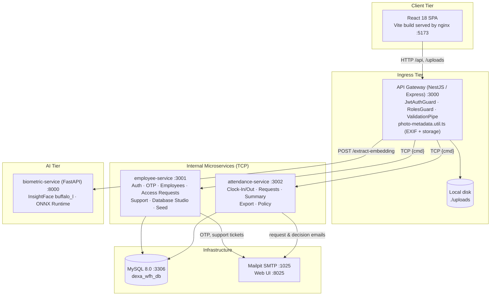

### 3.3 A. Frontend presentation tier (`frontend/`)

| Concern | Implementation (verified) |
|---|---|
| Framework | React `^18.3.1`, TypeScript `~5.6.2`, Vite `^5.4.21`, React Router `^6.30.6` |
| Runtime dependencies | Only six: `react`, `react-dom`, `react-router-dom`, `axios`, `lucide-react`, `@mediapipe/tasks-vision`. No charting library — charts are hand-built from `div` elements. |
| Serving | Multi-stage `Dockerfile` (`node:22-alpine` build → `nginx:1.27-alpine`). `nginx.conf` proxies `/api/` and `/uploads/` to `api-gateway:3000`, SPA fallback, `client_max_body_size 15M`. Locally, `vite.config.ts` proxies `/api` and `/uploads` to `http://localhost:3000`. |
| Styling | Tailwind CSS `^3.4.19`, `darkMode: 'class'`. Tokens: `navy` / `sidebar-bg` `#0A2D62`, `dexa.red` `#D32F2F`, plus `#B71C1C`, `#1E40AF`, `#2563EB`. Theme persisted in `localStorage` key `dexa_wfh_theme`. |
| Typography | **IBM Plex Sans** (body/display) and IBM Plex Mono / JetBrains Mono (mono). `tabular-nums` applied to the live clock, timestamps, NIP badges, Rupiah amounts, OTP inputs. (`index.html` also loads Plus Jakarta Sans, but it is unused.) |
| Logos | `/logo-dexa-red.png` (light), `/logo-dexa-white.png` (dark) via `DexaBrandLogo.tsx`. |
| HTTP client | `src/api/client.ts`: Axios, base URL `VITE_API_BASE_URL \|\| '/api'`, 20 s timeout. Request interceptor injects the Bearer access token. Response interceptor on `401` (excluding `/auth/login` and `/auth/refresh`) calls `POST /auth/refresh` once, stores the new access **and** refresh tokens, and replays the request; on failure it clears the session. |
| Session storage | `localStorage`: `dexa_wfh_access_token`, `dexa_wfh_refresh_token`, `dexa_wfh_user_profile`. |
| Notifications | `ToastContext` + `ToastContainerBottomRight` (bottom-right, variants `success` / `error` / `info`, max 4 visible, 5.2 s / 7.5 s for errors). Every notification also enters `NotificationCenterDropdown` in the header (persisted in `localStorage` key `dexa_wfh_business_notifications_v3`, capped at 40, unread state, mark-all-read, clear). Messages carry `where` / `what` / `why` without square brackets. The Axios interceptor automatically toasts API errors unless a request sets `silentToast`. |
| Hardware | `navigator.mediaDevices.getUserMedia` (1280×720 ideal, front camera), HTML5 Canvas 2D watermarking, MediaPipe FaceLandmarker (WASM + model served locally from `/mediapipe/`), optional `navigator.geolocation`. |
| Layout | `AppLayout.tsx`: collapsible navy sidebar (open by default ≥ 1024 px), header with `LiveServerClock`, `ThemeToggle`, notification bell, Support button (opens `ContactDeveloperModal`), user menu, and the copyright footer. |

**Custom components (`src/components/custom/`):** `CameraPhotoUpload`, `CompanyPolicyModal`, `ContactDeveloperModal`, `CopyrightFooterWatermark`, `DexaBrandLogo`, `InteractiveDataTable`, `LeaveAndCorrectionModal`, `LiveServerClock`, `NotificationCenterDropdown`, `OtpInputGroup`, `PhotoLightboxModal`, `ThemeToggle`, `ToastContainerBottomRight`.

**Frontend routes (`App.tsx`):**

| Path | Page | Allowed |
|---|---|---|
| `/login`, `/verify-account`, `/forgot-password`, `/request-access` | Auth pages | Public |
| `/auth/enroll-face` | `FaceEnrollmentPage` | Authenticated (not SYSTEM_ADMIN) |
| `/` | Role-based redirect: MANAGER → `/manager/approvals`; admins → `/hrd/dashboard`; others → `/employee/dashboard` | Authenticated |
| `/employee/dashboard`, `/employee/attendance`, `/employee/history` | Employee self-service | Authenticated except SYSTEM_ADMIN |
| `/profile` | `ProfilePage` | Authenticated |
| `/manager/approvals` | `ManagerApprovalsPage` | SYSTEM_ADMIN, HR_ADMIN, MANAGER |
| `/hrd/dashboard`, `/hrd/monitoring`, `/hrd/employees` | HRD portal | SYSTEM_ADMIN, HR_ADMIN |
| `/system/database` | `SystemDatabaseManagementPage` | SYSTEM_ADMIN (HR_ADMIN bypasses — see §2.3) |

### 3.4 B. API gateway & ingress tier (`backend/apps/api-gateway/`)

- **Framework:** NestJS `^11.2.8` on the Express adapter, listening on `:3000` with global prefix `/api`, CORS (`origin: true`, exposes `Content-Disposition` and `X-Export-Row-Count`), global `ValidationPipe` (`whitelist`, `transform`), global `AllHttpExceptionsFilter`, static serving of `uploads/` at `/uploads/`, Swagger UI at `/api/docs`.
- **Controllers:** `AuthController`, `EmployeesController`, `AttendanceController`, `SupportController`, `SystemController`, `DatabaseManagementController`.
- **Security:** `JwtAuthGuard` and `RolesGuard` (see §2.3).
- **Transport:** `ClientsModule` registers two TCP `ClientProxy` instances (`EMPLOYEE_SERVICE`, `ATTENDANCE_SERVICE`). `rpc.util.ts → sendRpc()` sends `{ cmd }` patterns with a **15 s RxJS timeout**, unwraps structured RPC errors into `HttpException`s, and maps transport failures to `502`.
- **Biometric bridge:** `BiometricClientService` posts multipart images to the FastAPI service (`POST /extract-embedding`, 10 s timeout). A `verifyFace()` method targeting `POST /verify-face` exists but is **not called** anywhere.
- **Storage & EXIF:** `storage/photo-metadata.util.ts` validates MIME (`jpeg/jpg/png/webp`) and size (≤ 8 MB), parses EXIF `DateTimeOriginal` → `CreateDate` → `ModifyDate` via `exif-parser`, and writes files into the hierarchical directory (§5 F10). Uploads are buffered in memory (`multer.memoryStorage()`), written by the gateway, and only the resulting URL is sent over TCP.

### 3.5 C. Internal TCP microservices tier

| Service | Port | Responsibilities | Schema sync |
|---|---|---|---|
| `employee-service` | 3001 | Login, JWT issue/refresh, 6-digit OTP (account verification & forgot password), public access requests and approval, master employee CRUD + soft delete/restore, department directory, face-embedding persistence, support tickets + SMTP, Database Studio, seed data (`SeedService.onApplicationBootstrap`). | **Owner** — `synchronize` enabled when `DB_SYNCHRONIZE=true` |
| `attendance-service` | 3002 | Clock-In/Out processing (biometric similarity, duplicate-photo detection, liveness score gate, geofence, timestamp verification), today status, personal history & dashboard, HRD summary & audit log, `.xlsx`/`.csv` export, company policy, attendance requests (WFH approval/notice, overtime, leave, sick, correction) with SMTP routing and attendance sync. | Disabled (`allowSchemaSync: false`) to avoid concurrent DDL |

Both services bootstrap with `NestFactory.createMicroservice(..., { transport: Transport.TCP })` and the shared `AllRpcExceptionsFilter` (structured `{ statusCode, where, what, why }` errors).

### 3.6 D. AI biometrics & infrastructure tier

| Component | Details (verified) |
|---|---|
| `biometric-service` | Python 3.10-slim, FastAPI + Uvicorn on `:8000`. `insightface` `FaceAnalysis(name="buffalo_l")` prepared with `det_size=(320,320)`, `det_thresh=0.55`, ONNX Runtime `CPUExecutionProvider` (CUDA optional via `FORCE_GPU=1`). Model weights are mounted read-only from the host's `~/.insightface`. |
| Endpoints | `GET /health`; `POST /extract-embedding` → `SUCCESS` / `NO_FACE` / `MULTIPLE_FACES` / `ERROR`, an **L2-normalised 512-float embedding**, bbox, detection score, `image_hash` (SHA-256 of raw bytes) and `image_phash` (64-bit **average hash** of an 8×8 grayscale thumbnail); `POST /verify-face` (cosine similarity, default threshold 0.45 — currently unused by the gateway). |
| `dexa-wfh-mysql` | `mysql:8.0`, database `dexa_wfh_db`, `TZ=Asia/Jakarta`, named volume `dexa_mysql_data`, health-checked. TypeORM `^0.3.31` with `mysql2`. `DB_TYPE` may also be `mariadb` or `postgres` (`DATETIME_COLUMN` switches to `timestamp` for Postgres). |
| `dexa-wfh-mailpit` | `axllent/mailpit`, SMTP `:1025`, web inbox `:8025`. Captures every outbound email locally; nothing is delivered to the internet. |

> [!NOTE]
> **Where similarity is computed.** The FastAPI service only *extracts* embeddings during attendance. The 1:1 comparison is a 512-element dot product computed in `attendance-service` (`attendance.service.ts`) against `employees.face_embedding`. Because both vectors are L2-normalised, the dot product equals cosine similarity.

---

## 4. Business Rules Reference (Constants & Formulas)

All values below are taken from code. Where a configuration knob exists, the environment variable is named.

| Rule | Value in code | Source |
|---|---|---|
| Timezone | `Asia/Jakarta` (WIB) | `utils/time.util.ts` |
| Shift start | `WORK_START_TIME`, default `08:30` | `getWorkScheduleConfig()` |
| Late grace period | `WORK_GRACE_MINUTES`, default **15** (note: `.env.example`/compose set `LATE_GRACE_MINUTES`, which the code does not read) | `attendance-rules.ts` |
| Half-day threshold | `HALF_DAY_THRESHOLD_MINUTES`, default **240** | `attendance-rules.ts` |
| Standard shift span for overtime | **540 minutes** (9 h, e.g. 08:30–17:30) — hard-coded | `evaluateClockOut()` |
| Minimum overtime to count | **30 minutes** | `evaluateClockOut()`, `calculateOvertimeAndPay()` |
| Lunch-break deduction | **None** — duration is the raw clock-out − clock-in span | `evaluateClockOut()` |
| Face match threshold | similarity **≥ 0.45** | `attendance.service.ts` |
| Liveness gate | reject if submitted `livenessScore < 0.85` (live-camera method only) | `attendance.service.ts` |
| Duplicate photo | exact SHA-256 match against any of the employee's prior photos → reject; average-hash Hamming distance **≤ 5** against the last 10 records → reject | `attendance.service.ts` |
| Geofence | Haversine distance to `home_latitude/longitude`; ≤ **100 m** → `IN_HOME_RADIUS`, else `OUT_OF_HOME_RADIUS`; no coordinates → `LOCATION_UNAVAILABLE`. **Informational only** — never blocks Clock-In. | `attendance.service.ts` |
| Photo timestamp verification | Live webcam: `|server − captured| ≤ 5 min`. Upload: requires a timestamp, same WIB calendar day, captured no more than 5 min in the future and no older than 12 h. | `verifyPhotoTimestamp()` |
| Default base salary | IDR 12,000,000 (floor IDR 1,000,000 in overtime calc) | `employee.entity.ts`, `attendance-rules.ts` |
| Default weekly WFH quota | 1 day/week (configurable 1–5) | `system_settings`, `departments` |
| OTP | 6 digits, bcrypt-hashed, **15 min** TTL, max **5** attempts, previous unused OTPs invalidated on reissue (`OTP_EXPIRES_MINUTES` is not read) | `otp.service.ts` |
| JWT | Access TTL `JWT_ACCESS_EXPIRES_IN` default **8h**; refresh TTL `JWT_REFRESH_EXPIRES_IN` default **7d** | `auth.service.ts` |
| Password hashing | bcrypt (`bcryptjs`), cost **10** | `auth.service.ts`, `employees.service.ts` |
| Upload limits | images `jpeg/png/webp` ≤ 8 MB; attachments ≤ 8 MB | `photo-metadata.util.ts` |

### 4.1 Status evaluation

**Clock-In (`evaluateClockIn`)** — computed from the *server* instant in WIB minutes-of-day:

$$
\text{isLate} = \text{clockInMinutes} > \text{startMinutes} + \text{graceMinutes}
$$

$$
\text{late\_minutes} = \begin{cases} \text{clockInMinutes} - \text{startMinutes} & \text{if isLate} \\ 0 & \text{otherwise} \end{cases}
$$

With defaults, 08:45 → `ON_TIME` (0 late minutes); 08:46 → `LATE` with **16** late minutes (measured from 08:30, not from the end of the grace period).

**Clock-Out (`evaluateClockOut`)**:

$$
\text{work\_duration\_minutes} = \max\left(0, \left\lfloor \frac{\text{clock\_out} - \text{clock\_in}}{60\,000\text{ ms}} \right\rfloor\right)
$$

$$
\text{status} = \begin{cases} \texttt{HALF\_DAY} & \text{if work\_duration\_minutes} < 240 \\ \texttt{COMPLETED} & \text{otherwise} \end{cases}
$$

$$
\text{overtime\_minutes} = \begin{cases} \text{work\_duration\_minutes} - 540 & \text{if that value} \ge 30 \\ 0 & \text{otherwise} \end{cases}
$$

**Missing clock-out:** whenever today-status, history, audit-log or summary queries run, any earlier-dated record with no `clock_out_time` and status `ON_TIME`/`LATE` is bulk-updated to `MISSING_CLOCK_OUT` (lazy evaluation; no scheduler).

**Full status set (`AttendanceStatus`):** `ON_TIME`, `LATE`, `HALF_DAY`, `COMPLETED`, `MISSING_CLOCK_OUT`, `ON_LEAVE`, `SICK`. Note that Clock-Out overwrites `ON_TIME`/`LATE` with `COMPLETED`/`HALF_DAY`; lateness remains visible through `late_minutes`.

### 4.2 Overtime pay (Indonesian 1/173 convention, PP No. 35/2021)

`calculateOvertimeAndPay(overtimeMinutes, baseSalary)`:

$$
\text{hourlyBaseRate} = \text{round}\left(\frac{\text{baseSalary}}{173}\right)
$$

$$
\text{multiplierHours} = 1.5 \times \min\left(1, \tfrac{m}{60}\right) + 2.0 \times \max\left(0, \tfrac{m}{60} - 1\right)
$$

$$
\text{overtimePay (IDR)} = \text{round}(\text{multiplierHours} \times \text{hourlyBaseRate})
$$

where *m* is overtime minutes (0 if *m* < 30). Partial hours are pro-rated (not rounded to whole hours). Example: base salary IDR 12,000,000, clock-in 08:30, clock-out 20:00 → duration 690 min → overtime 150 min → hourly rate 69,364 → multiplier hours 1.5 + 2.0 × 1.5 = 4.5 → **IDR 312,138**.

Overtime is applied only when the company policy `enable_overtime` is true. On Clock-Out, existing overtime fields (e.g., from a previously approved `OVERTIME` request) are kept if larger (`Math.max`).

### 4.3 WFH workflow modes (`system_settings.wfh_workflow_mode`)

| Mode | Submission | Clock-In unlock |
|---|---|---|
| `STRICT_APPROVAL` (default) | `WFH_APPROVAL` request saved as `PENDING`; email to approver | Only after a reviewer approves it |
| `NOTICE_ONLY` | `WFH_APPROVAL` request saved immediately as `APPROVED` with note "Auto-approved via Notice-Only workflow policy"; notification email sent | Immediately |

Both modes enforce: no duplicate `PENDING`/`APPROVED` WFH request for the same date, and at most `max_wfh_days_per_week` `PENDING`+`APPROVED` WFH requests per ISO week (Monday–Sunday).

---

## 5. Feature Breakdown & 12 End-to-End Flows

Every feature is documented in four parts: **Goals & Rationale**, **Assumptions**, **End-to-End Flow**, and **Scope & Limitations**.

---

### Feature 1 — Authentication, RBAC & 6-Digit Email OTP (Flow 1)

#### 1. Goals & rationale
Provide secure daily login (email + password → JWT) while using email OTP **only** for (a) first-time account verification and (b) forgot-password recovery. New accounts are created by HR (directly or by approving a public access request), so the OTP doubles as proof of mailbox ownership and as the moment the user sets their own password.

#### 2. Assumptions
- The user can read the mailbox (in this environment, the Mailpit inbox at `http://localhost:8025`).
- Seeded accounts are pre-verified except where noted; `employee.four@dexagroup.com` is wired to a fixed demo OTP `123456`.
- HR provisions accounts; there is no anonymous self-registration that grants immediate access.

#### 3. End-to-end flow

**3a. Login & first-time verification**
1. User submits email + password at `/login` → `POST /api/auth/login` → TCP `auth.login`.
2. `AuthService.login` loads the user by lower-cased email (joined to employee and department).
3. Unknown email → `401`. Inactive user or employee → `403`.
4. **If `is_verified = false`:** the service issues an `ACCOUNT_VERIFICATION` OTP, emails it via Mailpit, and returns **`200` with `type: 'info'` and `data.requiresVerification = true`** (plus `demoOtpHint` when `NODE_ENV` ≠ `production`). The password is **not** checked on this branch. The frontend routes to `/verify-account`.
5. `POST /api/auth/verify-account` (`email`, 6-digit `otp`, `newPassword` meeting the strong-password regex) → OTP consumed → password re-hashed (bcrypt 10) → `is_verified = true` → tokens issued (the user is signed in immediately).
6. **If verified:** `bcrypt.compare` → `401` on mismatch; on success `last_login_at` is updated and a token pair is issued.

**3b. Token issue & refresh**
- Access and refresh JWTs carry `{ sub, email, role, employeeId, fullName, department, tokenType }`.
- Access TTL default 8 h; refresh TTL default 7 d. `POST /api/auth/refresh` verifies the refresh token and returns a **new access + refresh pair** and the user profile. There is no server-side refresh-token store or revocation list.

**3c. Forgot password:** `POST /auth/forgot-password` → `FORGOT_PASSWORD` OTP emailed → `POST /auth/reset-password` (email, OTP, new password).

**3d. Public onboarding (access request)**
1. Prospective employee fills `/request-access` (department dropdown from public `GET /api/auth/departments`) → `POST /api/auth/request-access` → `access_requests` row `PENDING` (rejects if the email already has an account or a pending request).
2. HR reviews in `/hrd/employees`. Backend endpoints: `PATCH /api/access-requests/:id/approve` (optional `role`, `joinDate`, `reviewNotes`) and `PATCH /api/access-requests/:id/reject` (`reviewNotes` ≥ 5 chars).
3. Approve → `EmployeesService.create` provisions user + employee in a DB transaction (NIP from request or auto-generated `DEXA-2026-NNN`) and emails a verification OTP. The user then completes Flow 3a.

> [!WARNING]
> The current `MasterEmployeesPage` calls `PATCH /api/access-requests/:id/review`, which the gateway does not expose, so approving/rejecting from the UI returns `404`. The backend approve/reject endpoints work when called directly. See [§9](#9-known-defects--implementation-gaps-audit-findings).

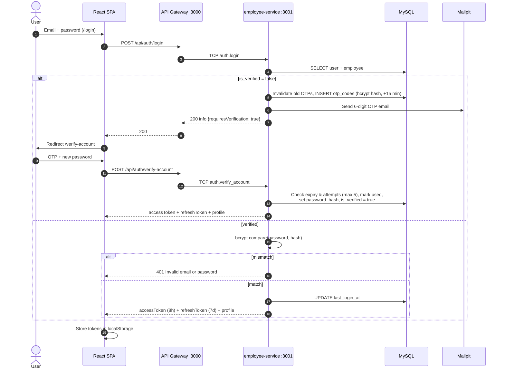

#### 4. Scope & limitations
- Unverified-login branch re-sends an OTP on every login attempt without checking the password (a mailbox-flooding / enumeration vector).
- Login reveals whether an email is registered (`No account is registered with email ...`).
- No rate limiting on login, OTP issue, or refresh endpoints (only the 5-attempt cap per OTP).
- Refresh tokens are stateless; logout cannot revoke them.
- Tokens live in `localStorage` (readable by any script running on the origin).

---

### Feature 2 — Biometric Facial Setup & ArcFace 512-D Enrollment (Flow 2)

#### 1. Goals & rationale
Create a one-time biometric reference for each operational user so every subsequent Clock-In/Out photo can be matched 1:1 against the person who owns the account, defeating "buddy punching".

#### 2. Assumptions
- A working webcam, reasonable frontal lighting, one face in frame.
- InsightFace `buffalo_l` model files exist in the host's `~/.insightface` (mounted into the container).

#### 3. End-to-end flow
1. `ProtectedRoute` redirects any non-SYSTEM_ADMIN user who has an `employeeId` and `isFaceEnrolled = false` to **`/auth/enroll-face`**. `isFaceEnrolled` is derived on the server as `face_embedding` being a 512-element array.
2. `FaceEnrollmentPage` streams the webcam inside an oval guide, captures a JPEG (quality 0.95) and posts multipart field `photo` to **`POST /api/employees/me/enroll-face`**. There is no liveness challenge on this page.
3. Gateway calls `POST /extract-embedding` on the biometric service. Anything other than `SUCCESS` with exactly one face → `422` (`No face detected` / `Multiple faces detected` / `Biometric feature extraction failed`).
4. Gateway saves the photo with prefix `avatar_` in the hierarchical store, then sends TCP `employee.enroll_face` with the embedding and photo URL.
5. `employee-service` validates the 512-length array and stores it in `employees.face_embedding` (JSON), sets `face_enrolled_at` and `face_enrolled_photo_url` (and the avatar).
6. Frontend refreshes the profile and navigates to `/employee/attendance`.

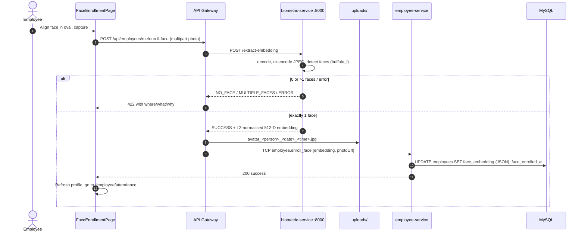

#### 4. Scope & limitations
- Single reference image; no multi-angle enrolment or template averaging.
- Re-enrolment is self-service (the same endpoint overwrites the embedding) with no HR approval step.
- Embedding stored as plain JSON in MySQL (no encryption at rest).

---

### Feature 3 — Daily WFH Request/Notice, Upward Escalation & Biometric Clock-In (Flow 3)

#### 1. Goals & rationale
Tie remote attendance to an explicit, manager-visible WFH arrangement for the day, then verify identity and record the start of work with server time and photo proof.

#### 2. Assumptions
- The company's base arrangement is Work From Office; WFH is a quota-limited exception.
- Each department has a manager email and HR PIC email in `departments`; defaults are used if missing.
- The user has completed face enrolment.

#### 3. End-to-end flow

**Step A — WFH request / notice (prerequisite).**
There is **no dedicated `/wfh-notice` endpoint**. The WFH notice is an attendance request of type `WFH_APPROVAL`, submitted through `LeaveAndCorrectionModal` → `POST /api/attendance-requests` (multipart) → TCP `attendance_request.create`.

Email routing (`AttendanceRequestsService.create`):

| Submitter role | `to` | `cc` |
|---|---|---|
| `EMPLOYEE` or `HR_ADMIN` | Department `manager_email` (fallback `manager.it@dexagroup.com`) | Department `hr_pic_email` (default `admin.hrd@dexagroup.com`) + submitter |
| `MANAGER` or `SYSTEM_ADMIN` (**upward escalation**) | Department `hr_pic_email` (addressed to the Head of HRD) | `sysadmin@dexagroup.com` + HR PIC + submitter |

`from` / `sender` / `replyTo` = the submitting employee. In `STRICT_APPROVAL` the email contains a **"Review & Approve in System Portal"** button linking to `http://localhost:5173/manager/approvals?requestId=<uuid>`; in `NOTICE_ONLY` the request is auto-approved and the email links to the approvals list.

**Step B — Live capture, liveness and watermark (`CameraPhotoUpload.tsx`).**
1. `getUserMedia` stream inside an oval guide.
2. A frame is posted to `POST /api/attendances/verify-face-preview`; the gateway extracts the embedding and `attendance-service` returns `recognized` with the similarity (≥ 0.45).
3. MediaPipe FaceLandmarker runs the challenge sequence: **ALIGN → IDENTIFYING → RECOGNIZED → BLINK** (eye aspect ratio < 0.20 or blendshape > 0.45) **→ TURN_LEFT** (yaw ≤ −14°) **→ TURN_RIGHT** (yaw ≥ 14°) **→ HOLD_FRONT** (|yaw| ≤ 10° for 7 frames) → auto-capture. It falls back from GPU to CPU to a canvas-brightness heuristic if MediaPipe cannot load.
4. The Canvas burns a watermark into the pixels: a red `DEXA GROUP WFH • CLOCK-IN` badge; a green `INSIGHTFACE & LIVENESS VERIFIED` badge (live camera only); a bottom bar with `SERVER TIME: <YYYY-MM-DD HH:mm:ss> WIB …` (or `FILE TIME: … | SUBMITTED: …` for uploads), `<NIP> • <Full Name> (<Department>) — VERIFIED BIOMETRIC PROOF` / `MANUAL PHOTO PROOF`, and the copyright line.
5. **Fallback upload:** after entering a device-issue reason, the user may upload a JPEG/PNG/WebP, which is redrawn (1280 px wide) and watermarked the same way.

**Step C — Clock-In submission.**
The user enters the mandatory **Daily Work Plan** (frontend `required`, min 5 chars) and submits multipart `POST /api/attendances/clock-in` with `photo`, `captureSource`, `photoCapturedAt`, `dailyPlan`, `verificationMethod`, `livenessScore`, optional `latitude`/`longitude` (geolocation with a 3.5 s timeout), and `deviceIssueReason`.

Gateway (`AttendanceController.clockIn`):
1. `403` if role is SYSTEM_ADMIN; `400` if no photo.
2. `POST /extract-embedding`; `422` on `NO_FACE` / `MULTIPLE_FACES`.
3. `persistPhotoProof` (MIME/size checks, EXIF extraction, hierarchical write).
4. Captures IP (`X-Forwarded-For` or socket) and user-agent, then TCP `attendance.clock_in`.

Attendance service (`AttendanceService.clockIn`), in order:
1. Active employee with a 512-D embedding, else `403`.
2. `serverNow = new Date()`; `todayDate` in WIB; `409` if already clocked in today.
3. **WFH gate:** requires an `APPROVED` `WFH_APPROVAL` for today. Otherwise `403` with a message for Notice-Only ("send WFH notice first"), Pending ("awaiting manager"), or no request ("Scheduled as Work From Office").
4. **Duplicate photo:** SHA-256 equality with any prior clock-in/out photo of the employee → `409`; average-hash Hamming distance ≤ 5 vs. the last 10 records → `409`.
5. **Face match:** dot product of probe vs. stored embedding; `< 0.45` → `422`.
6. **Liveness gate:** if the method is `LIVE_CAMERA_LIVENESS` and `livenessScore < 0.85` → `422`. `verification_status` = `VERIFIED_LIVE_BIOMETRIC` (live) or `MANUAL_FACE_MATCHED_PENDING_REVIEW` (upload).
7. **Geofence:** Haversine distance to home coordinates → `location_status` (informational).
8. **Photo timestamp verification** → `is_timestamp_verified`.
9. `evaluateClockIn(serverNow)` → `ON_TIME` / `LATE` and `late_minutes`; save the record with `wfh_approved = true`, scores, hashes, IP, device info and `daily_plan`.

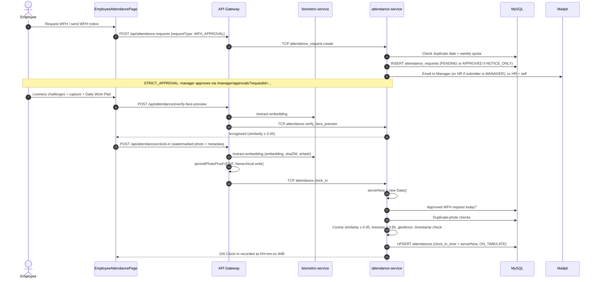

#### 4. Scope & limitations
- Liveness is evaluated in the browser; the server only receives a numeric `livenessScore`. The current `CameraPhotoUpload` sets `livenessScore: 0.99` for every captured photo, including uploads, so the server-side 0.85 gate is not independently enforced.
- If the face-preview call fails, the client proceeds as "recognized" with a placeholder score (fail-open UX). The server still re-checks similarity on Clock-In, **unless** the biometric service returns `ERROR`, in which case no embedding is sent and the server stores a default similarity of 0.92 without matching (see §9).
- The backend `dailyPlan` field is optional; it is mandatory only in the frontend form.
- Geofence never blocks Clock-In and requires home coordinates on the employee record (no UI to set them).

---

### Feature 4 — Authoritative Server Timestamp & Anti-Clock-Tampering

#### 1. Goals & rationale
Make the official attendance time independent of the user's device so changing the system clock cannot produce a punctual record.

#### 2. Assumptions
- The server's clock is NTP-synchronised; MySQL and services run with `TZ=Asia/Jakarta` / explicit WIB conversion.

#### 3. End-to-end flow
1. `clock_in_time` and `clock_out_time` are assigned exclusively from `const serverNow = new Date()` inside `attendance-service`. No client timestamp is ever written to these columns.
2. The client-provided `photoCapturedAt` and any EXIF timestamp are stored separately (`clock_in_photo_captured_at`, `clock_out_photo_captured_at`) and only influence the `is_timestamp_verified` / `is_clock_out_timestamp_verified` flags.
3. `persistPhotoProof` resolves the captured time as: EXIF `DateTimeOriginal` → `CreateDate` → `ModifyDate`; else the client's `photoCapturedAt`; else the server time.
4. `verifyPhotoTimestamp` applies the rules in §4 (±5 min for live webcam; same WIB day, ≤ 12 h old, ≤ 5 min future for uploads with a timestamp).
5. HR sees the flag as "Photo Timestamp Verified" or "Unverified / Old File Timestamp Warning" in the lightbox, and can filter the audit log by `verified=true|false`.
6. `GET /api/system/time` returns the authoritative server time (ISO, epoch ms, WIB strings, schedule) for client display.

```mermaid
flowchart LR
    A[Photo received at gateway] --> B{EXIF DateTimeOriginal /<br/>CreateDate / ModifyDate?}
    B -- yes --> C[capturedAt = EXIF<br/>hasExifTimestamp = true]
    B -- no --> D{Client photoCapturedAt?}
    D -- yes --> E[capturedAt = client time<br/>hasExifTimestamp = true ⚠]
    D -- no --> F[capturedAt = server now]
    C & E & F --> G[attendance-service:<br/>clock_in_time = new Date&#40;&#41;]
    G --> H{source}
    H -- LIVE_WEBCAM --> I["|now − capturedAt| ≤ 5 min ?"]
    H -- FILE_UPLOAD --> J["same WIB day AND<br/>−5 min ≤ age ≤ 12 h ?"]
    I --> K[is_timestamp_verified]
    J --> K
```

#### 4. Scope & limitations
- **Request-arrival time is the official time.** On slow connections, the recorded time can be a few seconds after the user pressed capture.
- In `persistPhotoProof`, `hasExifTimestamp` is set to `true` whenever a client `photoCapturedAt` is present (`… || true`), so uploads without real EXIF can still pass verification using a client-supplied time (⚠ in the diagram; see §9).
- The header clock (`LiveServerClock`) is intended to display server-offset time, but a field-name mismatch means it currently displays the **client** clock (see §9). Official records are unaffected.

---

### Feature 5 — Daily Clock-Out, Working Duration, Punctuality & Overtime (Flow 4)

#### 1. Goals & rationale
Close each day with a written accomplishment and proof photo, and compute payroll-relevant metrics (duration, status, overtime minutes and pay) automatically and consistently.

#### 2. Assumptions
- Single standard schedule: start 08:30 WIB, 15-minute grace, 9-hour span (08:30–17:30).
- Overtime compensation follows the 1/173 hourly rate with 1.5× for the first hour and 2.0× thereafter.
- The employee's `base_salary` is maintained by HR (default IDR 12,000,000).

#### 3. End-to-end flow
1. The employee enters the mandatory **Daily Accomplishment** (frontend min 5 chars; backend DTO `@MinLength(10)`), captures a proof photo, and submits `POST /api/attendances/clock-out` (multipart).
2. Gateway: SYSTEM_ADMIN `403`; embedding extraction and face-count checks; `persistPhotoProof` (prefix `clock-out`); TCP `attendance.clock_out`.
3. Attendance service:
   - Requires today's record with `clock_in_time` (`400` otherwise) and no prior clock-out (`409`).
   - `serverNow = new Date()` → `clock_out_time`.
   - Face match ≥ 0.45 (`422` on mismatch).
   - Timestamp verification → `is_clock_out_timestamp_verified`.
   - `evaluateClockOut` → `work_duration_minutes`, `COMPLETED` / `HALF_DAY`, overtime minutes.
   - If policy `enable_overtime`: `calculateOvertimeAndPay` → `overtime_minutes`, `overtime_multiplier_hours`, `overtime_pay_amount` (keeping larger existing values).
   - Saves accomplishment, clock-out similarity, hashes.
4. Response: "Clock-Out recorded at HH:mm:ss WIB (COMPLETED)" with hours worked and any overtime pay in IDR.

```mermaid
flowchart TD
    A[POST /api/attendances/clock-out] --> B{Clock-in exists today?}
    B -- no --> X1[400 Cannot Clock-Out before Clock-In]
    B -- yes --> C{Already clocked out?}
    C -- yes --> X2[409 Clock-Out already completed]
    C -- no --> D[clock_out_time = new Date&#40;&#41;]
    D --> E{similarity ≥ 0.45?}
    E -- no --> X3[422 Biometric mismatch]
    E -- yes --> F["duration = floor((out − in) / 1 min)"]
    F --> G{duration < 240?}
    G -- yes --> H[status = HALF_DAY]
    G -- no --> I[status = COMPLETED]
    H & I --> J{"duration − 540 ≥ 30<br/>AND enable_overtime?"}
    J -- no --> K[overtime = 0]
    J -- yes --> L["rate = round(baseSalary / 173)<br/>mult = 1.5·min(1,h) + 2.0·max(0,h−1)<br/>pay = round(mult × rate)"]
    K & L --> M[Save attendances row]
```

#### 4. Scope & limitations
- **No lunch-break deduction** is applied; duration is the gross span.
- Overtime starts after 540 minutes of *duration*, not at a fixed 17:30 wall-clock time — a late starter must work later before overtime accrues.
- `HALF_DAY` threshold is 4 hours (240 min). There is no "under 8 hours" status.
- Clock-Out overwrites the `LATE` status with `COMPLETED`/`HALF_DAY`; lateness persists in `late_minutes`.
- Overtime is computed per day; there are no weekly/holiday multipliers.
- Missing clock-outs are tagged lazily on later reads, not by a scheduled job.

---

### Feature 6 — Leave, Sick, Overtime & Correction Workflow with Direct Deep Links (Flow 5)

#### 1. Goals & rationale
Replace scattered emails and spreadsheets with one auditable request pipeline whose approval automatically updates the official attendance record.

#### 2. Assumptions
- The reviewer has a portal account; deep links rely on normal login, not anonymous tokens.
- A supporting document is optional (doctor's note, etc.).

#### 3. End-to-end flow
1. **Submission.** `LeaveAndCorrectionModal` offers `WFH_APPROVAL`, `OVERTIME` (hidden when overtime is disabled), `CORRECTION` (adds requested HH:mm clock-in/out), `LEAVE` and `SICK`, with an optional attachment (`image/*`, `.pdf`, ≤ 8 MB). Request: `POST /api/attendance-requests` (multipart field `attachment`).
2. **Validation (attendance-service).** Reason ≥ 10 characters. Correction requires at least one time and clock-out > clock-in. WFH quota/duplicate checks (§4.3). Overtime requires the policy enabled; requested minutes default to 120 if not given or < 30, and `estimated_overtime_pay` is pre-computed.
3. **Persistence.** `attendance_requests` row with `status = PENDING` (or `APPROVED` for Notice-Only WFH), `manager_email`, `cc_emails`, `attachment_url`.
4. **Email with deep link.** Sent from the employee to the approver (routing per Feature 3). The link is **`http://localhost:5173/manager/approvals?requestId=<request-uuid>`**.
5. **Review.** `ManagerApprovalsPage` (SYSTEM_ADMIN, HR_ADMIN, MANAGER) reads `?requestId=`, opens that request in a review modal (attachment, reason, dates) and offers Approve / Reject (a note is required to reject). HR can also review from the queue in `/hrd/monitoring`. Request: `PATCH /api/attendance-requests/:id/review` `{ decision: APPROVED|REJECTED, reviewNotes? }`.
6. **Authorization.** MANAGER may only review requests from their own department (`403` otherwise). Only `PENDING` requests can be reviewed (`400` otherwise).
7. **Automatic attendance sync on approval** (`syncApprovedRequestToAttendance`) — upserts `attendances` for `(employee_id, target_date)`:

| Type | Effect on `attendances` |
|---|---|
| `WFH_APPROVAL` | `wfh_approved = true` (unlocks Clock-In); plan/HR note annotated; new row created with status `ON_TIME` if none |
| `OVERTIME` | Overtime minutes, multiplier hours, pay recomputed from the requested minutes |
| `LEAVE` | `status = ON_LEAVE`, `is_timestamp_verified = true` |
| `SICK` | `status = SICK`; attachment shown as the proof photo |
| `CORRECTION` | `clock_in_time` / `clock_out_time` set from the requested times (WIB → UTC), then status, late minutes, duration and overtime recomputed with the same rules as live Clock-In/Out; `is_timestamp_verified = true` |

8. **Decision email** to the employee, `cc` the manager and `admin.hrd@dexagroup.com`.

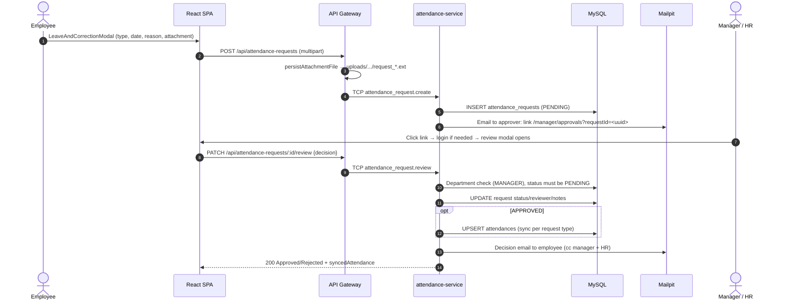

#### 4. Scope & limitations
- **The deep link is not a signed token.** It carries only the request UUID; security comes from the reviewer's portal login and the department check. The host is hard-coded to `http://localhost:5173`.
- There is no leave-balance ledger; leave days are not debited from an entitlement.
- If SMTP fails, `email_dispatched` is still set to `true` (the failure is only logged).
- The decision email is plain text.
- Approved corrections mark the timestamp as verified even though the times are user-requested.

---

### Feature 7 — Master Employee Management: CRUD & Soft Delete (Flow 6)

#### 1. Goals & rationale
Give HR a single authoritative employee directory while guaranteeing that deactivating staff never destroys attendance history needed for payroll and audits.

#### 2. Assumptions
- HR manages NIP assignment; NIPs are unique across the company.
- Deactivated employees must not log in or clock in, but their records must remain queryable.

#### 3. End-to-end flow
1. `/hrd/employees` (SYSTEM_ADMIN, HR_ADMIN) loads `GET /api/employees?limit=100&includeInactive=…` (search, department, status, role filters supported by the API).
2. **Create** `POST /api/employees`:
   - NIP (`employeeCode`) is mandatory: frontend label "Employee Code / NIP (Mandatory) *" with an explicit check; DTO regex `^[A-Z0-9-]{3,50}$`; service-level `400` if empty; `409` if duplicate; unique index `UQ_employees_code`.
   - Email must be unique (`409`; unique on both `users` and `employees`).
   - Phone defaults to `+62` in the form; base salary defaults to IDR 12,000,000; role defaults to `EMPLOYEE`.
   - User + employee are created in one DB transaction and a verification OTP is emailed.
3. **Update** `PATCH /api/employees/:id`: profile fields, salary, status (`ACTIVE` / `ON_LEAVE` only), and role (synced to `users.role`); uniqueness is rechecked.
4. **Soft delete** `DELETE /api/employees/:id`: sets `employees.is_active = false`, `status = INACTIVE`, `deleted_at = NOW()`, and `users.is_active = false`. No SQL `DELETE` is executed. HR cannot deactivate their own account.
5. **Restore** `PATCH /api/employees/:id/restore`: reverses all of the above.
6. **Resend OTP** `POST /api/employees/:id/resend-otp` for unverified employees.

Referential integrity: `attendances.employee_id` and `attendance_requests.employee_id` reference `employees.id` with `ON DELETE RESTRICT`, and audit/summary queries use `withDeleted`, so history for deactivated employees remains visible and exportable.

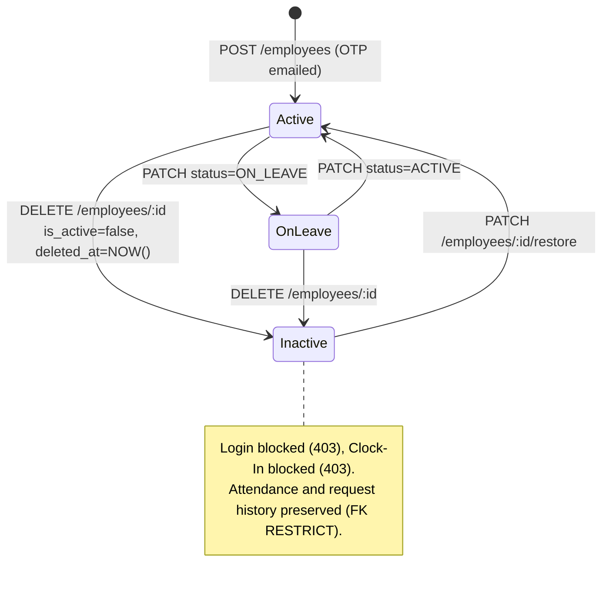

#### 4. Scope & limitations
- The Database Studio (Feature 11) can perform hard deletes, bypassing soft-delete semantics (FK `RESTRICT` still blocks deleting employees with attendance).
- No bulk import.
- Department is a free-text name on the employee (with optional FK), so renaming a department requires updating employees.

---

### Feature 8 — Dual Dashboard Architecture & Photo Lightbox Inspection (Flow 7)

#### 1. Goals & rationale
Give HR a company-wide, real-time operational picture with drill-down to individual photo evidence, and give each employee a self-service view of their own performance.

#### 2. Assumptions
- "Real time" means data is fetched on page load / refresh; there is no push channel.
- Present = has `clock_in_time` and is not on leave/sick.

#### 3. End-to-end flow

**HRD Dashboard (`/hrd/dashboard`, `GET /api/attendances/summary?date=`)** — the service loads active employees and the day's attendances and aggregates **in TypeScript**:
- Six KPI cards: Total Active Employees, Present WFH Today, On-Time Arrivals, Late Clock-Ins, On Leave / Sick, Photo Timestamp Audit (verified vs. unverified). Pending attendance and access requests are also counted.
- Workforce composition bar, department breakdown (present / on-time / late / leave per department), 7-day trend, recent photo-proof feed, and a "Company Policy" button.
- If the selected day has no attendance, the frontend falls back to the latest day with data in the 7-day window.
- MANAGER callers are scoped to their department.

**Attendance Monitoring & Audit Log (`/hrd/monitoring`, `GET /api/attendances`)** — filters: start/end date, department, status, timestamp-verified, and search (name, NIP, email, daily plan, accomplishment). Built with TypeORM `QueryBuilder` (`LEFT JOIN employee`, parameterised `WHERE` clauses, `LIKE` search, pagination). The table shows photo thumbnails; the same page has an approval queue for requests.

**Photo Lightbox (`PhotoLightboxModal`)** shows: clock-in and clock-out photos side by side (with the burned-in watermark), server time and photo-captured time for each, the timestamp-verification banner, daily work plan and accomplishment, net duration, late minutes, IP and device info.

**Employee Dashboard (`/employee/dashboard`, `GET /api/attendances/my-dashboard`)**:
- KPI cards: Punctuality Score %, Cumulative WFH Hours (average per day vs. 8.0 h target), Overtime & WFH Quota (overtime pay in Rp, overtime minutes, weekly WFH used/max), Today's Shift Status.
- **14-day work-duration bar chart** built from `div` bars on a 10-hour scale with a dashed **8.0 h target line**.
- Punctuality distribution (on time / within 15-minute grace / late / leave-sick), last 5 sessions, last 4 requests.

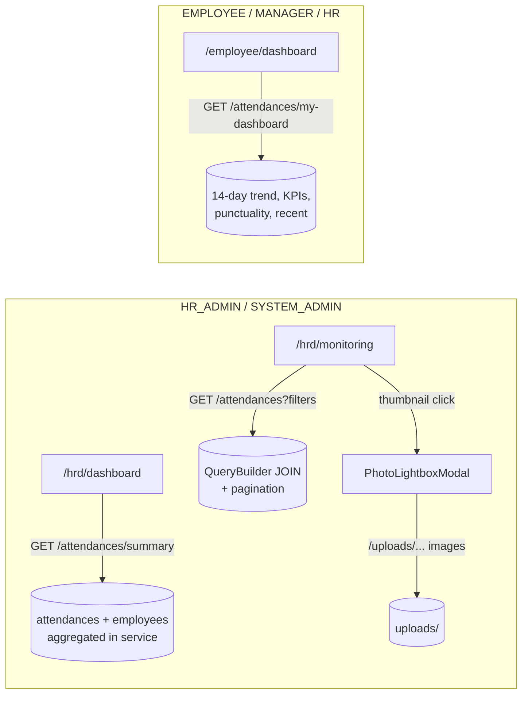

#### 4. Scope & limitations
- Aggregations are done in application memory over all of a day's rows (and, for personal KPIs, all of an employee's rows) rather than SQL `GROUP BY`; adequate for assessment-scale data, not for very large datasets.
- The lightbox does **not** display the cosine-similarity score, liveness score, geolocation or perceptual hash, although these are stored and available through `GET /api/attendances/:id`.
- The audit page requests up to 100 rows per page.
- The "Attendance rate" and "Leave balance" KPIs from earlier specifications are not implemented; punctuality rate and WFH quota are shown instead.

---

### Feature 9 — Multi-Format Payroll & Audit Data Export (Flow 8)

#### 1. Goals & rationale
Hand HR and payroll a filter-consistent dataset in formats they already use, including overtime pay, without manual re-keying.

#### 2. Assumptions
- Exported row counts are modest (≤ 5,000 per export).
- Spreadsheet tools (Excel, Google Sheets, payroll importers) are the consumers.

#### 3. End-to-end flow
1. On `/hrd/monitoring`, HR applies filters and clicks Excel or CSV → `GET /api/attendances/export?format=xlsx|csv&<same filters>` (Roles: HR_ADMIN, MANAGER, SYSTEM_ADMIN; MANAGER scoped to department).
2. `ExportService` reuses `buildFilteredQuery` (`.take(5000)`), builds an ExcelJS workbook (sheet "WFH Attendance & Payroll Recap") with 22 columns: No, Date (WIB), Employee NIP, Full Name, Email, Department, Position, Base Salary (IDR), Clock-In (WIB), Clock-Out (WIB), Duration (Mins), Duration (Hrs), Overtime (Mins), OT Multiplier (Hrs), Overtime Pay (IDR), WFH Approved, Late (Mins), Status, Photo Source, Timestamp Verified, Daily Plan, Daily Accomplishment. The header row is bold white on blue `#1E40AF`; a copyright row is appended.
3. CSV is produced by ExcelJS's CSV writer from the same workbook.
4. The file buffer is **base64-encoded and returned over TCP**; the gateway decodes it and sends it with `Content-Disposition: attachment; filename="Dexa_WFH_Attendance_Payroll_Report_<YYYY-MM-DD>.<ext>"` and `X-Export-Row-Count`.
5. **PDF:** the frontend calls `window.print()`; print CSS (`.no-print`) hides navigation so the browser's "Save as PDF" produces a report of the current filtered view.

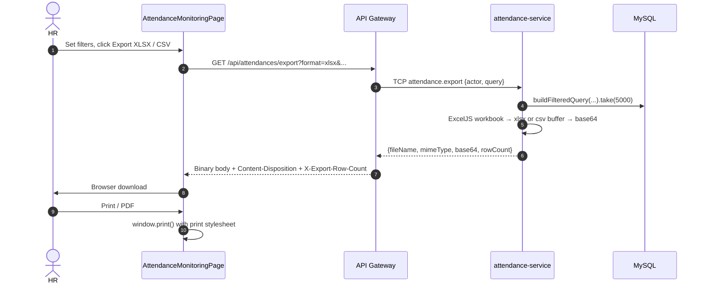

#### 4. Scope & limitations
- Not a true stream: the whole file is built in memory and base64-encoded over TCP (~33% overhead), capped at 5,000 rows.
- No summed totals row or per-employee subtotals in the sheet.
- PDF depends on the browser's print engine; no server-generated PDF.
- The "Photo Source" column reflects the clock-in source only.

---

### Feature 10 — Hierarchical Organized Storage Architecture (Flow 9)

#### 1. Goals & rationale
Keep evidence files human-navigable and audit-friendly instead of a flat folder of random names.

#### 2. Assumptions
- Single-node deployment with a local or bind-mounted disk (`./uploads` → `/app/uploads`).

#### 3. End-to-end flow
`buildOrganizedDirectory()` + `buildOrganizedFilename()` in `photo-metadata.util.ts`:

```
uploads/
└── <year>/                         e.g. 2026  (from the photo's resolved date)
    └── <department-slug>/          e.g. it-digital-innovation
        └── <employee | manager>/   MANAGER, HR_ADMIN, SYSTEM_ADMIN → "manager"; EMPLOYEE → "employee"
            └── <person-slug>/      e.g. employee-one
                └── <MM-monthname>/ e.g. 11-november
                    ├── clock-in_employee-one_2026-11-09_08-25-14.jpg
                    ├── clock-out_employee-one_2026-11-09_17-41-02.jpg
                    ├── request_employee-one_2026-11-09_10-02-33.pdf
                    └── avatar_employee-one_2026-11-09_07-58-11.jpg
```

- File prefixes: `clock-in`, `clock-out`, `request`, `avatar`.
- Slugs are lower-case, accent-stripped, non-alphanumerics → `-` (so academic titles become part of the slug).
- Same-second collisions get a random 3-digit suffix.
- The URL path stored in the DB is `/uploads/...` with forward slashes; files are served statically by the gateway and proxied by nginx/Vite.
- Attendance photos use the resolved capture date (EXIF/client/server); attachments and avatars use the server's current date.

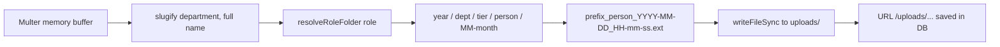

#### 4. Scope & limitations
- Year/month/time in the path come from `Date#getFullYear/getMonth/getHours`, i.e. the **container's local timezone**, while business dates use WIB; in a UTC container, folder/time names can differ from WIB by 7 hours.
- `/uploads` is served without authentication — anyone who knows a URL can fetch the image.
- Local disk only; no S3/MinIO adapter, no retention policy.

---

### Feature 11 — Relational Database Management Studio (Flow 10)

#### 1. Goals & rationale
Give the platform custodian a safe-ish, in-app way to inspect and repair data during evaluation without opening a separate SQL client.

#### 2. Assumptions
- Operator understands the schema and FK consequences.
- Only the nine application tables are in scope.

#### 3. End-to-end flow
1. `/system/database` → `GET /api/system/database/tables` → TCP `database.get_tables`: for each whitelisted table (`users`, `employees`, `departments`, `attendances`, `attendance_requests`, `access_requests`, `support_tickets`, `system_settings`, `otp_codes`) returns display name, description, primary key, **live row count** (`COUNT`) and column metadata (type, nullable, generated, default, enum values).
2. Browse rows: `GET /api/system/database/:table?page&limit(≤100)&search&sortBy&sortOrder` — `LIKE` search across char/text columns, sorting only on known columns, `password_hash` masked as `[PROTECTED_BCRYPT_HASH]`.
3. Inspect one row: `GET /:table/:id`.
4. Insert `POST /:table` (UUID auto-generated; `password` field bcrypt-hashed for `users`).
5. Update `PUT /:table/:id` (primary key immutable; masked hash ignored; optional password re-hash).
6. Delete `DELETE /:table/:id` — **hard delete**; FK violations return `409`.
7. Client-side CSV export of the current table view.

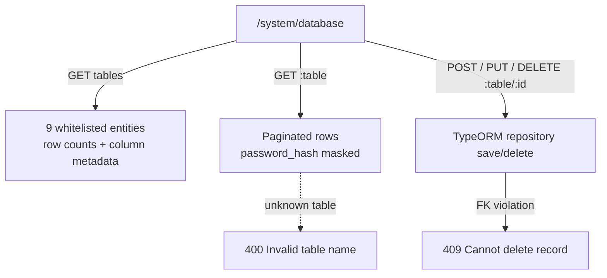

#### 4. Scope & limitations
- **No free-form SQL query runner** exists; operations are entity-repository CRUD only (which keeps queries parameterised).
- No storage-footprint (data/index size) metrics — row counts only.
- No per-operation audit log of who changed what (beyond the acting email in the response message).
- Route and API are reachable by HR_ADMIN due to the guard behaviour noted in §2.3.

---

### Feature 12 — Developer Support & Targeted SMTP Routing (Flow 11)

#### 1. Goals & rationale
Let any user report a problem from wherever they are, routed to the people who can fix it, with replies going straight back to the reporter.

#### 2. Assumptions
- At least one active SYSTEM_ADMIN exists; otherwise a fallback address is used.

#### 3. End-to-end flow
1. The **Support** button in the header opens `ContactDeveloperModal`. The sender identity is shown read-only as `"<Full Name>" <email>`; the user chooses a category (`ATTENDANCE_ISSUE` default, `ACCOUNT_ACCESS`, `BUG`, `OTHER`), module location (default "WFH Attendance Portal"), subject (5–200 chars) and message (10–4000 chars).
2. `POST /api/support/contact-developer` → TCP `support.contact_developer`.
3. `SupportService` saves a `support_tickets` row (`OPEN`), then resolves recipients:
   - **To:** all active `SYSTEM_ADMIN` users (fallback `sysadmin@dexagroup.com`).
   - **Cc:** all active `HR_ADMIN` users **plus** the sender.
   - **From / Sender / Reply-To:** the logged-in user's name and email. The email body includes role and NIP (looked up server-side) and the ticket ID.
4. `email_delivered = true` on successful send.
5. History tab: `GET /api/support/tickets` (admins see all, latest 50; others see their own). Resolve: `PATCH /api/support/tickets/:id/resolve` (HR_ADMIN; SYSTEM_ADMIN via guard).

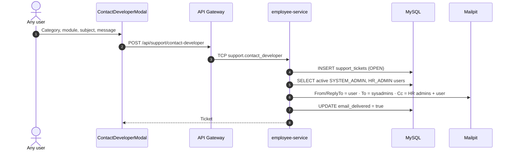

#### 4. Scope & limitations
- Spoofed `From` addresses work with Mailpit but would be rejected or flagged by real SMTP providers enforcing SPF/DKIM/DMARC; production would need `From` = system address with `Reply-To` = user.
- No threaded replies or ticket comments inside the app.
- `DEVELOPER_SUPPORT_EMAIL` in the environment is not used by the routing logic.

---

## 6. Data Architecture, ERD & Schema

Nine TypeORM entities (`libs/common/src/entities/`) are registered in `ALL_ENTITIES`. All primary keys are UUIDs except `system_settings` (string singleton `'DEFAULT'`). `DATETIME` columns become `TIMESTAMP` when `DB_TYPE=postgres`.

### 6.1 Entity-relationship diagram

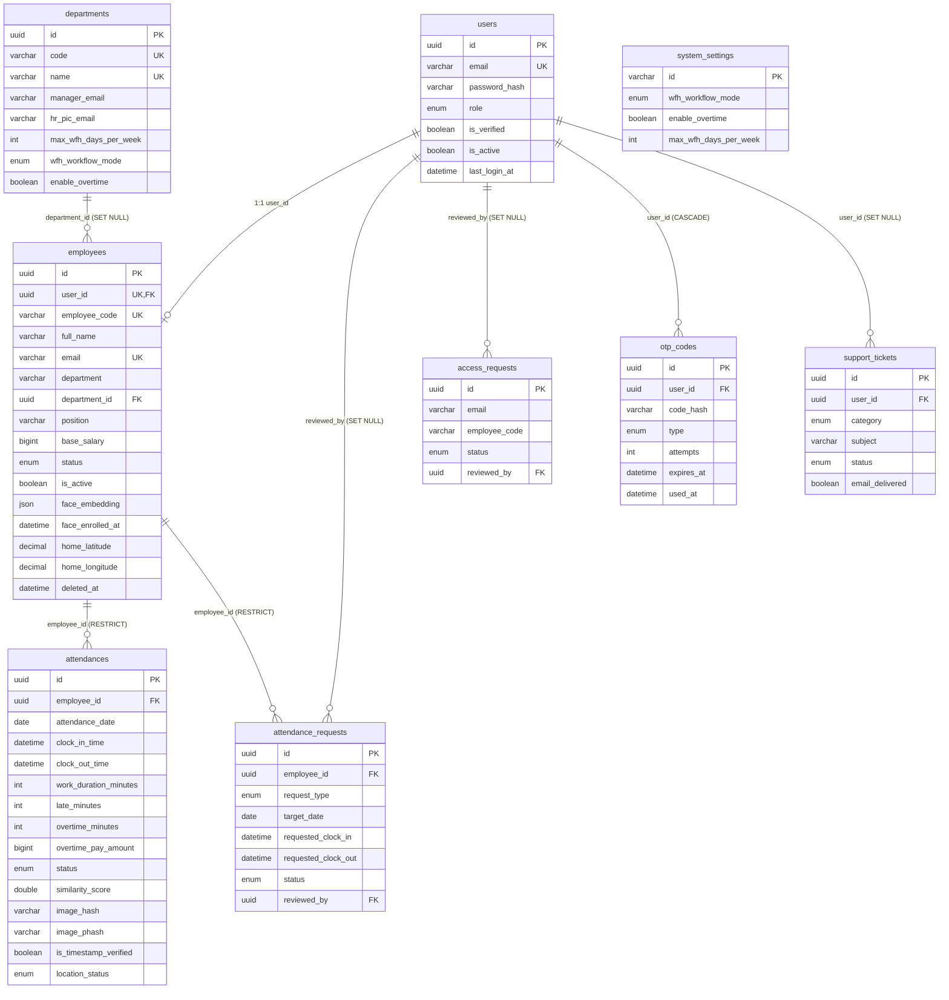

### 6.2 Table specifications

#### `users`
| Column | Type | Constraints / Default |
|---|---|---|
| `id` | uuid | PK |
| `email` | varchar(150) | **UNIQUE** `UQ_users_email` |
| `password_hash` | varchar(255) | bcrypt; `select: false` |
| `role` | enum `SYSTEM_ADMIN`, `HR_ADMIN`, `MANAGER`, `EMPLOYEE` | default `EMPLOYEE` |
| `is_verified` | boolean | default `false` |
| `is_active` | boolean | default `true` |
| `last_login_at` | datetime | nullable |
| `created_at`, `updated_at` | datetime | auto |

#### `employees`
| Column | Type | Constraints / Default |
|---|---|---|
| `id` | uuid | PK |
| `user_id` | uuid | **UNIQUE** `UQ_employees_user_id`, FK → `users.id` (RESTRICT) |
| `employee_code` (NIP) | varchar(50) | **UNIQUE** `UQ_employees_code`, required |
| `full_name` | varchar(150) | |
| `email` | varchar(150) | **UNIQUE** `UQ_employees_email` |
| `department` | varchar(100) | index `IDX_employees_department` |
| `department_id` | uuid | nullable FK → `departments.id` (SET NULL) |
| `position` | varchar(100) | |
| `base_salary` | bigint | default 12,000,000 |
| `phone_number` | varchar(30) | nullable |
| `join_date` | date | |
| `status` | enum `ACTIVE`, `INACTIVE`, `ON_LEAVE` | default `ACTIVE`; index |
| `is_active` | boolean | default `true` (soft-delete flag) |
| `avatar_url` | text | nullable |
| `face_embedding` | **json** | nullable; 512 floats |
| `face_enrolled_at` | datetime | nullable |
| `face_enrolled_photo_url` | text | nullable |
| `home_latitude` / `home_longitude` | decimal(10,8) / decimal(11,8) | nullable |
| `home_address` | text | nullable |
| `created_at`, `updated_at` | datetime | auto |
| `deleted_at` | datetime | nullable; TypeORM `@DeleteDateColumn` (soft delete) |

#### `departments`
| Column | Type | Constraints / Default |
|---|---|---|
| `id` | uuid | PK |
| `code` | varchar(30) | **UNIQUE** (e.g. `DEPT-IT`) |
| `name` | varchar(100) | **UNIQUE** |
| `manager_name`, `manager_email` | varchar(150) | approval routing |
| `hr_pic_email` | varchar(150) | default `admin.hrd@dexagroup.com` |
| `max_wfh_days_per_week` | int | default 1 |
| `wfh_workflow_mode` | enum `STRICT_APPROVAL`, `NOTICE_ONLY` | default `STRICT_APPROVAL` |
| `enable_overtime` | boolean | default `true` |
| `is_active` | boolean | default `true` |
| `created_at`, `updated_at` | datetime | auto |

Seeded departments: IT & Digital Innovation, HRD & People Operations, Finance & Accounting, Quality Assurance & R&D, Supply Chain & Logistics.

#### `attendances`
Indexes: **`UQ_attendance_employee_date` UNIQUE (`employee_id`, `attendance_date`)**, `IDX_attendance_date`, `IDX_attendance_status`, `IDX_attendances_phash` (`employee_id`, `image_phash`), `IDX_attendances_out_phash` (`employee_id`, `clock_out_image_phash`).

| Column | Type | Notes |
|---|---|---|
| `id` | uuid | PK |
| `employee_id` | uuid | FK → `employees.id` (RESTRICT) |
| `attendance_date` | date | WIB calendar date |
| `clock_in_time`, `clock_out_time` | datetime | **server-generated** |
| `work_duration_minutes` | int | nullable |
| `late_minutes` | int | default 0 |
| `overtime_minutes` | int | default 0 |
| `overtime_multiplier_hours` | double | default 0 |
| `overtime_pay_amount` | bigint | default 0 (IDR) |
| `wfh_approved` | boolean | default false |
| `clock_in_photo_url`, `clock_out_photo_url` | text | `/uploads/...` |
| `clock_in_photo_captured_at`, `clock_out_photo_captured_at` | datetime | EXIF/client capture time |
| `photo_capture_source`, `clock_out_capture_source` | enum `LIVE_WEBCAM`, `FILE_UPLOAD` | |
| `is_timestamp_verified` | boolean | default false |
| `is_clock_out_timestamp_verified` | boolean | nullable |
| `verification_method` | enum `LIVE_CAMERA_LIVENESS`, `MANUAL_FILE_UPLOAD` | |
| `verification_status` | enum `VERIFIED_LIVE_BIOMETRIC`, `MANUAL_FACE_MATCHED_PENDING_REVIEW`, `BIOMETRIC_FAILED`, `REJECTED_DUPLICATE_PHOTO`, `REJECTED_LIVENESS_FAILED` | only the first two are written |
| `liveness_score`, `liveness_challenge_type` | double / varchar(50) | |
| `similarity_score`, `clock_out_similarity_score` | double | cosine similarity |
| `is_face_matched`, `is_clock_out_face_matched` | boolean | |
| `image_hash`, `clock_out_image_hash` | varchar(64) | SHA-256 |
| `image_phash`, `clock_out_image_phash` | varchar(64) | 16-hex average hash |
| `exif_captured_at`, `exif_metadata` | datetime / json | defined; not currently populated |
| `fallback_reason`, `clock_out_fallback_reason` | text | defined; not currently populated |
| `latitude`, `longitude`, `address` | decimal / text | optional browser geolocation |
| `distance_from_home_meters` | int | Haversine |
| `location_status` | enum `IN_HOME_RADIUS`, `OUT_OF_HOME_RADIUS`, `LOCATION_UNAVAILABLE` | |
| `daily_plan` | text | Clock-In work plan |
| `daily_accomplishment` | text | Clock-Out summary |
| `status` | enum (§4.1) | |
| `hr_note` | text | set by request sync |
| `ip_address` | varchar(64) | |
| `device_info` | varchar(255) | user agent |
| `created_at`, `updated_at` | datetime | auto |

#### `attendance_requests`
Indexes: `IDX_att_req_employee_date` (`employee_id`, `target_date`), `IDX_att_req_status`.

| Column | Type | Notes |
|---|---|---|
| `id` | uuid | PK |
| `employee_id` | uuid | FK → `employees.id` (RESTRICT) |
| `request_type` | enum `WFH_APPROVAL`, `OVERTIME`, `LEAVE`, `SICK`, `CORRECTION` | |
| `target_date` | date | |
| `requested_clock_in`, `requested_clock_out` | datetime | correction only |
| `overtime_minutes` | int | overtime only |
| `estimated_overtime_pay` | bigint | IDR |
| `manager_email` | varchar(150) | resolved approver |
| `cc_emails` | varchar(300) | comma-separated |
| `email_dispatched` | boolean | default false |
| `reason` | text | ≥ 10 chars |
| `attachment_url` | text | nullable |
| `status` | enum `PENDING`, `APPROVED`, `REJECTED` | default `PENDING` |
| `reviewed_by` | uuid | FK → `users.id` (SET NULL) |
| `review_notes` | text | |
| `reviewed_at`, `created_at` | datetime | |

#### `access_requests`
`id` uuid PK; `full_name`; `email` (index with `status`: `IDX_access_req_email_status`); `employee_code` (nullable); `department`; `position`; `phone_number`; `reason`; `status` enum `PENDING/APPROVED/REJECTED`; `reviewed_by` FK → `users` (SET NULL); `review_notes`; `reviewed_at`; `created_at`.

#### `otp_codes`
`id` uuid PK; `user_id` FK → `users` (**CASCADE**); `email` (index with `type`: `IDX_otp_email_type`); `code_hash` (bcrypt — never plain text); `type` enum `ACCOUNT_VERIFICATION`, `FORGOT_PASSWORD`; `attempts` int; `expires_at`; `used_at`; `created_at`.

#### `support_tickets`
`id` uuid PK; `user_id` FK → `users` (SET NULL); `sender_email`; `sender_name`; `category` enum `BUG`, `ACCOUNT_ACCESS`, `ATTENDANCE_ISSUE`, `OTHER`; `module_location`; `subject` varchar(200); `message` text; `status` enum `OPEN`, `RESOLVED` (indexed); `email_delivered` boolean; `created_at`.

#### `system_settings` (singleton)
`id` varchar(50) PK (`'DEFAULT'`); `wfh_workflow_mode` enum (default `STRICT_APPROVAL`); `enable_overtime` boolean (default true); `max_wfh_days_per_week` int (default 1); `updated_by_email`; `created_at`; `updated_at`. Created lazily on first read. Updating it also bulk-updates the same fields on all `departments`, and the system setting takes precedence over department values.

---

## 7. REST API & TCP RPC Contract Reference

All gateway paths are prefixed with `/api`. "JWT" = `JwtAuthGuard`; role lists come from `@Roles(...)`. Remember that `SYSTEM_ADMIN` and `HR_ADMIN` pass every `@Roles` check (§2.3). All JSON responses use the envelope `{ statusCode, type, where, what, why, data, meta? }`.

### 7.1 Authentication & onboarding — `employee-service`

| Method | Gateway path | TCP pattern | Guard / Roles | Request | Response |
|---|---|---|---|---|---|
| POST | `/auth/login` | `auth.login` | Public | `LoginDto {email, password}` | 200 tokens + profile · 200 info `requiresVerification` · 401 · 403 |
| POST | `/auth/refresh` | `auth.refresh` | Public | `{refreshToken}` | 200 new token pair · 401 |
| GET | `/auth/me` | `auth.me` | JWT | — | 200 profile (incl. `isFaceEnrolled`) |
| PATCH | `/auth/change-password` | `auth.change_password` | JWT | `{currentPassword, newPassword}` | 200 · 400 |
| GET | `/auth/departments` | `employee.department_directory` | Public | — | 200 active departments |
| POST | `/auth/request-access` | `auth.request_access` | Public | `RequestAccessDto` | 200 PENDING · 409 |
| POST | `/auth/verify-account` | `auth.verify_account` | Public | `{email, otp(6), newPassword}` | 200 tokens · 400 · 429 |
| POST | `/auth/resend-verification` | `auth.resend_verification` | Public | `{email}` | 200 · 400 · 404 |
| POST | `/auth/forgot-password` | `auth.forgot_password` | Public | `{email}` | 200 · 404 |
| POST | `/auth/reset-password` | `auth.reset_password` | Public | `{email, otp, newPassword}` | 200 · 400 · 429 |

### 7.2 Employees, biometrics & access requests — `employee-service` (+ FastAPI)

| Method | Gateway path | TCP pattern / FastAPI | Guard / Roles | Request | Response |
|---|---|---|---|---|---|
| POST | `/employees/me/enroll-face` | FastAPI `POST /extract-embedding` → `employee.enroll_face` | JWT | multipart `photo` | 200 · 400 · 422 |
| GET | `/employees/departments` | `employee.departments` | JWT | — | 200 department names |
| GET | `/employees/department-directory` | `employee.department_directory` | JWT | — | 200 departments with routing emails |
| GET | `/employees` | `employee.find_all` | JWT, HR_ADMIN | `EmployeeQueryDto` (page, limit ≤ 100, search, department, status, role, includeInactive) | 200 paginated |
| GET | `/employees/:id` | `employee.find_one` | JWT, HR_ADMIN | — | 200 · 404 |
| POST | `/employees` | `employee.create` | JWT, HR_ADMIN | `CreateEmployeeDto` | 200 · 400 · 409 |
| PATCH | `/employees/:id` | `employee.update` | JWT, HR_ADMIN | `UpdateEmployeeDto` | 200 · 404 · 409 |
| DELETE | `/employees/:id` | `employee.soft_delete` | JWT, HR_ADMIN | — | 200 (soft) · 400 self · 404 |
| PATCH | `/employees/:id/restore` | `employee.restore` | JWT, HR_ADMIN | — | 200 · 404 |
| POST | `/employees/:id/resend-otp` | `employee.resend_verification` | JWT, HR_ADMIN | — | 200 · 400 · 404 |
| GET | `/access-requests` | `access_request.find_all` | JWT, HR_ADMIN | `?status` | 200 |
| PATCH | `/access-requests/:id/approve` | `access_request.approve` | JWT, HR_ADMIN | `{role?, joinDate?, reviewNotes?}` | 200 provisions account + OTP · 400 · 404 |
| PATCH | `/access-requests/:id/reject` | `access_request.reject` | JWT, HR_ADMIN | `{reviewNotes (≥5)}` | 200 · 400 · 404 |

### 7.3 Attendance — `attendance-service` (+ FastAPI)

| Method | Gateway path | TCP pattern / FastAPI | Guard / Roles | Request | Response |
|---|---|---|---|---|---|
| POST | `/attendances/verify-face-preview` | FastAPI `/extract-embedding` → `attendance.verify_face_preview` | JWT | multipart `photo` | 200 `{recognized, similarityScore, ...}` |
| POST | `/attendances/clock-in` | FastAPI `/extract-embedding` → `attendance.clock_in` | JWT (SYSTEM_ADMIN → 403) | multipart `photo` + `ClockInDto` | 200 · 400 · 403 · 409 · 422 |
| POST | `/attendances/clock-out` | FastAPI `/extract-embedding` → `attendance.clock_out` | JWT (SYSTEM_ADMIN → 403) | multipart `photo` + `ClockOutDto` (`dailyAccomplishment` ≥ 10) | 200 · 400 · 409 · 422 |
| GET | `/attendances/today` | `attendance.today` | JWT | — | 200 today record, schedule, `wfhQuota` |
| GET | `/attendances/my-history` | `attendance.my_history` | JWT | `?page&limit&startDate&endDate` | 200 items + stats |
| GET | `/attendances/my-dashboard` | `attendance.my_dashboard` | JWT | — | 200 KPIs, 14-day trend, distribution |
| GET | `/attendances/summary` | `attendance.summary` | JWT, HR_ADMIN / MANAGER / SYSTEM_ADMIN | `?date` | 200 metrics, department breakdown, 7-day trend |
| GET | `/attendances/export` | `attendance.export` | JWT, HR_ADMIN / MANAGER / SYSTEM_ADMIN | `ExportQueryDto` (`format=xlsx\|csv` + filters) | 200 binary file + `Content-Disposition`, `X-Export-Row-Count` |
| GET | `/attendances` | `attendance.find_all` | JWT, HR_ADMIN / MANAGER / SYSTEM_ADMIN | `AttendanceQueryDto` (dates, department, status, captureSource, verified, search, page, limit) | 200 paginated |
| GET | `/attendances/:id` | `attendance.find_one` | JWT | — | 200 · 404 |
| POST | `/attendance-requests` | `attendance_request.create` | JWT | multipart `attachment?` + `CreateAttendanceRequestDto` | 200 · 400 · 409 |
| GET | `/attendance-requests/my` | `attendance_request.my` | JWT | — | 200 |
| GET | `/attendance-requests` | `attendance_request.find_all` | JWT, HR_ADMIN / MANAGER / SYSTEM_ADMIN | `?status&requestType&search&page&limit` | 200 paginated |
| PATCH | `/attendance-requests/:id/review` | `attendance_request.review` | JWT, HR_ADMIN / MANAGER / SYSTEM_ADMIN | `{decision, reviewNotes?}` | 200 + `syncedAttendance` · 400 · 403 · 404 |

> [!NOTE]
> `GET /attendances/:id` has no role restriction or ownership check: any authenticated user who knows a record ID can read it.

### 7.4 System, policy, support & Database Studio

| Method | Gateway path | TCP pattern | Guard / Roles | Request | Response |
|---|---|---|---|---|---|
| GET | `/system/time` | — (gateway) | Public | — | 200 `{serverTimeIso, serverEpochMs, timezone, dateWib, timeWib, formattedWib, schedule}` |
| GET | `/system/health` | — (gateway) | Public | — | 200 `{status: 'OK', uptimeSeconds}` |
| GET | `/system/policy` | `attendance.get_policy` | Public | — | 200 `system_settings` |
| PATCH | `/system/policy` | `attendance.update_policy` | JWT, HR_ADMIN / SYSTEM_ADMIN | `UpdatePolicyDto {wfhWorkflowMode?, enableOvertime?, maxWfhDaysPerWeek? (1–5)}` | 200 · 403 |
| POST | `/support/contact-developer` | `support.contact_developer` | JWT | `ContactDeveloperDto` | 200 ticket |
| GET | `/support/tickets` | `support.find_tickets` | JWT | — | 200 (all for admins, own otherwise; max 50) |
| PATCH | `/support/tickets/:id/resolve` | `support.resolve` | JWT, HR_ADMIN | — | 200 · 404 |
| GET | `/system/database/tables` | `database.get_tables` | JWT, SYSTEM_ADMIN* | — | 200 table metadata + row counts |
| GET | `/system/database/:table` | `database.get_rows` | JWT, SYSTEM_ADMIN* | `?page&limit&search&sortBy&sortOrder` | 200 rows + meta · 400 |
| GET | `/system/database/:table/:id` | `database.get_row` | JWT, SYSTEM_ADMIN* | — | 200 · 404 |
| POST | `/system/database/:table` | `database.insert_row` | JWT, SYSTEM_ADMIN* | JSON row | 200 · 400 |
| PUT | `/system/database/:table/:id` | `database.update_row` | JWT, SYSTEM_ADMIN* | JSON fields | 200 · 400 · 404 |
| DELETE | `/system/database/:table/:id` | `database.delete_row` | JWT, SYSTEM_ADMIN* | — | 200 · 404 · 409 |

\* HR_ADMIN also passes (§2.3).

### 7.5 Biometric service (FastAPI, internal)

| Method | Path | Called by | Request | Response |
|---|---|---|---|---|
| GET | `/health` | Docker healthcheck | — | `{status: HEALTHY, model: insightface_buffalo_l, embedding_dimensions: 512}` |
| POST | `/extract-embedding` | `BiometricClientService.extractEmbedding` | multipart `file` | `{status, face_detected, face_count, embedding[512]?, bbox?, det_score?, image_hash, image_phash, message}` |
| POST | `/verify-face` | *not called* | multipart `file`, `reference_embedding` (JSON), `threshold` (0.45) | `{status, is_match, similarity, threshold, ...}` |

---

## 8. Non-Functional Requirements, Security & Limitations

### 8.1 Performance targets & behaviour

| Area | Target / behaviour | Basis |
|---|---|---|
| Biometric extraction | Target ≤ ~200 ms per frame on CPU with `det_size` 320×320 (not formally benchmarked in this repo). The gateway's HTTP timeout to FastAPI is 10 s. | `service.py`, `biometric-client.service.ts` |
| Similarity comparison | 512-element dot product — sub-millisecond. | `attendance.service.ts` |
| Gateway → microservice RPC | 15 s timeout per call; `502` on transport failure. | `rpc.util.ts` |
| Paginated queries | Max `limit` 100 (DTO), default per `resolvePagination`. | `PaginationQueryDto` |
| Export | ≤ 5,000 rows; in-memory buffer, base64 over TCP. | `export.service.ts` |
| Frontend API timeout | 20 s. | `client.ts` |
| Upload size | 8 MB per image/attachment (nginx allows 15 MB body). | `photo-metadata.util.ts`, `nginx.conf` |

### 8.2 Security safeguards (implemented)

| Safeguard | Implementation |
|---|---|
| SQL injection | All service queries use TypeORM repositories / `QueryBuilder` with bound parameters; Database Studio restricts table names to a whitelist and sort columns to entity metadata. |
| XSS | React escapes rendered values by default. (Email HTML templates interpolate user-supplied reasons without escaping — relevant only to mail clients.) |
| Password storage | bcrypt cost 10; `password_hash` excluded from default selects and masked in Database Studio. |
| OTP storage | bcrypt-hashed codes, 15-min expiry, 5-attempt lockout, previous codes invalidated on reissue. |
| JWT | HS256 signed access/refresh tokens with `tokenType` claim separation; separate secrets for access and refresh. |
| Input validation | Global `ValidationPipe` with `whitelist` + class-validator DTOs (regexes for NIP, phone, OTP, HH:mm, strong password). |
| Server-side time | Official timestamps generated with `new Date()` server-side. |
| Anti-replay of photos | SHA-256 exact and average-hash near-duplicate rejection per employee. |
| Biometric identity | ArcFace 1:1 match with threshold 0.45 on Clock-In and Clock-Out. |
| Separation of duties | SYSTEM_ADMIN blocked from attendance at gateway and UI. |
| Error hygiene | Structured `where/what/why` errors via global exception filters; no stack traces returned. |

### 8.3 Global system limitations & constraints

1. **Biometric lighting, occlusion and pose sensitivity.** ArcFace needs a clearly visible frontal face. Low light, strong backlighting, masks/heavy occlusion, or large head rotation can push similarity below 0.45 or cause `NO_FACE`. Mitigation: the watermarked file-upload fallback (marked `MANUAL_FACE_MATCHED_PENDING_REVIEW`), which still requires a face match.
2. **2D liveness only.** MediaPipe blink/turn challenges run in the browser and can be defeated by a sufficiently good video replay; the server trusts the client-reported score.
3. **Single-shift work paradigm.** Start time, grace, half-day threshold and the 540-minute overtime span assume one corporate shift (08:30–17:30 WIB). 24/7 or rotating shifts would need a `shift_templates` module.
4. **Local volume storage scalability.** Files live on local disk / a Docker bind mount (`./uploads`). Horizontal scaling across nodes would require an S3-compatible adapter (AWS S3, MinIO, GCS) and authenticated/signed URLs.
5. **Server clock vs. client latency.** Because official times are taken on request arrival, users on slow or throttled connections may see a few seconds' difference between pressing capture and the recorded time.
6. **In-memory aggregation.** Dashboards aggregate rows in Node.js; very large datasets would need SQL `GROUP BY` / materialised summaries.
7. **No background scheduler.** `MISSING_CLOCK_OUT` is applied lazily when data is read.
8. **Hard-coded hosts.** Email deep links point to `http://localhost:5173`.
9. **Default secrets and demo credentials.** Default JWT secrets, seeded passwords (`AdminDexa2026!`, `ManagerDexa2026!`, `EmployeeDexa2026!`) and a fixed demo OTP exist for evaluation convenience and must be changed for any real deployment.

---

## 9. Known Defects & Implementation Gaps (Audit Findings)

These issues were found while verifying this PRD against the source. They are listed so evaluators see the true state of the system; none are hidden behind the feature descriptions above.

| # | Severity | Finding | Location | Effect |
|---|---|---|---|---|
| D1 | High | `RolesGuard` always admits `HR_ADMIN` (and `SYSTEM_ADMIN`), and `ProtectedRoute` lets `HR_ADMIN` bypass `allowedRoles`. | `api-gateway/src/auth/roles.guard.ts`; `frontend/src/components/layout/ProtectedRoute.tsx` | `SYSTEM_ADMIN`-only Database Studio (API and page) is reachable by HR Admins. |
| D2 | High | Access-request review UI calls `PATCH /access-requests/:id/review`, but the gateway exposes only `/approve` and `/reject`. | `frontend/src/pages/hrd/MasterEmployeesPage.tsx`; `api-gateway/src/employee/employees.controller.ts` | Approving or rejecting onboarding requests from the UI returns 404. |
| D3 | Medium | When FastAPI returns `ERROR` (service down, decode failure), no embedding is forwarded, and Clock-In/Out store a default similarity of 0.92 with `is_face_matched = true`. | `attendance.service.ts` (default `similarityScore = 0.92`) | Biometric check fails open if the AI service is unavailable. |
| D4 | Medium | `hasExifTimestamp` is forced `true` whenever a client `photoCapturedAt` is supplied (`… \|\| true`). | `api-gateway/src/storage/photo-metadata.util.ts` | Uploaded photos without EXIF can pass timestamp verification using a client-supplied time. |
| D5 | Medium | Frontend sends a hard-coded `livenessScore` of 0.99 for all captures, including uploads; the face-preview step proceeds as "recognized" if the API call fails. | `frontend/src/components/custom/CameraPhotoUpload.tsx` | Server liveness gate (0.85) is not independently meaningful. |
| D6 | Medium | `LiveServerClock` reads `serverTimestampMs`, but `/api/system/time` returns `serverEpochMs`. | `LiveServerClock.tsx`; `system.controller.ts` | Clock offset never applies; the header clock and the burned-in watermark show **client** time. Official DB timestamps are unaffected. |
| D7 | Low | Environment variable names in `docker-compose.yml` / `.env.example` do not match what the code reads: `JWT_ACCESS_SECRET` vs. `JWT_SECRET`; `LATE_GRACE_MINUTES` vs. `WORK_GRACE_MINUTES`; `OTP_EXPIRES_MINUTES` is unused (15 min hard-coded). | `jwt-auth.guard.ts`, `auth.service.ts`, `attendance-rules.ts`, `otp.service.ts` | Configuration changes to those variables have no effect; the system runs on code defaults (consistent between services, so it works). |
| D8 | Low | Approval email failures are logged but still recorded as `email_dispatched = true`. | `attendance-requests.service.ts` | Dispatch flag can be inaccurate. |
| D9 | Low | Unverified-account login re-issues an OTP without checking the password; login reveals unregistered emails. | `auth.service.ts` | Enumeration and OTP-email flooding. |
| D10 | Low | `GET /attendances/:id` has no ownership or role check; `/uploads/*` is served without authentication. | `attendance.controller.ts`, `main.ts` | Any authenticated user (or anyone, for images) with an ID/URL can view another employee's record or photo. |
| D11 | Low | Storage folder/file names use the container's local time rather than WIB. | `photo-metadata.util.ts` | In UTC containers, names may be offset by 7 hours from WIB. |
| D12 | Info | `/verify-face` FastAPI endpoint and several attendance columns (`exif_metadata`, `exif_captured_at`, `fallback_reason`, `liveness_challenge_type`) are defined but unused. | — | Dead code / unpopulated columns. |

---

## 10. Deployment Scope & Local Evaluation Environment

### 10.1 No cloud production deployment

> [!IMPORTANT]
> **This project does NOT include a live cloud production deployment.** CI/CD to AWS, GCP, Azure, Vercel, DigitalOcean or similar is intentionally **not** performed. There is no public URL, no managed database, no CDN, and no production secret management.

### 10.2 Rationale
The system was architected and built strictly as a **Fullstack Technical Assessment and local engineering showcase**. The goal is to let evaluators run the complete multi-tier topology deterministically on one machine and inspect every layer — including captured emails and stored photo evidence — without external accounts or costs.

### 10.3 Local containerized architecture (`docker-compose.yml`)

| Container | Image / build | Host port(s) | Depends on (health) |
|---|---|---|---|
| `dexa-wfh-mysql` | `mysql:8.0` | 3306 | — |
| `dexa-wfh-mailpit` | `axllent/mailpit:latest` | 1025 (SMTP), 8025 (inbox UI) | — |
| `dexa-wfh-biometric-service` | `./biometric-service` (Python 3.10-slim) | 8000 | — (mounts host `~/.insightface` read-only) |
| `dexa-wfh-employee-service` | `./backend` (Node 22-alpine) → `dist/apps/employee-service/main.js` | 3001 | mysql, mailpit, biometric |
| `dexa-wfh-attendance-service` | `./backend` → `dist/apps/attendance-service/main.js` | 3002 | mysql, mailpit, employee-service, biometric |
| `dexa-wfh-api-gateway` | `./backend` → `dist/apps/api-gateway/main.js` | 3000 | employee, attendance, biometric (mounts `./uploads`) |
| `dexa-wfh-frontend` | `./frontend` (Vite build → nginx 1.27-alpine) | 5173 → 80 | api-gateway |

Every backend container has a TCP or HTTP health check; start order is enforced through `depends_on: condition: service_healthy`. MySQL data persists in the named volume `dexa_mysql_data`; evidence files persist in the host `./uploads` directory.

### 10.4 Evaluation entry points

| What | URL |
|---|---|
| Web application | `http://localhost:5173` |
| API base | `http://localhost:3000/api` |
| Swagger / OpenAPI | `http://localhost:3000/api/docs` |
| Captured emails (OTP, approvals, support) | `http://localhost:8025` |
| Biometric health | `http://localhost:8000/health` |

### 10.5 Seeded evaluation accounts

All demonstration accounts use standardized anonymous personas to protect privacy and prevent identity disputes, with the exception of the candidate author (`Abdurrahman Khairi` as `SYSTEM_ADMIN`):

| Role | Person / Title | Email | Default Password |
|---|---|---|---|
| `SYSTEM_ADMIN` | Abdurrahman Khairi (Lead System Administrator) | `sysadmin@dexagroup.com` | `AdminDexa2026!` |
| `HR_ADMIN` | HR Admin One (Head of People & Culture) | `admin.hrd@dexagroup.com` | `AdminDexa2026!` |
| `MANAGER (IT)` | Manager One (IT & Digital Innovation Manager) | `manager.it@dexagroup.com` | `ManagerDexa2026!` |
| `MANAGER (Finance)` | Manager Two (Finance & Accounting Manager) | `manager.finance@dexagroup.com` | `ManagerDexa2026!` |
| `EMPLOYEE (Primary)` | Employee One (Senior Fullstack Engineer) | `employee.one@dexagroup.com` | `EmployeeDexa2026!` |
| `EMPLOYEE` | Employee Two (Corporate Financial Analyst) | `employee.two@dexagroup.com` | `EmployeeDexa2026!` |
| `EMPLOYEE` | Employee Three (Pharmaceutical QA Specialist) | `employee.three@dexagroup.com` | `EmployeeDexa2026!` |
| `EMPLOYEE (Unverified)` | Employee Four (UI/UX Product Designer) | `employee.four@dexagroup.com` | Set during verification — demonstrates the first-login 6-digit OTP flow with fixed code `123456` |
| `EMPLOYEE` | Employee Five (Fullstack Developer) | `employee.five@dexagroup.com` | `EmployeeDexa2026!` |

> [!NOTE]
> The InsightFace `buffalo_l` model weights must be present in the host user's `~/.insightface` directory before `docker compose up`, because the biometric container mounts that folder read-only rather than downloading models at runtime.

---

<p align="center"><sub>© 2026 Abdurrahman Khairi - Created strictly for Technical Assessment evaluation. Unauthorized commercial use is prohibited</sub></p>
