# System Documentation Directory
## WFH Attendance & Employee Monitoring System — Dexa Group Fullstack Technical Assessment
**Author:** Abdurrahman Khairi | **License:** Proprietary — All Rights Reserved ([LICENSE](../../LICENSE))  
**Copyright:** © 2026 Abdurrahman Khairi. Unauthorized commercial use, modification, or distribution is prohibited.

---

## 1. Documentation Index & Navigation Guide

Welcome to the comprehensive, technical documentation for the **Dexa Group WFH Attendance & Employee Monitoring System**. This folder contains detailed architectural blueprints, entity-relationship diagrams, use case interaction matrices, end-to-end feature flowcharts, and product requirements.

| Document | File Link | Description & Key Contents |
| :--- | :--- | :--- |
| **Product Requirements Document (PRD)** | [PRD.md](./PRD.md) | Master requirements, technical objectives, 12 feature specifications, REST API reference, and non-functional requirements. |
| **System Architecture & Topology** | [system-architecture.md](./system-architecture.md) | Distributed microservices topology diagram in Mermaid, container network mappings, protocols, and SOLID design patterns. |
| **UML Use Case Diagrams** | [use-case-diagram.md](./use-case-diagram.md) | UML actor hierarchy, complete Mermaid use case diagrams for 4 roles (`EMPLOYEE`, `MANAGER`, `HR_ADMIN`, `SYSTEM_ADMIN`), and RBAC matrix. |
| **Entity-Relationship Diagram (ERD)** | [database-erd.md](./database-erd.md) | Comprehensive Mermaid ERD, table data dictionaries for 9 MySQL tables, column types, foreign keys, and indexes. |
| **End-to-End Feature Flows** | [feature-flows.md](./feature-flows.md) | 11 detailed Mermaid flowcharts and sequence diagrams covering every feature workflow from authentication to payroll export. |

---

## 2. System Technology Stack Summary

```mermaid
flowchart LR
    subgraph Frontend["Frontend Tier"]
        React["React 18 SPA"]
        Vite["Vite Bundler"]
        TS["TypeScript"]
        Tailwind["Tailwind CSS"]
        Lucide["Lucide Icons"]
    end

    subgraph Backend["Backend Microservices Tier"]
        NestGateway["NestJS API Gateway (:3000)"]
        NestEmp["NestJS Employee Service (:3001)"]
        NestAtt["NestJS Attendance Service (:3002)"]
        FastApi["FastAPI ArcFace Biometric Service (:8000)"]
    end

    subgraph Infrastructure["Data & Infrastructure Tier"]
        MySQL[("MySQL 8.0 InnoDB (:3306)")]
        Mailpit["Mailpit SMTP Testing (:1025 / :8025)"]
        Docker["Docker & Docker Compose Orchestration"]
        Nginx["Nginx Reverse Proxy & Static Host"]
    end

    Frontend --> Backend
    Backend --> Infrastructure
```



---

## 3. Quick Local Development & Inspection

1. **Clone & Environment Setup:**
   Ensure Docker Desktop is running on your machine.
2. **Start All 7 Services:**
   ```bash
   docker compose up -d
   ```
3. **Access Endpoints:**
   - **Frontend Web Portal:** `http://localhost:5173`
   - **API Gateway & Swagger UI:** `http://localhost:3000/api/docs`
   - **AI Biometric Service Docs:** `http://localhost:8000/docs`
   - **Mailpit Webmail Client:** `http://localhost:8025`
   - **MySQL Database Port:** `localhost:3306` (`user: root`, `db: dexa_wfh_db`)

---

> **© 2026 Abdurrahman Khairi - Created strictly for Technical Assessment evaluation. Unauthorized commercial use is prohibited**
