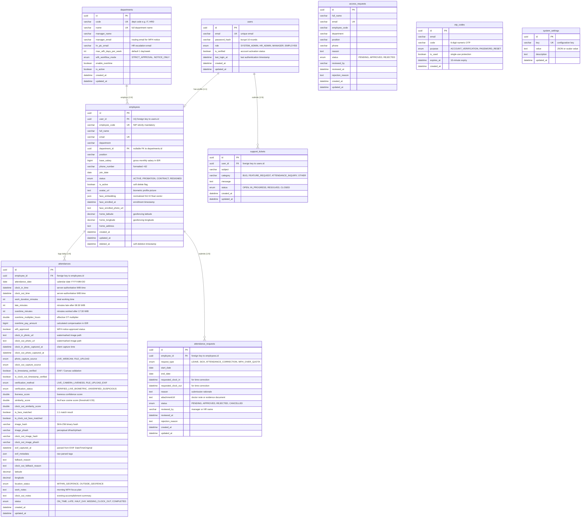

# Entity-Relationship Diagram (ERD) & Database Specifications
## WFH Attendance & Employee Monitoring System — Dexa Group Fullstack Technical Assessment
**Author:** Abdurrahman Khairi | **License:** Proprietary — All Rights Reserved ([LICENSE](../../LICENSE))  
**Copyright:** © 2026 Abdurrahman Khairi. Unauthorized commercial use, modification, or distribution is prohibited.

---

## 1. Complete Entity-Relationship Diagram (ERD)

---

## 2. Table Specifications & Column Dictionaries

### 2.1. `users` Table
Stores authenticated user accounts and credentials.

| Column Name | SQL Type | Constraints | Description |
| :--- | :--- | :--- | :--- |
| `id` | `VARCHAR(36)` (UUID) | Primary Key | Universally unique user identifier |
| `email` | `VARCHAR(150)` | UNIQUE, NOT NULL | Corporate email address used for login |
| `password_hash`| `VARCHAR(255)` | NOT NULL | Password hash generated via bcrypt (salt 10) |
| `role` | `ENUM` | NOT NULL, DEFAULT `'EMPLOYEE'` | `SYSTEM_ADMIN`, `HR_ADMIN`, `MANAGER`, `EMPLOYEE` |
| `is_verified` | `BOOLEAN` | NOT NULL, DEFAULT `false` | True once email OTP verification succeeds |
| `last_login_at`| `DATETIME` | NULL | Timestamp of the most recent authentication session |
| `created_at` | `DATETIME` | NOT NULL | Record creation timestamp |
| `updated_at` | `DATETIME` | NOT NULL | Last record modification timestamp |

### 2.2. `employees` Table
Master employee profiles with soft-delete capability and biometric enrollment fields.

| Column Name | SQL Type | Constraints | Description |
| :--- | :--- | :--- | :--- |
| `id` | `VARCHAR(36)` (UUID) | Primary Key | Unique employee identifier |
| `user_id` | `VARCHAR(36)` (UUID) | UNIQUE, NOT NULL, FK `users.id` | One-to-one relationship to `users` |
| `employee_code`| `VARCHAR(50)` | UNIQUE, NOT NULL | Official company NIP (strictly mandatory) |
| `full_name` | `VARCHAR(150)` | NOT NULL | Employee full legal name with degrees |
| `email` | `VARCHAR(150)` | UNIQUE, NOT NULL | Synchronized with `users.email` |
| `department` | `VARCHAR(100)` | NOT NULL, INDEX | Department name slug or string |
| `department_id`| `VARCHAR(36)` (UUID) | NULL, FK `departments.id` | Foreign key reference to department entity |
| `position` | `VARCHAR(100)` | NOT NULL | Official corporate job title |
| `base_salary` | `BIGINT` | NOT NULL, DEFAULT `12000000` | Base salary in IDR used for overtime calculation |
| `phone_number` | `VARCHAR(30)` | NULL | Contact phone number (defaults to `+62`) |
| `join_date` | `DATE` | NOT NULL | Employee start date |
| `status` | `ENUM` | NOT NULL, DEFAULT `'ACTIVE'` | `ACTIVE`, `PROBATION`, `CONTRACT`, `RESIGNED` |
| `is_active` | `BOOLEAN` | NOT NULL, DEFAULT `true` | Soft delete indicator |
| `avatar_url` | `TEXT` | NULL | Static URL path to enrolled face photo |
| `face_embedding`| `JSON` | NULL | 512-dimensional normalized float array from ArcFace |
| `face_enrolled_at`| `DATETIME` | NULL | Timestamp when biometric enrollment was completed |
| `home_latitude`| `DECIMAL(10,8)`| NULL | Geofencing latitude coordinate |
| `home_longitude`| `DECIMAL(11,8)`| NULL | Geofencing longitude coordinate |
| `deleted_at` | `DATETIME` | NULL | Soft deletion date; non-null indicates deleted employee |

### 2.3. `attendances` Table
Core transactional table recording daily WFH sessions, biometric scores, and overtime calculations.

| Column Name | SQL Type | Constraints | Description |
| :--- | :--- | :--- | :--- |
| `id` | `VARCHAR(36)` (UUID) | Primary Key | Unique attendance session identifier |
| `employee_id` | `VARCHAR(36)` (UUID) | NOT NULL, FK `employees.id` | Target employee foreign key |
| `attendance_date`| `DATE` | NOT NULL, INDEX | Calendar date in `YYYY-MM-DD` |
| `clock_in_time` | `DATETIME` | NULL | Authoritative server timestamp at Clock-In |
| `clock_out_time`| `DATETIME` | NULL | Authoritative server timestamp at Clock-Out |
| `work_duration_minutes` | `INT` | NULL | Total minutes elapsed minus lunch break (60m) |
| `late_minutes` | `INT` | NOT NULL, DEFAULT `0` | Minutes after 08:30 WIB target threshold |
| `overtime_minutes`| `INT` | NOT NULL, DEFAULT `0` | Minutes worked after 17:30 WIB shift end |
| `overtime_multiplier_hours` | `DOUBLE` | DEFAULT `0` | Computed overtime multiplier (1.5x first hr, 2.0x after) |
| `overtime_pay_amount` | `BIGINT` | DEFAULT `0` | IDR overtime compensation ($HourlyRate \times Multiplier$) |
| `clock_in_photo_url` | `TEXT` | NULL | File path in hierarchical storage |
| `clock_out_photo_url` | `TEXT` | NULL | File path in hierarchical storage |
| `similarity_score` | `DOUBLE` | NULL | Cosine similarity score against enrolled template ($\ge 0.55$) |
| `is_face_matched` | `BOOLEAN` | NOT NULL, DEFAULT `false` | True if facial cosine similarity meets threshold |
| `status` | `ENUM` | NOT NULL, INDEX | `ON_TIME`, `LATE`, `HALF_DAY`, `MISSING_CLOCK_OUT`, `COMPLETED` |
| `work_notes` | `TEXT` | NULL | Morning daily work plan submitted during Clock-In |
| `clock_out_notes`| `TEXT` | NULL | Evening accomplishment notes submitted during Clock-Out |

---

## 3. Database Indexes & Query Optimizations

1. **Unique Attendance Index (`UQ_attendance_employee_date`):**
   `UNIQUE INDEX (employee_id, attendance_date)` ensures that an employee can record at most **one attendance session per calendar day**, preventing race-condition duplicate Clock-Ins.
2. **Department Filter Index (`IDX_employees_department` & `IDX_attendance_date`):**
   Powers high-speed aggregations in the HRD Monitoring Dashboard (`SELECT COUNT(*), status FROM attendances WHERE attendance_date = ? GROUP BY status`).
3. **Perceptual Image Hashing Index (`IDX_attendances_phash`):**
   Indexes perceptual hash fingerprints (`image_phash`) to detect fraudulent photo reuse within sub-millisecond query time.

---

> **© 2026 Abdurrahman Khairi - Created strictly for Technical Assessment evaluation. Unauthorized commercial use is prohibited**
