# End-to-End Feature Flows in Mermaid
## WFH Attendance & Employee Monitoring System — Dexa Group Fullstack Technical Assessment
**Author:** Abdurrahman Khairi | **License:** Proprietary — All Rights Reserved ([LICENSE](../../LICENSE))  
**Copyright:** © 2026 Abdurrahman Khairi. Unauthorized commercial use, modification, or distribution is prohibited.

---

## Flow 1: Authentication, Role-Based Access Control & Email OTP

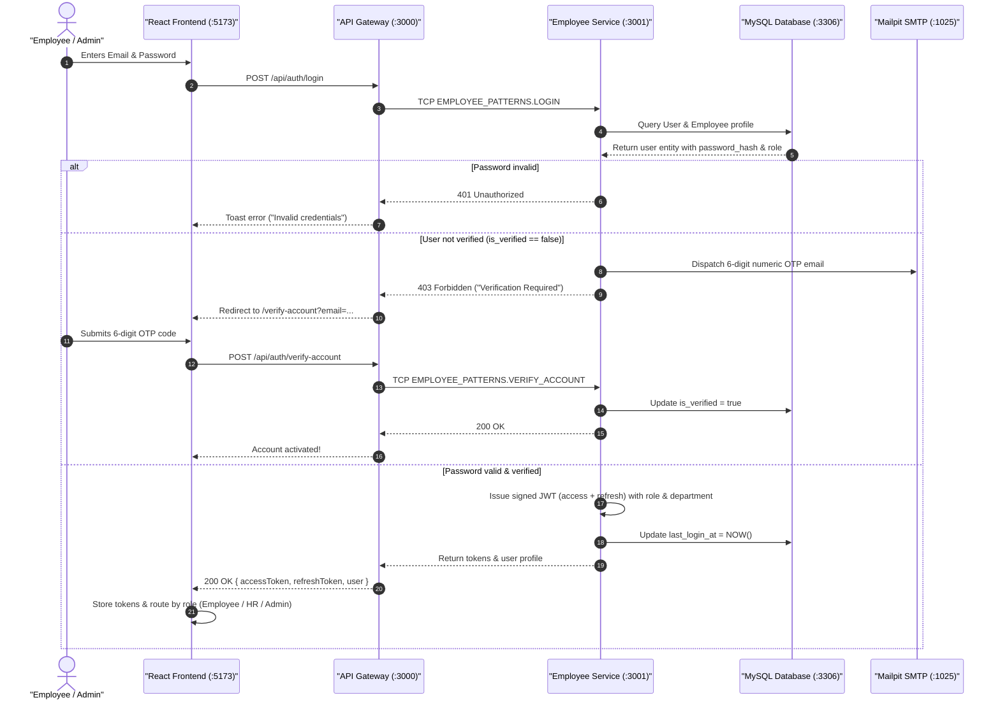

---

## Flow 2: Biometric Face Setup & 512-D ArcFace Enrollment

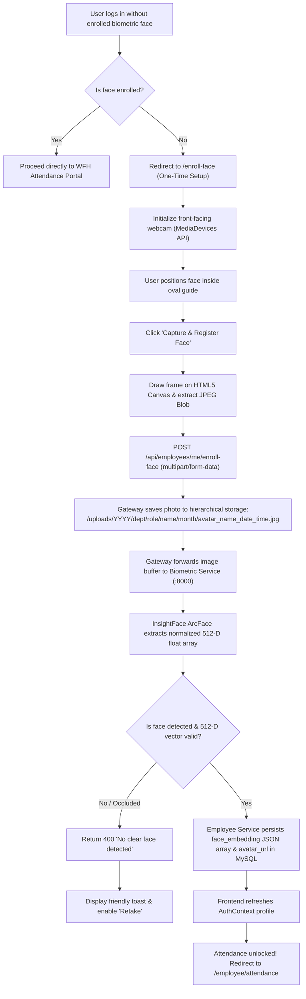

---

## Flow 3: Daily WFH Notice, Upward Escalation & Biometric Clock-In

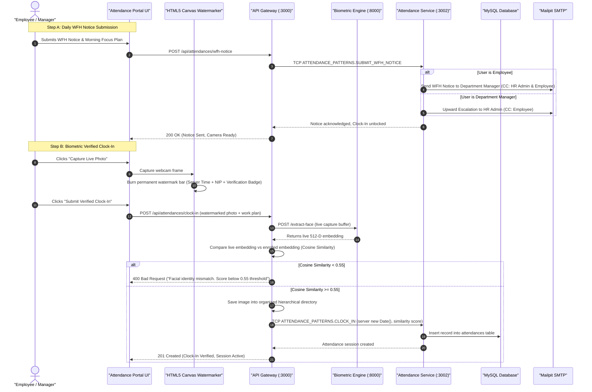

---

## Flow 4: Daily Clock-Out & Accomplishment Summary

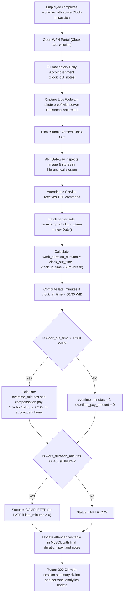

---

## Flow 5: Leave, Sick & Attendance Correction Workflow with Direct Deep Links

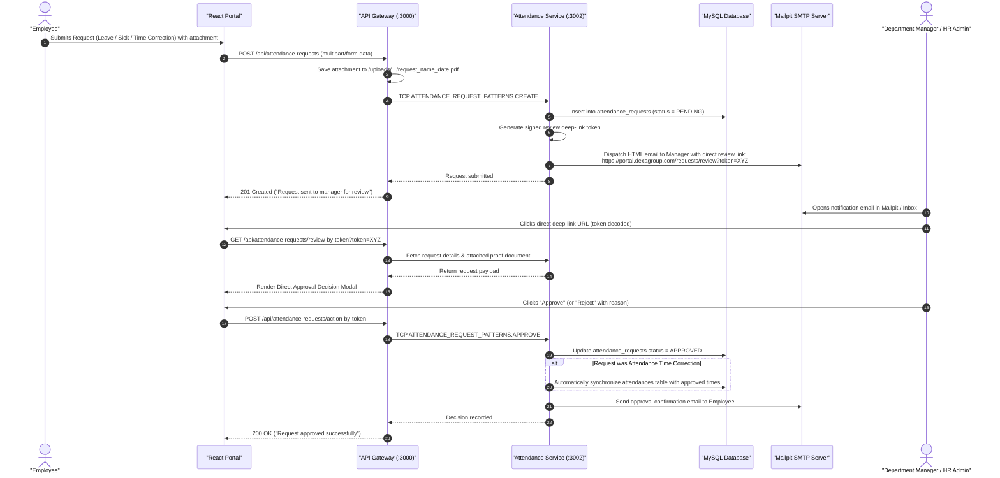

---

## Flow 6: Master Employee Management (CRUD & Soft Delete)

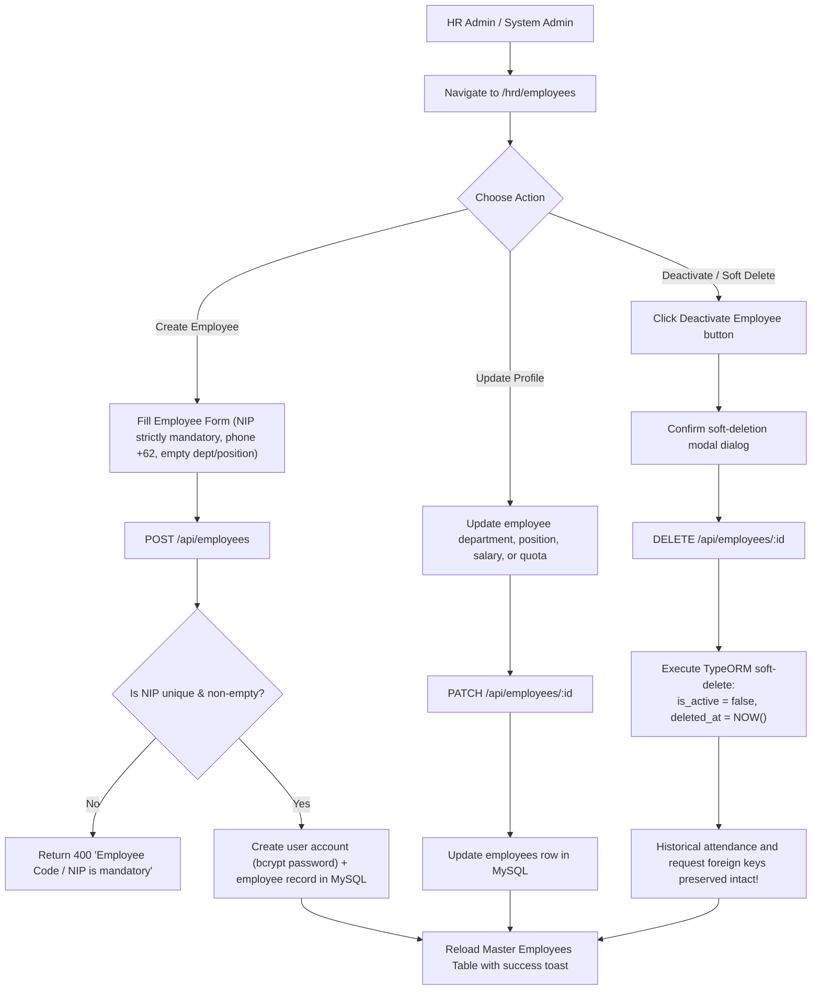

---

## Flow 7: Real-Time Attendance Monitoring & Lightbox Inspection

```mermaid
sequenceDiagram
    autonumber
    actor HR as "HR Admin / System Admin"
    participant UI as "HRD Real-Time Dashboard"
    participant Gateway as "API Gateway (:3000)"
    participant AttSvc as "Attendance Service (:3002)"
    participant DB as "MySQL Database"
    participant Lightbox as "Photo Lightbox Modal"

    HR->>UI: Opens /hrd/attendance-audit
    UI->>Gateway: GET /api/attendances/audit-log?date=YYYY-MM-DD&department=...
    Gateway->>AttSvc: TCP ATTENDANCE_PATTERNS.GET_AUDIT_LOG
    AttSvc->>DB: SQL JOIN attendances + employees + departments
    DB-->>AttSvc: Paginated session records + KPI aggregations
    AttSvc-->>Gateway: Return records
    Gateway-->>UI: Render Interactive Data Table & KPI Metric Cards

    HR->>UI: Clicks on Clock-In / Clock-Out thumbnail photo
    UI->>Lightbox: Open full-resolution photo proof
    Lightbox->>Lightbox: Inspect Canvas Watermark bar (server WIB time + NIP)
    Lightbox->>Lightbox: Check EXIF verification badge & similarity score (e.g. 0.94)
    Lightbox-->>HR: Display verified authenticity breakdown
```

---

## Flow 8: Payroll Calculation & Multi-Format Data Export

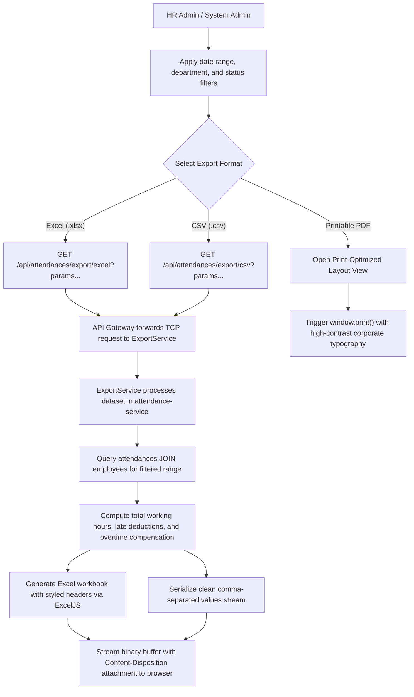

---

## Flow 9: Hierarchical File Storage & EXIF Verification

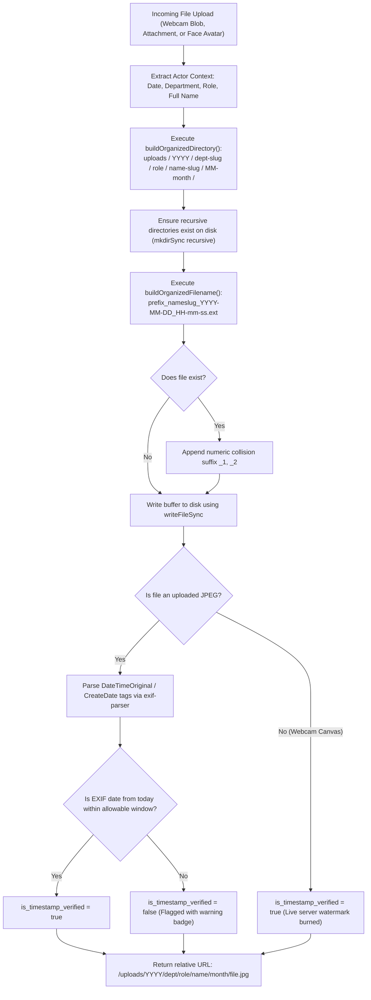

---

## Flow 10: Relational Database Management Studio (System Admin)

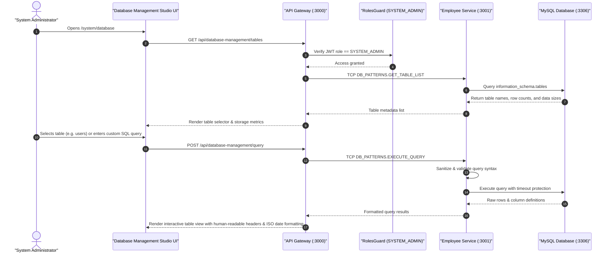

---

## Flow 11: Developer Support & Ticket Routing (SMTP)

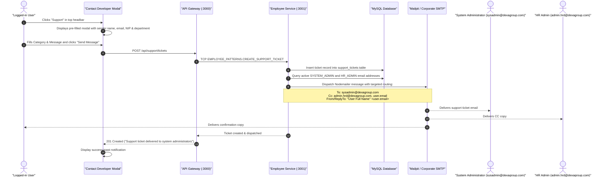

---

> **© 2026 Abdurrahman Khairi - Created strictly for Technical Assessment evaluation. Unauthorized commercial use is prohibited**
