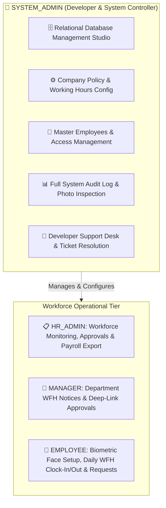
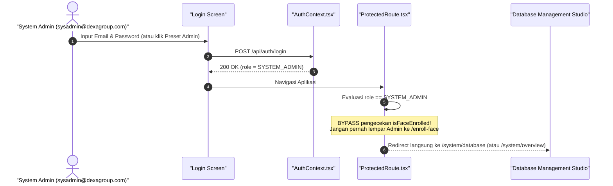

# Implementation Plan: Dedicated System Admin & Developer Console
## Architectural Separation of Duties (SoD) & Role Boundary Refinement
**Author:** Abdurrahman Khairi | **License:** Proprietary — All Rights Reserved ([LICENSE](../../LICENSE))  
**Copyright:** © 2026 Abdurrahman Khairi. Unauthorized commercial use, modification, or distribution is prohibited.

---

## 1. Executive Evaluation: "Apakah Lebih Baik Seperti Ini?"

**Jawaban:** **Sangat Jauh Lebih Baik (100% Industry Best Practice).**

Dalam standar arsitektur perangkat lunak enterprise dan tata kelola keamanan informasi (**ISO 27001**, **SOC 2 Type II**, dan prinsip **Separation of Duties / SoD**):
1. **Akun System Administrator / Developer** adalah akun pengendali infrastruktur, konfigurasi sistem, database relasional, dan resolusi tiket teknis (*Technical Superuser*).
2. **Akun Karyawan / Manager** adalah entitas operasional tenaga kerja (*Workforce Entity*) yang terikat kontrak kerja, target jam kantor, kuota WFH mingguan, geofencing koordinat rumah, dan kewajiban presensi biometrik harian.

### Mengapa Menggabungkan System Admin dengan Presensi Adalah "Anti-Pattern"?
| Masalah pada Sistem Saat Ini | Dampak Negatif | Solusi dengan Pemisahan SoD |
| :--- | :--- | :--- |
| **Terjebak Wajib Setup Biometrik Wajah** | Saat System Admin login untuk mengontrol database, sistem memaksanya masuk ke kamera `/enroll-face` seolah-olah dia staf WFH. | System Admin **bebas dari kewajiban biometrik wajah**; langsung diarahkan ke Developer/Database Console. |
| **Pencemaran Data Kehadiran & Payroll** | Jika System Admin melakukan presensi / request izin, data testing tersebut masuk ke rekap HRD, merusak rata-rata durasi kerja (KPI), dan mengotori slip ekspor payroll. | Data tabel presensi (`attendances`) **murni 100% berisi karyawan operasional**. |
| **Kekacauan Navigasi Sidebar** | Menampilkan menu *"Clock-In / Out"*, *"My Analytics"*, dan *"My Attendance & Leave"* pada layar administrator membuat UI terlihat tidak fokus dan membingungkan. | Sidebar System Admin **bersih & fokus**: Database Studio, Master Karyawan, Konfigurasi Kebijakan Sistem, Audit Log, dan Meja Bantuan Support. |
| **Kebijakan Testing yang Benar** | Developer sering kali melakukan presensi menggunakan akun admin utama. | Testing alur presensi dilakukan menggunakan **Dedicated Test Accounts** (`budi.santoso@dexagroup.com` untuk Employee, `dr.rina.kusuma@dexagroup.com` untuk HR). |

---

## 2. Rekomendasi Matriks Peran & Tanggung Jawab (4-Role Matrix)

### Rincian Pembagian Hak Akses:

| Fitur / Modul Aplikasi | `SYSTEM_ADMIN` (Developer) | `HR_ADMIN` (People Ops) | `MANAGER` (Dept Lead) | `EMPLOYEE` (Staff) |
| :--- | :---: | :---: | :---: | :---: |
| **Database Management Studio (Raw SQL / Tables)** | ✅ **Penuh** | ❌ Dilarang | ❌ Dilarang | ❌ Dilarang |
| **Company Policy & Shift Configuration** | ✅ **Penuh** | ❌ Hanya Baca | ❌ Hanya Baca | ❌ Hanya Baca |
| **Master Employee CRUD & Soft Delete** | ✅ **Penuh** | ✅ **Penuh** | ❌ Dilarang | ❌ Dilarang |
| **Organization-Wide Audit Log & Lightbox** | ✅ **Penuh** | ✅ **Penuh** | ❌ Hanya Dept | ❌ Dilarang |
| **Payroll Data Export (Excel/CSV/PDF)** | ✅ **Penuh** | ✅ **Penuh** | ❌ Dilarang | ❌ Dilarang |
| **Bypass Biometric Face Setup (`/enroll-face`)** | ✅ **Otomatis Bypass** | ❌ Wajib | ❌ Wajib | ❌ Wajib |
| **Self-Service Clock-In / Clock-Out** | ❌ **Non-Aktif** | ❌ Non-Aktif | ✅ Aktif | ✅ Aktif |
| **Daily WFH Notice & Plan Submission** | ❌ **Non-Aktif** | ❌ Non-Aktif | ✅ Aktif | ✅ Aktif |
| **Leave & Attendance Correction Request** | ❌ **Non-Aktif** | ❌ Non-Aktif | ✅ Aktif | ✅ Aktif |
| **Support Desk (Inbox Tiket Bantuan)** | ✅ **Menerima & Review** | ✅ CC Email | ❌ Mengirim | ❌ Mengirim |

---

## 3. Rekomendasi Flow Navigasi & Pengalaman Pengguna (UX)

### A. Flow Login & Redirect untuk `SYSTEM_ADMIN`

### B. Tampilan Sidebar & Headbar Khusus `SYSTEM_ADMIN`
- **Sidebar Kiri (Window Sidebar):**
  - **Seksi 1 (System & Infrastructure):**
    - `Database Studio` (`/system/database`)
    - `Company Policy & Shifts` (`/system/policy`)
  - **Seksi 2 (HR & Organization Administration):**
    - `Master Employees` (`/hrd/employees`)
    - `Attendance Audit & Lightbox` (`/hrd/attendance-audit`)
    - `Payroll Data Export` (`/hrd/attendance-audit`)
  - **Seksi 3 (Support Desk):**
    - `Developer Support Tickets` (`/system/support-desk`)
  - **Dihapus Total dari Sidebar System Admin:**
    - ❌ *My Analytics*
    - ❌ *Clock-In / Out*
    - ❌ *My Attendance & Leave*
- **Top Headbar:**
  - Badge role: `SYSTEM_ADMIN (Infrastructure)`.
  - Tombol **Support** di headbar untuk System Admin berubah fungsi menjadi **Support Desk Inbox** (meninjau tiket bantuan dari karyawan) bukan mengirim email ke diri sendiri.

---

## 4. Rencana Implementasi Bertahap (Step-by-Step Implementation)

### Tahap 1: Backend Guard & Rule Segregation
1. **Bypass Biometrik di API Gateway:**
   - Pada `jwt-auth.guard.ts`: Bila `user.role === UserRole.SYSTEM_ADMIN`, bypass validasi `isFaceEnrolled`.
2. **Proteksi Endpoint Presensi Operasional:**
   - Pada `attendance.controller.ts`: Endpoint `POST /clock-in`, `POST /clock-out`, dan `POST /wfh-notice` memblokir `SYSTEM_ADMIN` dengan respon ramah:
     `403 Forbidden: "System Administrator accounts are reserved for platform administration and data management. Please use an Employee or Manager account to record operational attendance."`

### Tahap 2: Frontend Route Protection & Redirect Logic
1. **`ProtectedRoute.tsx`:**
   - Bila `user.role === 'SYSTEM_ADMIN'`, lewati cek `isFaceEnrolled` sehingga tidak pernah diarahkan ke `/enroll-face`.
2. **`LoginPage.tsx`:**
   - Bila `user.role === 'SYSTEM_ADMIN'`, redirect otomatis langsung ke `/system/database`.

### Tahap 3: Pemisahan Menu Sidebar (`AppLayout.tsx`)
1. Jika `user.role === 'SYSTEM_ADMIN'`, sembunyikan seluruh grup menu operasional karyawan (**Employee Self-Service**).
2. Jika System Admin membuka URL `/employee/attendance` secara manual, redirect ke `/system/database`.

---

> **© 2026 Abdurrahman Khairi - Created strictly for Technical Assessment evaluation. Unauthorized commercial use is prohibited**
