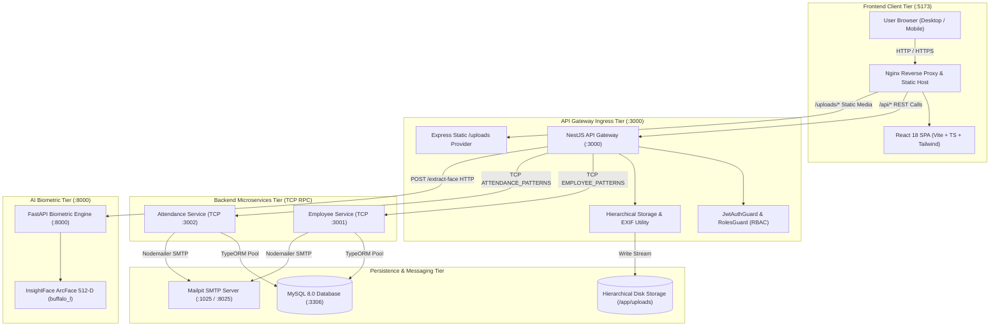

# System Architecture & Microservices Topology
## WFH Attendance & Employee Monitoring System — Dexa Group Fullstack Technical Assessment
**Author:** Abdurrahman Khairi | **License:** Proprietary — All Rights Reserved ([LICENSE](../../LICENSE))  
**Copyright:** © 2026 Abdurrahman Khairi. Unauthorized commercial use, modification, or distribution is prohibited.

---

## 1. High-Level Architectural Overview

The **WFH Attendance & Employee Monitoring System** is engineered as a production-grade, distributed microservices monorepo designed for enterprise workforce monitoring, AI-powered biometric facial verification, and real-time attendance compliance.

The platform cleanly separates responsibilities across **4 distinct service tiers**:
1. **Frontend Presentation Tier:** React 18 SPA (Vite + TypeScript + Tailwind CSS) running in Nginx reverse-proxy on port `5173`.
2. **API Gateway & Ingress Tier:** NestJS HTTP Ingress Gateway on port `3000` handling authentication, rate-limiting, EXIF inspection, hierarchical file storage, Swagger OpenAPI, and client request orchestration.
3. **Internal Microservices Tier:** Distributed NestJS TCP services isolating domain logic:
   - `employee-service` (TCP `:3001`): User authentication, RBAC, employee profiles, department routing, and database management.
   - `attendance-service` (TCP `:3002`): WFH attendance sessions, daily work logs, overtime formulas, leave/correction requests, and payroll exports.
4. **AI Biometrics & Infrastructure Tier:**
   - `biometric-service` (FastAPI / Python `:8000`): InsightFace ArcFace (`buffalo_l` ResNet-50) 512-dimensional vector embedding extraction and cosine similarity comparison.
   - `dexa-wfh-mysql` (MySQL 8.0 `:3306`): Relational data persistence with strict foreign key constraints and transactional integrity.
   - `dexa-wfh-mailpit` (SMTP `:1025` / Web UI `:8025`): Local transactional email testing server for WFH notices, deep-link approvals, OTPs, and developer support tickets.

---

## 2. Distributed Microservices Topology Diagram

---

## 3. Communication Protocols & Data Contracts

| Communication Path | Transport Protocol | Serialization | Port / Address | Description |
| :--- | :--- | :--- | :--- | :--- |
| **Browser $\rightarrow$ Gateway** | HTTP / 1.1 REST | JSON / Multipart | `http://localhost:3000` | Client requests via Axios with JWT Bearer tokens |
| **Gateway $\rightarrow$ Employee Service** | NestJS TCP RPC | JSON Object Streams | `tcp://employee-service:3001` | Authentication, profile CRUD, department hierarchy |
| **Gateway $\rightarrow$ Attendance Service** | NestJS TCP RPC | JSON Object Streams | `tcp://attendance-service:3002` | Session tracking, leave workflow, export streaming |
| **Gateway $\rightarrow$ Biometric Service** | HTTP / 1.1 REST | Multipart Form Data | `http://biometric-service:8000` | Facial image buffer transmission for embedding extraction |
| **Services $\rightarrow$ MySQL Database** | MySQL Native Wire | Binary TCP | `mysql:3306` | TypeORM relational persistence with connection pooling |
| **Services $\rightarrow$ Mailpit SMTP** | SMTP | RFC 5322 MIME | `mailpit:1025` | Automated transactional emails with HTML deep links |
| **Browser $\rightarrow$ Static Media** | HTTP / 1.1 GET | Binary Image Stream | `http://localhost:3000/uploads/...` | Accessing watermarked attendance proof photos |

---

## 4. Architectural Patterns & SOLID Principles

1. **API Gateway Pattern:**
   The `api-gateway` serves as the single entry point for all frontend traffic. It intercepts incoming HTTP requests, validates JWT authorization tokens, extracts the authenticated actor context (`userId`, `role`, `employeeId`, `department`), performs EXIF inspection and hierarchical directory path calculation, and forwards normalized payloads to internal microservices via TCP.
2. **Repository Pattern & Data Decoupling:**
   Both `employee-service` and `attendance-service` maintain isolated TypeORM repository instances connected to MySQL. Database operations are strictly encapsulated inside domain services (`EmployeesService`, `AttendanceService`, `ExportService`).
3. **Stateless AI Sidecar Pattern:**
   The Python FastAPI `biometric-service` operates as a stateless machine-learning sidecar. It holds the pre-loaded ArcFace ONNX weights in memory, receives raw JPEG buffers, extracts normalized 512-dimensional float arrays, and returns them in under 200ms without holding database connections.
4. **Resilient Fallback & Graceful Degradation:**
   If the webcam hardware is unavailable, the system seamlessly transitions to file upload mode while enforcing EXIF timestamp verification and perceptual image hashing (`dHash` / `pHash`) to prevent fraudulent gallery re-uploads.

---

> **© 2026 Abdurrahman Khairi - Created strictly for Technical Assessment evaluation. Unauthorized commercial use is prohibited**
