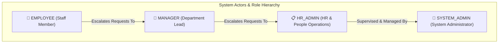
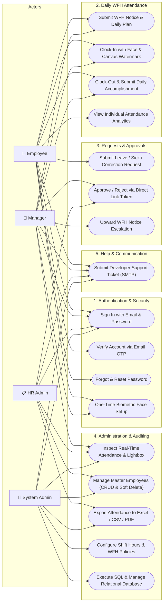

# UML Use Case Diagrams & Actor Interaction Specifications
## WFH Attendance & Employee Monitoring System — Dexa Group Fullstack Technical Assessment
**Author:** Abdurrahman Khairi | **License:** Proprietary — All Rights Reserved ([LICENSE](../../LICENSE))  
**Copyright:** © 2026 Abdurrahman Khairi. Unauthorized commercial use, modification, or distribution is prohibited.

---

## 1. Actor Hierarchy & Role Definitions

The system defines **4 distinct actors** with clear separation of duties and administrative boundaries:

1. **`EMPLOYEE` (Standard Staff):**
   - Workforce self-service user. Enrolls biometric face, submits daily WFH notice, performs live webcam clock-in/out, logs daily accomplishment plans, requests leave or attendance time correction, views personal analytics, and contacts developer support.
2. **`MANAGER` (Department Head):**
   - Head of department responsible for direct reports. Receives automated WFH notices, reviews and approves/rejects team leave and attendance correction requests via direct deep-link tokens, monitors department attendance, and escalates own WFH requests upward to HR Admin.
3. **`HR_ADMIN` (People Operations):**
   - Administrative authority over workforce compliance. Manages master employee directory (CRUD with soft delete), monitors organization-wide attendance audit logs, inspects photo proof and EXIF timestamps via Lightbox, approves company-wide leave requests, and generates payroll-ready Excel/CSV/PDF exports.
4. **`SYSTEM_ADMIN` (Supreme Authority):**
   - Full technical and administrative control. All HR_ADMIN and MANAGER capabilities, plus access to Relational Database Management Studio, company policy & working hour rules configuration, user credentials administration, and developer support ticket resolution.

---

## 2. Comprehensive Use Case Diagram

---

## 3. Detailed Use Case Matrix

| Use Case ID | Feature / Use Case | Primary Actor | Pre-conditions | Post-conditions |
| :--- | :--- | :--- | :--- | :--- |
| **UC-01** | **Sign In & Issue JWT** | All Actors | Active account in `users` table | Receives signed JWT access & refresh token |
| **UC-02** | **Verify Account OTP** | All Actors | Newly created account (`is_verified = false`) | 6-digit OTP verified, account unlocked |
| **UC-03** | **Biometric Face Enrollment** | All Actors | Authenticated, no prior embedding enrolled | 512-D vector saved, full attendance unlocked |
| **UC-04** | **Submit WFH Notice** | Employee / Manager | Biometric enrolled, current day WFH quota valid | Email notice sent to Manager, Clock-In unlocked |
| **UC-05** | **Biometric Verified Clock-In** | Employee / Manager | WFH notice dispatched, camera active | Live frame verified against enrolled template ($\ge 0.55$), record saved with server time |
| **UC-06** | **Clock-Out & Work Summary** | Employee / Manager | Clocked in on current date | Work duration calculated, status auto-tagged (`COMPLETED` / `HALF_DAY`) |
| **UC-07** | **Submit Attendance Request** | Employee | Authenticated employee | Request record created with `PENDING` status, email alert sent to Manager |
| **UC-08** | **Direct Deep-Link Approval** | Manager / HR Admin | Valid cryptographic review token in email | Request status transitioned to `APPROVED`/`REJECTED`, attendance table updated |
| **UC-09** | **Real-Time Attendance Audit** | Manager / HR / Sys Admin | Role is `MANAGER`, `HR_ADMIN`, or `SYSTEM_ADMIN` | View paginated audit logs with search, department filters, and photo Lightbox |
| **UC-10** | **Master Employee CRUD** | HR / Sys Admin | Role is `HR_ADMIN` or `SYSTEM_ADMIN` | Employee profile created, updated, or soft-deleted preserving historical records |
| **UC-11** | **Export Payroll Data** | HR / Sys Admin | Role is `HR_ADMIN` or `SYSTEM_ADMIN` | Formatted `.xlsx`, `.csv`, or printable PDF document generated and downloaded |
| **UC-12** | **Relational Database Studio** | System Admin | Role is strictly `SYSTEM_ADMIN` | Raw SQL query execution and table inspection with security guardrails |
| **UC-13** | **Contact Developer SMTP** | All Actors | Authenticated user | Email dispatched to System Admin with CC to HR Admin and logged-in user |

---

## 4. Role-Based Access Control (RBAC) Permissions Matrix

| System Module / Capability | `EMPLOYEE` | `MANAGER` | `HR_ADMIN` | `SYSTEM_ADMIN` |
| :--- | :---: | :---: | :---: | :---: |
| **Self-Service Clock-In / Clock-Out** | ✅ | ✅ | ❌ | ❌ |
| **Personal Analytics Dashboard** | ✅ | ✅ | ❌ | ❌ |
| **Submit Leave / Time Correction** | ✅ | ✅ | ❌ | ❌ |
| **Direct Deep-Link Request Approval** | ❌ | ✅ (Department) | ✅ (All) | ✅ (All) |
| **Department Attendance Monitoring** | ❌ | ✅ (Department) | ✅ (All) | ✅ (All) |
| **Organization-Wide Audit & Lightbox** | ❌ | ❌ | ✅ | ✅ |
| **Master Employee CRUD & Soft Delete** | ❌ | ❌ | ✅ | ✅ |
| **Payroll Data Export (Excel/CSV/PDF)** | ❌ | ❌ | ✅ | ✅ |
| **Company Working Hours & Policy Config** | ❌ | ❌ | ❌ | ✅ |
| **Relational Database Management Studio**| ❌ | ❌ | ❌ | ✅ |
| **Developer Support Ticket Submission** | ✅ | ✅ | ✅ | ✅ |

---

> **© 2026 Abdurrahman Khairi - Created strictly for Technical Assessment evaluation. Unauthorized commercial use is prohibited**
